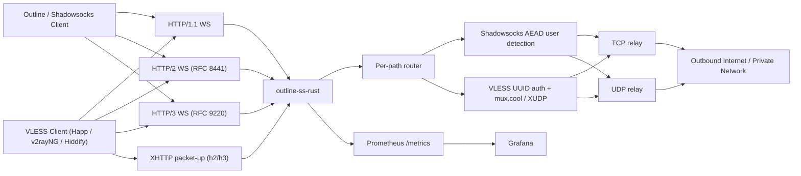

<p align="center">
  <picture>
    <source media="(prefers-color-scheme: dark)" srcset="docs/logo-dark.png">
    
  </picture>
</p>

# outline-ss-rust

`outline-ss-rust` is a Shadowsocks and VLESS relay written in Rust, modelled on `outline-ss-server`. It accepts Shadowsocks AEAD or VLESS traffic carried over WebSocket or XHTTP and relays it to arbitrary TCP and UDP destinations. It has multiple users, per-user cipher and `fwmark`, Prometheus metrics and a runtime user-management API; it does not include the Outline management plane.

Real fleet node names, domains and addresses in this document are replaced with stand-ins: `fleet.example` is the fleet domain. The mapping lives in the local, uncommitted `FLEET.local.md`.

This document describes the server binary: transports, the configuration file, the control API, deployment and metrics. The client is `bins/outline-ws-rust`.

*Русская версия: [README.ru.md](README.ru.md)*

## Protocols and transports

- WebSocket over HTTP/1.1
- WebSocket over HTTP/2 via RFC 8441 Extended CONNECT
- WebSocket over HTTP/3 via RFC 9220 Extended CONNECT
- Shadowsocks AEAD (including SS-2022) over WebSocket, TCP and UDP
- VLESS over WebSocket: TCP, UDP, and mux.cool with XUDP per-packet addressing (accepted by xray, Happ and Hiddify)
- VLESS over XHTTP, both `packet-up` (long-lived GET plus sequenced POSTs) and `stream-one` (one full-duplex POST), selected per session by `?mode=` in the request URL, with `X-Padding` and SSE-style response headers. Use it behind CDNs that block WebSocket upgrades (accepted by xray, sing-box and Hiddify)
- Cross-transport session resumption, including over XHTTP: a parked VLESS upstream re-attaches after an XHTTP reconnect, also when the client switches carrier (h3→h2 fallback)
- Multiple users with independent Shadowsocks passwords and/or VLESS UUIDs
- Per-user cipher selection
- Shared carrier endpoints (`[[endpoint]]`): a user works on every endpoint matching its kind
- Per-user Linux `fwmark` on outbound sockets
- IPv4 and IPv6 listeners and upstream targets
- Prometheus metrics and a Grafana dashboard JSON
- Optional built-in TLS for the HTTP/1.1 and HTTP/2 listener
- Optional built-in QUIC/TLS listener for HTTP/3

## Feature support

| Area | Status | Notes |
| --- | --- | --- |
| Shadowsocks AEAD TCP | Supported | Stream mode over WebSocket binary frames |
| Shadowsocks AEAD UDP | Supported | One UDP packet per WebSocket binary frame |
| Ciphers | Supported | `aes-128-gcm`, `aes-256-gcm`, `chacha20-ietf-poly1305`, `2022-blake3-aes-128-gcm`, `2022-blake3-aes-256-gcm`, `2022-blake3-chacha20-poly1305` |
| Multi-user | Supported | The user is identified by which key decrypts the first chunk |
| Per-user cipher | Supported | A user's `method` overrides `[shadowsocks].method` |
| Carrier endpoints | Supported | Global `[[endpoint]]` list (`path`, `kind`, `padded`); every user works on every endpoint of its kind |
| Per-user `fwmark` | Supported | Linux only, `SO_MARK` needs `CAP_NET_ADMIN` |
| HTTP/1.1 WebSocket | Supported | Plain `ws://` or `wss://` |
| HTTP/2 WebSocket | Supported | RFC 8441 Extended CONNECT |
| HTTP/3 WebSocket | Supported | RFC 9220 Extended CONNECT |
| Built-in TLS for h1/h2 | Supported | Optional, on the main TCP listener |
| Built-in QUIC/TLS for h3 | Supported | Optional, on `[server.h3].listen` (may reuse the `[server].listen` port over UDP); ALPN list is configurable |
| IPv6 | Supported | Listeners and upstream resolution |
| Prometheus metrics | Supported | Separate listener, low-cardinality labels |
| Grafana dashboard | Supported | JSON in [grafana/](grafana) |
| Outline dynamic access keys | External | Client configs are generated by `ops/access-keys`, not by this binary; see [Client config generation](#client-config-generation) |
| VLESS over WebSocket | Supported | TCP, UDP, mux.cool with XUDP per-packet addressing, up to 8 concurrent sub-connections per session; over HTTP/1.1, HTTP/2 and HTTP/3 |
| VLESS over XHTTP packet-up | Supported | Long-lived GET plus sequenced POSTs on one HTTP/2 (or HTTP/3) connection; a reorder buffer accepts out-of-order POSTs; the downlink ring survives a GET dropped mid-flight (CDNs cut long requests at about 100 s); `X-Padding` and SSE-style headers (`text/event-stream`, `Cache-Control: no-store`, `X-Accel-Buffering: no`) |
| VLESS over XHTTP stream-one | Supported | One bidirectional request: request body is the uplink, response body is the downlink. Selected by `?mode=stream-one` on the same base path. Requires h2 or h3 (h1 returns 505); on h3 the bidi stream is split with `RequestStream::split` and each half runs in its own task |
| XHTTP cross-transport session resumption | Supported | The server issues `X-Outline-Session` on first contact, parks the VLESS upstream when the carrier drops and re-attaches it on the next request carrying `X-Outline-Resume`, also across a carrier switch (client failed h3, re-dialled h2 with the same token) |
| HTTP fallback (camouflage) | Supported | Reverse-proxies unmatched HTTP/1.1 and HTTP/2 requests (and HTTP/3 with `apply_to_h3`) to a backend (haproxy, nginx, caddy) instead of returning 404. Optional HAProxy PROXY protocol v1/v2 header passes the client IP to the backend |
| SNI fallback (L4 camouflage) | Supported | Peeks the ClientHello on the TLS listener and splices connections with a foreign SNI (raw TCP, including the captured ClientHello) to a backend that holds its own certificate. nginx-style wildcards in `match_sni`; without PROXY protocol v1/v2 the backend sees `127.0.0.1` as the peer |
| VLESS REALITY / XTLS / Vision | Not supported | Out of scope |
| Outline management API | Not supported | Data plane only |
| SIP003 plugin negotiation | Not supported | Out of scope |

## Architecture

Architecture documentation: [docs/ARCHITECTURE.md](docs/ARCHITECTURE.md).



## Repository layout

- [src/server/](src/server): transport listeners, WebSocket upgrade handling, TCP and UDP relay, control API
- [src/crypto/](src/crypto): Shadowsocks AEAD stream and UDP packet encryption/decryption
- [src/config/](src/config): loading configuration from CLI flags, environment and TOML
- [src/metrics/](src/metrics): Prometheus exporter and metric families
- [src/protocol/](src/protocol): wire-protocol types re-exported from the shared `outline-wire` crate (SOCKS-style target address) and server-only VLESS / VLESS mux entities
- [src/server/nat/](src/server/nat): UDP NAT session table
- [src/fwmark.rs](src/fwmark.rs): Linux `SO_MARK` helpers for outbound sockets
- [config.toml](config.toml): example configuration
- [systemd/outline-ss-rust.service](systemd/outline-ss-rust.service): systemd unit
- [grafana/outline-ss-rust-dashboard.json](grafana/outline-ss-rust-dashboard.json): Grafana dashboard
- [PATCHES.md](PATCHES.md): pointer to the monorepo-wide inventory of patches to vendored crates

## Transport model

### TCP

The TCP endpoint carries a standard Shadowsocks AEAD stream over WebSocket binary frames:

1. The client opens a WebSocket connection on a `ws_ss_tcp` (or combined `ws_ss`) endpoint.
2. The client sends the encrypted Shadowsocks stream in binary frames.
3. The server buffers and decrypts the stream until the target address is complete.
4. The server connects to the target and relays bytes in both directions.

WebSocket frame boundaries are ignored; the encrypted stream may be split across frames at any byte.

### UDP

The UDP endpoint expects exactly one Shadowsocks AEAD UDP packet per WebSocket binary frame:

1. The client opens a WebSocket connection on a `ws_ss_udp` (or combined `ws_ss`) endpoint.
2. Each binary frame contains one encrypted UDP packet.
3. The server decrypts the packet, extracts the target address and forwards the datagram.
4. Each upstream response is returned as its own encrypted WebSocket binary frame.

Each incoming datagram is handled by its own relay task, at most 256 concurrent tasks per WebSocket connection (`UDP_MAX_CONCURRENT_RELAY_TASKS` in `src/server/constants.rs`). A datagram that arrives when the limit is reached is dropped and logged at `warn`.

UDP NAT table: the server keeps one UDP socket per `(user_id, fwmark, target_addr)`, shared by all WebSocket sessions of that user. As a result:

- The upstream source port does not change for the lifetime of the NAT entry, so stateful UDP protocols (QUIC, DTLS, some game and VoIP protocols) keep their association.
- Upstream packets that arrive between client datagrams (server pushes, QUIC stream continuations) are delivered to the currently active WebSocket session.
- After a WebSocket reconnect the existing upstream socket is reused, so the upstream side sees no new association.

An entry is evicted after `tuning.udp_nat_idle_timeout_secs` without outbound traffic (300 s on the default `large` profile). The eviction task runs every 60 s.

## Endpoint model

Every carrier path the server exposes is one entry in a single global list, `[[endpoint]]`, resolved once at startup:

```toml
[[endpoint]]
path = "/tcp"
kind = "ws_ss_tcp"

[[endpoint]]
path = "/pss"
kind = "ws_ss"
padded = true
```

Each entry is `{ path, kind, padded }`:

- `path`: the URL path clients dial. Must be unique across all endpoints, regardless of kind; a duplicate fails startup with `duplicate endpoint path`.
- `kind`: the protocol and carrier shape (`EndpointKind`), one of:

| `kind` | Carrier | What it carries |
| --- | --- | --- |
| `ws_ss` | WebSocket | Combined Shadowsocks: one path, both TCP and UDP legs |
| `ws_ss_tcp` | WebSocket | Split Shadowsocks: TCP leg only |
| `ws_ss_udp` | WebSocket | Split Shadowsocks: UDP leg only |
| `ws_vless` | WebSocket | VLESS: TCP, UDP and mux.cool, multiplexed on one path |
| `xhttp_ss` | XHTTP | Combined Shadowsocks: one base path, both legs |
| `xhttp_ss_tcp` | XHTTP | Split Shadowsocks: TCP leg only |
| `xhttp_ss_udp` | XHTTP | Split Shadowsocks: UDP leg only |
| `xhttp_vless` | XHTTP | VLESS: TCP, UDP and mux.cool, multiplexed on one base path |

  `ws_*` endpoints are served on the main TCP listener (HTTP/1.1, HTTP/2) and, when configured, on HTTP/3 (`[server.h3].listen`). `xhttp_*` endpoints are served over HTTP/1.1, HTTP/2 and HTTP/3. The HTTP version depends on the listener the client dials, not on the endpoint.
- `padded`: optional, default `false` (alias `padding`). Wraps every chunk on this endpoint in a padding frame; see [Carrier padding](#carrier-padding).

Endpoints replace the old per-category fields `ws_path_tcp` / `ws_path_udp` / `ws_path_ss` / `ws_path_vless` / `xhttp_path_*` and the per-user path overrides next to them; see [User model](#user-model) for what a user carries now. The list is read only at startup, like the H3 path registry (see [Control plane](#control-plane)): the control API manages users on configured endpoints but cannot add, remove or repath an endpoint. A new endpoint needs a restart.

## Carrier padding

Optional application-layer padding on the WebSocket and XHTTP carriers against classifiers that correlate TLS record sizes with the proxied payload ("proxy-inside-TLS", TLS-in-TLS). Each Shadowsocks chunk on a padded endpoint is wrapped in a `real_len | pad_len | real | pad` frame before it reaches the outer TLS record layer, so the encrypted record size no longer follows the Shadowsocks payload size. The idea is the same as AnyTLS padding, implemented inside the existing carriers instead of a second proxy protocol.

- Per endpoint. Padding is an attribute of the endpoint (`[[endpoint]] padded = true`). Other endpoints keep the plain Shadowsocks-over-WS / XHTTP wire, so third-party clients (Happ, Outline, xray, sing-box) on unpadded endpoints are not affected.
- Set in config on both ends, not negotiated. There is no capability bit on the wire: the `outline-ws-rust` client must enable `[padding]` too, otherwise its plain frames are fed into the padding decoder and the session fails. Off by default; no padding frames reach the wire until both ends enable it (early-session shaping on h1/h2 does not need padding, see [`docs/PADDING.md`](../../docs/PADDING.md)).
- Cover traffic. With `cover = true` the downlink sends pad-only frames on an idle connection at a random interval between `cover_jitter_min_ms` and `cover_jitter_max_ms` (defaults 250 and 1500 ms), so idle gaps do not reveal timing.

Applies to SS and VLESS over WebSocket (h1/h2/h3) and over XHTTP. UDP is padded per datagram on every WS carrier, for SS-UDP (split: set `padded = true` on its endpoint; combined: on the shared endpoint) and VLESS-UDP. Full reference: [`docs/PADDING.md`](../../docs/PADDING.md); the `[padding]` block in [config.toml](config.toml) lists the parameters.

## User model

`[[users]]` entries are credentials only; a user has no path of its own. A user entry has:

- `id`
- `password` (Shadowsocks) and/or `vless_id` (VLESS), at least one of the two
- `method`
- `fwmark`
- `enabled`
- `aliases` (source IP → accounting alias map)

A user with `password` works on every `ws_ss` / `ws_ss_tcp` / `ws_ss_udp` / `xhttp_ss` / `xhttp_ss_tcp` / `xhttp_ss_udp` endpoint on the server; a user with `vless_id` works on every `ws_vless` / `xhttp_vless` endpoint. One user may hold both fields and use both protocol families. A user without `method` uses `[shadowsocks].method`.

Possible setups:

- one shared set of endpoints for all users, distinguished only by Shadowsocks key or VLESS UUID
- different users on different ciphers
- different users with different Linux routing policy via `fwmark`
- one credential split into several accounting identities by source IP via `aliases` (see [Per-source-IP aliases](#per-source-ip-aliases))

Which paths exist and which protocol and carrier each one serves is decided once, server-wide, in [`[[endpoint]]`](#endpoint-model).

## Configuration

The server reads `config.toml` from the current directory by default. Override the path with `--config` (or `OUTLINE_SS_CONFIG`):

```bash
cargo run -- --config ./config.toml
```

Example configuration: [config.toml](config.toml). Every table is parsed with `deny_unknown_fields`: an unknown or misspelled key, or a removed section such as `[dashboard]`, stops the server at startup with a parse error.

At least one data-plane listener must be configured, `[server].listen` or `[server.h3].listen`; otherwise the server exits with `configure at least one data-plane listener: listen or h3_listen`. Only the configured listeners are started.

## Build shortcuts

Cross-builds for musl use `cargo-zigbuild` through aliases in the root `.cargo/config.toml`. Run them from the repository root:

```bash
cargo ss-build-musl-x86_64
cargo ss-release-musl-x86_64
cargo ss-build-musl-aarch64
cargo ss-release-musl-aarch64
cargo ss-build-musl-arm
cargo ss-release-musl-arm
cargo ss-build-musl-armv7
cargo ss-release-musl-armv7
```

They expand to `cargo zigbuild [--release] -p outline-ss-rust --target <triple>` for `x86_64-unknown-linux-musl`, `aarch64-unknown-linux-musl`, `arm-unknown-linux-musleabi` and `armv7-unknown-linux-musleabihf`. Requires `cargo-zigbuild` and `zig`.

`mips` and `mipsel` are not in the current stable Rustup target set. To build for them, use a pinned older toolchain or a `build-std` flow; the aliases and release workflows do not cover them.

### Configuration keys

Keys are given as `[table].key`. CLI flags and environment variables for the keys that have them are listed in [Environment variables and CLI flags](#environment-variables-and-cli-flags); a CLI flag or variable overrides the TOML value. For `tuning.*` the default is given per profile as `small` / `medium` / `large`.

| Key | Default | Purpose |
| --- | --- | --- |
| `[server].listen` | none | Main TCP listener for HTTP/1.1 and HTTP/2 |
| `[server].cert_path` / `[server].key_path` | none | Built-in TLS for the main listener; this pair is the default certificate when no SNI matches. Legacy names `tls_cert_path` / `tls_key_path` are accepted as aliases |
| `[[server.certs]]` | none | Additional cert/key pairs selected by SNI on the main listener. Each entry: `cert_path`, `key_path`, optional `sni = [...]`. Without `sni`, names come from the certificate's SAN (Subject CN only if there is no DNS SAN). Wildcard SAN entries are skipped because the resolver matches SNI exactly; list each hostname explicitly |
| `[server.h3].listen` | none | QUIC listener address for HTTP/3. HTTP/3 is off unless this is set |
| `[server.h3].cert_path` / `[server.h3].key_path` | inherited from `[server]` | Default certificate for the QUIC listener |
| `[[server.h3.certs]]` | inherited from `[[server.certs]]` | SNI-selected certificates for the QUIC listener, same shape as `[[server.certs]]`. An explicit empty `certs = []` disables inheritance |
| `[server.h3].alpn` | `["h3"]` | ALPN protocols advertised on the QUIC endpoint. Only `"h3"` (HTTP/3 and WebSocket over HTTP/3) is supported; an empty list is rejected |
| `[server.h3].initial_mtu` | unset (start at 1400) | Largest QUIC datagram the server starts with, as a UDP payload size (path MTU minus 28 for IPv4, 48 for IPv6). Range 1200–1452. Set it only on a host whose path is below 1500: unset, the server starts at 1400, the kernel rejects each datagram with `EMSGSIZE`, and quinn falls back to the 1200-byte QUIC minimum instead of the largest size that fits, losing about 12% of every packet plus retries on each handshake. A pinned host does not probe above the pinned value |
| `[server.h3].mtu_first_probe` | unset | First path MTU discovery probe, as a UDP payload size (1200–1452). Set it when the clients' paths are known to carry that size: discovery confirms it with one probe instead of the 1426 → 1439 → 1445 → 1452 ladder. A path that does not carry it costs one rejected size before the regular search, so do not set 1452 where clients sit behind a narrower tunnel (for example 1448). A confirmed first probe caps every connection at that value, so do not set it below the real path MTU either: 1448 on a 1452 path caps all connections at 1448. Without a pinned `initial_mtu` the start is 1400, so values of 1400 or less have no effect. Ignored when `initial_mtu` is set |
| `[server.h3].udp_datagrams` | `true` | Agree to UDP over HTTP/3 datagrams (RFC 9297) on `ws_h3` / `xhttp_h3`. The client offers them with the request header `x-outline-udp-datagram: 1`; the server echoes it only when this is on and the connection has a datagram size. `false` keeps UDP on the stream. Read at startup; a change needs a restart. See [UDP over HTTP/3 datagrams](#udp-over-http3-datagrams) |
| `[metrics].listen` | none | Prometheus listener. No metrics listener without it |
| `[metrics].path` | `/metrics` | Prometheus endpoint path |
| `[outbound].prefer_ipv4` | `false` | Prefer IPv4 for upstream DNS resolution and connects. Set when the host's IPv6 path is broken |
| `[outbound].ipv6_prefix` | none | IPv6 CIDR (for example `2001:db8:dead::/64`). Each upstream IPv6 TCP connect and UDP NAT socket binds to a random address from this prefix instead of the kernel-chosen source. Typical setup: `ip -6 addr add 2001:db8:dead::1/64 dev eth0` so the /64 is on-link; `IPV6_FREEBIND` (set automatically on Linux) then lets `bind()` use any address in the prefix. If FREEBIND is unavailable, add an AnyIP route: `ip -6 route add local 2001:db8:dead::/64 dev lo`. IPv4 upstreams are not affected. See [`docs/OUTBOUND-IPV6.md`](../../docs/OUTBOUND-IPV6.md) |
| `[outbound].ipv6_interface` | none | Alternative to `ipv6_prefix` for DHCPv6 / SLAAC hosts where the prefix is not known in advance. Names an interface (for example `eth0`); the pool is the set of global-unicast IPv6 addresses currently assigned to it (`getifaddrs(3)`), and each outbound socket binds to one at random. Only addresses configured on the host are used, so return traffic works under plain SLAAC without AnyIP routes or NDP proxying. With kernel privacy extensions (`sysctl -w net.ipv6.conf.<iface>.use_tempaddr=2`) each new temporary address enters the pool on the next refresh, giving per-connection source rotation. Only `2000::/3` addresses are used; loopback, link-local, ULA (`fc00::/7`), multicast, IPv4-mapped, discard (`100::/64`) and other non-global ranges are filtered out. If the pool is empty at bind time, the socket binds to the wildcard address and a `DEBUG` line is logged. Linux and macOS only. Mutually exclusive with `ipv6_prefix` and `ipv6_prefix_interface` |
| `[outbound].ipv6_prefix_interface` | none | Takes the current global /64 of the named interface as the random source prefix: addresses are generated across the whole prefix, and the prefix is re-derived on each refresh, so it follows a provider prefix that changes on reconnect. Requires the whole prefix routed back to the host (NDP proxy, `ndppd`). Mutually exclusive with `ipv6_prefix` and `ipv6_interface` |
| `[outbound].ipv6_refresh_secs` | `30` | Interval between re-reads of the interface addresses for `ipv6_interface` / `ipv6_prefix_interface` |
| `[outbound].ipv6_sticky` | `true` | With source rotation on, pin one source address per upstream destination IP for `ipv6_sticky_ttl_secs` instead of drawing a new one per connect. Cloudflare binds the `cf_clearance` cookie to the client source IP, so with a new source on every request an origin such as `claude.ai` shows the "Verifying you are human" challenge every time. Rotation still happens between destinations and after the TTL. The pin cache has an LRU cap and per-entry TTL; the startup reachability probe still tests random sources. No effect without a prefix or interface. `false` restores a random source per connect |
| `[outbound].ipv6_sticky_ttl_secs` | `1800` | TTL of a sticky source pin. Set it above the origin's challenge-clearance lifetime (about 30 min for Cloudflare) |
| `tuning_profile` | `large` | Resource-limit preset: `small` / `medium` / `large`. Sets H2/H3 flow-control windows, stream limits, session and NAT timeouts, and the global UDP / XHTTP task and session caps |
| `[tuning]` | profile values | Per-key overrides on top of the profile; keys below |
| `tuning.client_active_ttl_secs` | `180` / `300` / `300` | TTL used to compute `client_active` / `client_up`. Must be > 0 |
| `tuning.udp_nat_idle_timeout_secs` | `120` / `240` / `300` | How long a UDP NAT entry lives after the last outbound datagram. Must be > 0 |
| `tuning.udp_nat_max_entries` | `4096` / `16384` / `65536` | Process-wide cap on live UDP NAT entries (one per `(user, fwmark, target)`). Each entry holds an upstream socket and a reader task until idle eviction, so the cap bounds the descriptors and tasks an authenticated client can create by sending to many destinations. At the cap, datagrams to new targets are dropped and counted in `outline_ss_udp_nat_capacity_dropped_total`; live entries are not evicted by this path. `0` disables the cap |
| `tuning.udp_nat_max_entries_per_user` | `1024` / `2048` / `4096` | Per-user cap on live UDP NAT entries, on top of `udp_nat_max_entries`. Without it one user sending to many destinations can fill the whole table and block other users from opening new targets until idle eviction. A user at its cap has datagrams to new targets dropped (also counted in `outline_ss_udp_nat_capacity_dropped_total`); its live entries keep working, and a slot frees when one of them is evicted. `0` disables the cap |
| `tuning.udp_max_concurrent_relay_tasks` | `1024` / `2048` / `4096` | Process-wide cap on in-flight UDP relay tasks across all WebSocket sessions. `0` disables the cap |
| `tuning.udp_replay_max_sessions` | `16384` / `65536` / `262144` | Caps each of the two anti-replay maps separately: SS-2022 session windows and legacy request salts. At the cap a new `client_session_id` (SS-2022) or salt (legacy) is dropped, which bounds memory against a client that rotates them. `0` disables both caps and the legacy salt filter |
| `tuning.udp_replay_max_sessions_per_user` | `4096` / `8192` / `16384` | Per-user cap on replay-store entries (SS-2022 windows and legacy salts combined), on top of `udp_replay_max_sessions`. Without it one user sending unique session ids or salts can fill the global cap, after which other users' new sessions are dropped. With it, a user at its cap drops only its own new sessions (counted with `reason="max_sessions_per_user"` in `outline_ss_udp_replay_store_full_dropped_total`). An SS-2022 client uses one or a few `client_session_id`s; legacy UDP creates a new salt per datagram, so raise or disable (`0`) the cap on high-throughput legacy deployments |
| `tuning.tcp_handshake_replay_max_salts` | `16384` / `65536` / `262144` | Recently seen Shadowsocks TCP handshake salts kept for anti-replay. A captured handshake re-sent verbatim derives the same session key and decrypts again, so the salt is remembered and a repeat is rejected. Entries expire after `udp_nat_idle_timeout_secs`. At the cap a new salt is not recorded and the handshake is allowed (fail-open), counted in `outline_ss_tcp_handshake_replay_store_full_total`. `0` disables the filter |
| `tuning.xhttp_max_sessions` | `16384` / `65536` / `262144` | Process-wide cap on live XHTTP sessions. A session is created by the first request with a new well-formed session id, before Shadowsocks/VLESS authentication inside the relay, so the cap bounds what a peer that knows a base path can allocate by sending unique ids. At the cap a request that would create a new session gets HTTP 503 (`outline_ss_xhttp_sessions_rejected_total{reason="max_sessions"}`); requests for a live id are always served. `0` disables the cap |
| `tuning.xhttp_max_sessions_per_ip` | `0` (off) on every profile | Per-source-IP cap on live XHTTP sessions, on top of `xhttp_max_sessions`. At the cap a request that would create a new session gets HTTP 503 (`reason="max_sessions_per_ip"`); a live id is still served. The key is the transport peer address, which behind a CDN or reverse proxy is the edge IP shared by all its clients: keep it `0` behind a CDN and set it only where clients connect directly |
| `tuning.xhttp_max_concurrent_relay_tasks` | `1024` / `2048` / `4096` | Process-wide cap on in-flight XHTTP relay tasks. At the cap the session-creating request gets HTTP 503 and no task is spawned (`reason="max_relay_tasks"`). `0` disables the cap |
| `tuning.dns_cache_max_entries` | `16384` / `65536` / `262144` | Cap on upstream DNS cache entries; at `262144` the worst case is about 30–40 MiB (about 120 bytes plus the resolved addresses per entry). The key is `(port, prefer_ipv4_upstream, host)` with the host taken from the client, so without a cap a client resolving unique names grows the cache for TTL plus the one-hour stale-fallback window, reclaimed only by the 5-minute sweep. At the cap, inserts evict by approximate LRU, expired entries first. `0` disables the cap |
| `tuning.ws_data_channel_capacity` | `16` / `64` / `128` | Per-session channel capacity, in chunks, between the upstream reader and the WebSocket writer (TCP relay) or the NAT reader and the WebSocket writer (UDP relay). Too low: a short writer stall back-pressures the upstream read, visible as video buffer underruns. Too high: worst-case per-session memory grows (`capacity × 16 KiB` for TCP). Must be > 0 |
| `tuning.h2_*` / `tuning.h3_*` | per profile | H2/H3 flow-control windows, stream limits, H3 write buffer and backpressure limit, H3 UDP socket buffers; see `TuningProfile` in [src/config/tuning.rs](src/config/tuning.rs) and [QUIC limits](#quic-limits) |
| `[[endpoint]]` | none | Carrier endpoints: `path` (unique across all endpoints), `kind` (see [Endpoint model](#endpoint-model)), `padded` (bool, default `false`, alias `padding`; see [Carrier padding](#carrier-padding)). `padded` can be changed through `PATCH /control/config` and takes effect after a restart; paths are read only at startup, see [Control plane](#control-plane) |
| `[http_root].auth` | `false` | HTTP Basic auth on `/` (OpenConnect-style); after 3 failed passwords the server returns `403`. Other unmatched paths still return `404` |
| `[http_root].realm` | `Authorization required` | Text shown in the password prompt for `/` |
| `[access_keys]` | ignored | Read by the external `ops/access-keys` generator, not by this binary. The section is parsed so that existing configs still load under `deny_unknown_fields`, then ignored. Fields: `public_host`, `public_scheme`, `url_base`, `file_extension`, `print`, `write_dir`. See [Client config generation](#client-config-generation) |
| `[shadowsocks].method` | `chacha20-ietf-poly1305` | Default Shadowsocks cipher |
| `[[users]]` `password` | none | Shadowsocks password |
| `[[users]]` `vless_id` | none | VLESS UUID; must be unique across users |
| `[[users]]` `aliases` | none | Source IP → alias map for accounting (metrics, NAT key, logs): `{ alias = "cidr-or-ip" \| ["cidr", ...] }`. Longest-prefix match, IPv4 and IPv6. Alias names must not collide with user ids or other aliases. Direct connections only. See [Per-source-IP aliases](#per-source-ip-aliases) |
| `[[users]]` `enabled` | `true` | `false` blocks the user (no routes, no auth) without deleting the entry |
| `[control]` | none | Runtime user-management HTTP API (cargo feature `control`, on by default). See [Control plane](#control-plane) |
| `[control].listen` | none | Socket address of the control listener, for example `127.0.0.1:7001`. It is a separate socket; do not expose it to the internet |
| `[control].token` | none | Bearer token required on every request. Prefer `token_file` |
| `[control].token_file` | none | File with the bearer token; mutually exclusive with `token` |
| `[cluster]` | disabled | Mesh cluster membership (relay between nodes by shard). Fields: `enabled`, `shard_id` (`0..16`, unique in the cluster, required when enabled), `cluster_psk` (base64 shared secret), `mesh_listen` (`host:port` of the mesh QUIC listener), `mesh_relay_budget_ms` (default `4000`) and `[[cluster.peers]]` entries (`shard`, `addr`). See [`docs/CLUSTER.md`](../../docs/CLUSTER.md) and [`docs/CLUSTER-DEPLOY.md`](../../docs/CLUSTER-DEPLOY.md) |
| `[session_resumption]` | disabled | Cross-transport session resumption: `enabled`, `orphan_ttl_tcp_secs`, `orphan_ttl_udp_secs`, `orphan_per_user_cap`, `orphan_global_cap`, `downlink_buffer_bytes` (default `0`, disables v2 downlink replay). See [`docs/SESSION-RESUMPTION.md`](docs/SESSION-RESUMPTION.md) |
| `[padding]` | off | Padding frame and cover traffic parameters; which endpoints pad is set by `[[endpoint]] padded`. See [Carrier padding](#carrier-padding) |
| `[http_fallback]` | off | See [HTTP fallback](#4-http-fallback-to-an-external-web-server-camouflage) |
| `[sni_fallback]` | off | See [SNI routing](#5-sni-routing-for-foreign-tls-domains-l4-camouflage) |

### Per-user settings

```toml
[[users]]
id = "alice"
password = "change-me"
fwmark = 1001
method = "aes-256-gcm"
vless_id = "550e8400-e29b-41d4-a716-446655440000"

[users.aliases]
alice-mobile = ["10.0.0.0/8", "203.0.113.5"]
alice-office = "192.0.2.0/24"
```

For `2022-blake3-aes-128-gcm`, `2022-blake3-aes-256-gcm` and `2022-blake3-chacha20-poly1305`, `password` must be a base64-encoded raw PSK of exactly 16, 32 and 32 bytes respectively, for example `openssl rand -base64 32`.

### Per-source-IP aliases

`[users.aliases]` splits one credential into several accounting identities by
client source IP. After normal authentication (by Shadowsocks key or VLESS UUID)
the server picks a label: the matching alias when the source IP falls into one
of its subnets, otherwise the base `id`. The label is used for per-user metrics,
the UDP NAT key and logs. Authentication, the key and access control do not
change.

```toml
[[users]]
id = "team"
password = "shared-secret"

[users.aliases]
home   = "203.0.113.0/24"
mobile = ["10.0.0.0/8", "2001:db8::/48"]
```

- Value: one CIDR/IP string or a list. A bare address is a host route (`/32` or `/128`). Overlapping subnets are allowed; the longest prefix wins.
- Uniqueness: alias names must not collide with any user `id` or another alias. Each becomes a separate `user="…"` time series, and a collision would merge accounting. Such a config is rejected at startup and by the control API.
- Cardinality: each alias adds one label value to the per-user metric families.
- Coverage: applied where the server sees the client IP: SS over WS/XHTTP TCP and all VLESS carriers (WS/XHTTP/H3). SS-UDP over WebSocket uses the base `id` because the relay layer does not carry the peer address.
- CDN: the source IP is the directly connected peer. Behind a CDN or L4 proxy that is the proxy's IP, so aliases only work on direct connections. The server does not read inbound PROXY protocol or `X-Forwarded-For`.

### VLESS over XHTTP

Behind a CDN that blocks WebSocket upgrades, add an `xhttp_vless` endpoint next to (or instead of) a `ws_vless` one. The server registers `<path>/{id}` for every `xhttp_vless` endpoint; `{id}` is an opaque per-session token chosen by the client. Any user with a `vless_id` works on both carriers.

```toml
[server]
listen = "0.0.0.0:443"
cert_path = "/etc/letsencrypt/live/example/fullchain.pem"
key_path  = "/etc/letsencrypt/live/example/privkey.pem"

# Optional: keep the WS endpoint for clients on direct connections.
[[endpoint]]
path = "/vless"
kind = "ws_vless"

# Required for XHTTP.
[[endpoint]]
path = "/xh"
kind = "xhttp_vless"

[[users]]
id = "alice"
vless_id = "550e8400-e29b-41d4-a716-446655440000"
```

One `xhttp_vless` endpoint serves both XHTTP modes; the client picks the mode per session in the URL query:

| Mode | URL the client dials | What goes where |
| --- | --- | --- |
| `packet-up` (default) | `https://example.com/xh/<id>` | `GET <id>` is the long-lived downlink; short `POST <id>` requests with `X-Xhttp-Seq: N` carry the uplink. A reorder buffer accepts out-of-order POSTs. The downlink ring survives a GET dropped mid-flight (CDN cut-off at about 100 s): the next GET on the same `<id>` resumes from the unread position. |
| `stream-one` | `https://example.com/xh/<id>?mode=stream-one` | One bidirectional `POST <id>?mode=stream-one`: request body is the uplink, response body is the downlink. Requires h2 or h3 (h1 returns 505). On h3 the bidi QUIC stream is split into send and receive halves, each in its own task. |

Cross-transport session resumption is off by default; enable it with `[session_resumption].enabled = true`. It works across an XHTTP reconnect, including a carrier switch: a client whose h3 dial failed can fall back to h2 with the same `X-Outline-Resume` token, and the server re-attaches the parked VLESS upstream instead of opening a new connection to the target. The `X-Outline-Session` token issued on first contact is returned on every later GET/POST/stream-one response of that session, so the client needs no state beyond the token.

A byte-stream session also resumes across proxy protocols: a session parked over Shadowsocks re-attaches to a VLESS carrier of the same `[[users]]` entry, and the reverse. That entry holds both `password` and `vless_id`, and both legs park under its `id`. This keeps sessions alive on a client whose uplink rotates its active wire across a mixed SS/VLESS set. The framing the resuming stream sends to its client is built from that stream's own authenticated user, so nothing of the parked protocol carries over; crossings are counted in `outline_ss_orphan_resume_cross_protocol_total{parked,resumed}`. Datagram and mux parks stay within their protocol because they hold framing state the other protocol cannot express. Full rules, and what the owner check guarantees when it is the only identity signal on that path: [`docs/SESSION-RESUMPTION.md`](docs/SESSION-RESUMPTION.md).

Once an `xhttp_vless` endpoint is configured, the external `ops/access-keys` generator writes two `vless://...?type=xhttp&path=...` URIs for every VLESS user, one with `mode=packet-up` and one with `mode=stream-one`, into that user's `<user>.json` subscription and `<user>.txt`. xray, sing-box, Hiddify, v2rayNG and Shadowrocket accept both URIs, so the user can pick the mode that passes on their network. See [Client config generation](#client-config-generation).

### VLESS over WebSocket/TLS

The VLESS inbound accepts VLESS over WebSocket on the main HTTP/1.1 or HTTP/2 listener and, when configured, on the HTTP/3 listener (`[server.h3].listen`). Use TLS (`[server].cert_path` / `[server].key_path`) on public deployments: VLESS only authenticates the UUID and does not encrypt. Supported commands: TCP CONNECT, UDP (length-prefixed datagrams), and mux.cool with XUDP per-packet addressing (xray-style multiplexing, up to 8 concurrent sub-connections per session; the XUDP `GlobalID` is parsed but not reused across reconnects). REALITY, XTLS, Vision, flow, fallback and sniffing are not implemented.

```toml
[server]
listen = "0.0.0.0:443"
cert_path = "/etc/letsencrypt/live/example/fullchain.pem"
key_path  = "/etc/letsencrypt/live/example/privkey.pem"

[[endpoint]]
path = "/tcp"
kind = "ws_ss_tcp"

[[endpoint]]
path = "/udp"
kind = "ws_ss_udp"

[[endpoint]]
path = "/vless"
kind = "ws_vless"

[[users]]
id = "alice"
vless_id = "550e8400-e29b-41d4-a716-446655440000"
```

Example client URI for Happ, v2rayNG or Hiddify:

```text
vless://550e8400-e29b-41d4-a716-446655440000@example.com:443?type=ws&security=tls&path=%2Fvless&encryption=none#example:alice
```

Put VLESS and Shadowsocks on separate `[[endpoint]]` entries, one per kind. A `[[users]]` entry may combine `password` (Shadowsocks) and `vless_id` (VLESS), or carry only `vless_id`; either way it works on every endpoint of its kind(s).

### Control plane

The `control` cargo feature (on by default) adds an HTTP API for managing `[[users]]` at runtime. User changes are applied to the running data plane through `ArcSwap` and written back to the config file the server was started with.

```toml
[control]
listen = "127.0.0.1:7001"
token_file = "/etc/outline-ss-rust/control.token"
```

Every request must carry `Authorization: Bearer <token>`. Bind the listener to loopback or a management network. CLI equivalents: `--control-listen`, `--control-token`, `--control-token-file` (and `OUTLINE_SS_CONTROL_*` variables). Build with `--no-default-features` to leave the control module out; note that this also drops the default `jemalloc` feature, so add `--features jemalloc` to keep the allocator.

The browser dashboard that used to run on a separate listener of this binary is now the `outline-ui` service in k3s (`https://ui.k3s.fleet.example/ss`), which aggregates the `/control` API of every server; see [`bins/outline-ui/README.md`](../outline-ui/README.md). This binary serves only the API below.

| Method | Path | Purpose |
| --- | --- | --- |
| `GET` | `/control/users` | List users (metadata only, no secrets) |
| `POST` | `/control/users` | Create a user. Body: `{ "id": "...", "password": "...", "vless_id": "...", "method": "...", "fwmark": 0, "enabled": true, "aliases": {...} }`; at least one of `password` / `vless_id` is required |
| `GET` | `/control/users/{id}` | Get one user's metadata |
| `PATCH` | `/control/users/{id}` | Change `password`, `vless_id`, `method`, `fwmark`, `enabled`, `aliases`; a field set to `null` is cleared, an absent field is left as is |
| `DELETE` | `/control/users/{id}` | Remove the user |
| `POST` | `/control/users/{id}/block` | Disable the user (`enabled = false`) without deleting |
| `POST` | `/control/users/{id}/unblock` | Re-enable a blocked user |
| `GET` | `/control/defaults` | Server-wide default cipher (`[shadowsocks].method`) |
| `GET` | `/control/config` | Server configuration: mesh cluster, listeners/TLS, session resumption, outbound, padding, HTTP/SNI fallback, tuning profile, endpoints |
| `PATCH` | `/control/config` | Write changes to those sections into the config file. Not applied to the running process: the response carries `"requires_restart": true`. Returns `400` when the server runs without a config file |

```bash
curl -H "Authorization: Bearer $TOKEN" http://127.0.0.1:7001/control/users
curl -XPOST -H "Authorization: Bearer $TOKEN" -H 'Content-Type: application/json' \
  -d '{"id":"carol","password":"s3cret"}' http://127.0.0.1:7001/control/users
curl -XPOST -H "Authorization: Bearer $TOKEN" http://127.0.0.1:7001/control/users/carol/block
```

Each user change is written to the config file (`--config` / `OUTLINE_SS_CONFIG`) before it reaches the data plane, so a `201`/`200` response means the change survives a restart. The file is patched, not regenerated: only the `[[users]]` entry named in the request changes; other users, sections, key order and comments stay byte-for-byte the same. The write goes through a temporary file and `rename`, keeping the target's mode and owner, so a crash during the write leaves the previous config intact. If the write fails, the request fails and nothing changes in the running process.

When the server was started without a config file (users from `--user` / `OUTLINE_SS_USERS`), user changes apply to the running process only and are lost on restart; a warning is logged at startup.

Endpoints (`[[endpoint]]`) are resolved once at startup: the Axum and H3 routers register only the paths known at boot. The control API can create, block and delete users on those endpoints but cannot add, remove or repath an endpoint; a new endpoint needs a restart.

### HTTP Basic auth on `/`

With `[http_root].auth = true`, a `GET /` gets an HTTP Basic auth challenge. The username is ignored; the password is compared, in constant time, with the configured Shadowsocks user passwords. `[http_root].realm` sets the prompt text. After three failed attempts in one browser session the server returns `403 Forbidden`. Requests to other unmatched paths return `404 Not Found`.

### Environment variables and CLI flags

Each variable has a CLI flag of the same name (`OUTLINE_SS_LISTEN` → `--listen`). A flag or variable overrides the TOML key.

| Variable | CLI flag | TOML key |
| --- | --- | --- |
| `OUTLINE_SS_CONFIG` | `--config` | (path to the config file) |
| `OUTLINE_SS_LISTEN` | `--listen` | `[server].listen` |
| `OUTLINE_SS_TLS_CERT_PATH` | `--tls-cert-path` | `[server].cert_path` |
| `OUTLINE_SS_TLS_KEY_PATH` | `--tls-key-path` | `[server].key_path` |
| `OUTLINE_SS_H3_LISTEN` | `--h3-listen` | `[server.h3].listen` |
| `OUTLINE_SS_H3_CERT_PATH` | `--h3-cert-path` | `[server.h3].cert_path` |
| `OUTLINE_SS_H3_KEY_PATH` | `--h3-key-path` | `[server.h3].key_path` |
| `OUTLINE_SS_METRICS_LISTEN` | `--metrics-listen` | `[metrics].listen` |
| `OUTLINE_SS_METRICS_PATH` | `--metrics-path` | `[metrics].path` |
| `OUTLINE_SS_PREFER_IPV4_UPSTREAM` | `--prefer-ipv4-upstream[=true\|false]` | `[outbound].prefer_ipv4` |
| `OUTLINE_SS_OUTBOUND_IPV6_PREFIX` | `--outbound-ipv6-prefix` | `[outbound].ipv6_prefix` |
| `OUTLINE_SS_OUTBOUND_IPV6_INTERFACE` | `--outbound-ipv6-interface` | `[outbound].ipv6_interface` |
| `OUTLINE_SS_OUTBOUND_IPV6_PREFIX_INTERFACE` | `--outbound-ipv6-prefix-interface` | `[outbound].ipv6_prefix_interface` |
| `OUTLINE_SS_OUTBOUND_IPV6_REFRESH_SECS` | `--outbound-ipv6-refresh-secs` | `[outbound].ipv6_refresh_secs` |
| `OUTLINE_SS_OUTBOUND_IPV6_STICKY` | `--outbound-ipv6-sticky` | `[outbound].ipv6_sticky` |
| `OUTLINE_SS_OUTBOUND_IPV6_STICKY_TTL_SECS` | `--outbound-ipv6-sticky-ttl-secs` | `[outbound].ipv6_sticky_ttl_secs` |
| `OUTLINE_SS_HTTP_ROOT_AUTH` | `--http-root-auth[=true\|false]` | `[http_root].auth` |
| `OUTLINE_SS_HTTP_ROOT_REALM` | `--http-root-realm` | `[http_root].realm` |
| `OUTLINE_SS_METHOD` | `--method` | `[shadowsocks].method` |
| `OUTLINE_SS_TUNING_PROFILE` | `--tuning-profile` | `tuning_profile` |
| `OUTLINE_SS_USERS` | `--user` | `[[users]]` |
| `OUTLINE_SS_CONTROL_LISTEN` | `--control-listen` | `[control].listen` |
| `OUTLINE_SS_CONTROL_TOKEN` | `--control-token` | `[control].token` |
| `OUTLINE_SS_CONTROL_TOKEN_FILE` | `--control-token-file` | `[control].token_file` |

`OUTLINE_SS_USERS` takes comma-separated `id=password` entries:

```bash
OUTLINE_SS_USERS=alice=secret1,bob=secret2
```

Users given this way replace the `[[users]]` list from the file. Per-user `method`, `fwmark`, `vless_id` and `aliases` exist only in TOML. Endpoints are TOML-only as well; `[[endpoint]]` has no flag or variable.

## Deployment modes

### 1. Plain WebSocket

For testing or trusted private networks:

```toml
[server]
listen = "0.0.0.0:3000"

[[endpoint]]
path = "/tcp"
kind = "ws_ss_tcp"

[[endpoint]]
path = "/udp"
kind = "ws_ss_udp"

[shadowsocks]
method = "chacha20-ietf-poly1305"
```

### 2. Built-in TLS for HTTP/1.1 and HTTP/2

```toml
[server]
listen = "0.0.0.0:5443"
cert_path = "/etc/outline-ss-rust/tls/fullchain.pem"
key_path  = "/etc/outline-ss-rust/tls/privkey.pem"

[[endpoint]]
path = "/tcp"
kind = "ws_ss_tcp"

[[endpoint]]
path = "/udp"
kind = "ws_ss_udp"
```

This serves `wss://` on the main TCP listener, with RFC 8441 on the same socket.

To serve several domains on one listener, add cert/key pairs in `[[server.certs]]`. The `cert_path` / `key_path` pair above is returned when the SNI matches no array entry or the client sent no SNI:

```toml
[server]
listen = "0.0.0.0:5443"
cert_path = "/etc/letsencrypt/live/default.example.com/fullchain.pem"
key_path  = "/etc/letsencrypt/live/default.example.com/privkey.pem"

[[server.certs]]
cert_path = "/etc/letsencrypt/live/api.example.com/fullchain.pem"
key_path  = "/etc/letsencrypt/live/api.example.com/privkey.pem"
sni = ["api.example.com", "api2.example.com"]   # explicit list

[[server.certs]]
cert_path = "/etc/letsencrypt/live/shop.example.com/fullchain.pem"
key_path  = "/etc/letsencrypt/live/shop.example.com/privkey.pem"
# `sni` omitted — names are derived from the cert's SAN (and Subject CN
# as a last-resort fallback). Wildcard SAN entries are skipped.
```

The QUIC listener takes the same shape in `[[server.h3.certs]]`. When `[server.h3]` sets neither `cert_path` / `key_path` nor `certs`, the QUIC listener inherits the TCP listener's certificate configuration.

Certificate reload. Every configured cert/key file (the default pair and each `[[server.certs]]` / `[[server.h3.certs]]` entry) is polled every 5 minutes (`CERT_RELOAD_POLL_INTERVAL_SECS`) and reloaded when its contents change, without a restart or signal. New connections get the new certificate after the next poll; established connections keep the one they negotiated. Polling, instead of an inotify/kqueue watch, also catches the atomic rename or symlink swap that ACME clients (certbot, lego, acme.sh, Caddy) do on renewal. If a reload fails, for example a certificate was replaced before its key, the previous certificate keeps serving, the error is logged, and the next poll tries again.

### 3. Built-in HTTP/3

```toml
[server]
listen = "0.0.0.0:5443"
cert_path = "/etc/outline-ss-rust/tls/fullchain.pem"
key_path  = "/etc/outline-ss-rust/tls/privkey.pem"

[server.h3]
listen = "0.0.0.0:5443"
# `cert_path` / `key_path` (and any `[[server.h3.certs]]` array) are
# inherited from `[server]` when omitted, so a typical deployment
# only configures the cert once.
```

HTTP/3 always uses TLS and needs the UDP port reachable from clients.

### 4. HTTP fallback to an external web server (camouflage)

Without a fallback, the server answers `404 Not Found` to every request that does not hit a WebSocket / XHTTP / metrics path, which lets a probe tell the listener from an ordinary web server. With `[http_fallback]`, such requests are reverse-proxied to a backend (haproxy, nginx, caddy), so `curl https://your-host/` or a TLS scanner sees whatever the backend serves.

```toml
[http_fallback]
backend = "http://127.0.0.1:8080"   # only http:// in MVP
# request_timeout_secs = 30
# add_x_forwarded_for = true
# add_x_forwarded_proto = true
# add_x_forwarded_host = true
# proxy_protocol = "v1"             # or "v2"; omit to disable
# backend_proto = "h1"              # or "h2" (prior-knowledge h2c) to the backend
# apply_to_h1 = true                # default true; TCP listener (h1 + h2 via ALPN)
# apply_to_h3 = false               # default false; HTTP/3 listener, needs [server.h3]
```

What is proxied:

- Every request that does not match a WebSocket / XHTTP / metrics / control route. Priority: WebSocket and XHTTP routes first, then `[http_root].auth` on `/` if enabled, then the fallback.
- Hop-by-hop headers (`Connection`, `Keep-Alive`, `TE`, `Trailers`, `Transfer-Encoding`, `Upgrade`, `Proxy-*`) are removed in both directions, including any header named in `Connection:`. Bodies are streamed in both directions.
- `Host` is rewritten to the backend authority, as nginx does with `proxy_set_header Host $proxy_host;`.
- `X-Forwarded-For`, `X-Forwarded-Proto` and `X-Forwarded-Host` are added or set according to the switches above. `X-Forwarded-Proto` reflects whether the inbound listener terminated TLS.

PROXY protocol:

- `proxy_protocol = "v1"` (text) or `"v2"` (binary) prepends the HAProxy PROXY protocol header to the backend TCP connection. The backend must expect exactly that version (`proxy_protocol on;` on the nginx `listen` directive, `accept-proxy` on the haproxy `bind`).
- The destination address in the header is the inbound listener's bind address. For `0.0.0.0` / `[::]` the header degrades to UNKNOWN (v1) / UNSPEC (v2); the per-connection local address is not used.

HTTP/3 (`apply_to_h3`):

- By default the fallback covers only the TCP listener (`apply_to_h1 = true`). `apply_to_h3 = true` applies the same reverse proxy to the HTTP/3 listener and requires `[server.h3]`. The two switches are independent; with both on, one backend answers probes on 443/TCP and 443/UDP.
- Every HTTP/3 request that is not an XHTTP base path, a WS-over-h3 CONNECT or the `/` auth challenge goes to the same `backend`, with the same `backend_proto`, hop-by-hop removal and `X-Forwarded-*` handling as on TCP. `[http_root].auth` on `/` takes priority over the fallback, as on TCP.
- `X-Forwarded-Proto` is always `https` on this path: QUIC is always encrypted.
- The request body is buffered in full before forwarding, up to 256 KiB (`MAX_FALLBACK_BODY_BYTES`, same as the XHTTP POST cap); a larger body gets `413 Payload Too Large`. The response body is streamed back over QUIC chunk by chunk, so a large file or an SSE feed is not held in memory. Trailers are relayed both ways when `backend_proto` supports them.
- PROXY protocol on this path is always v2 with `Transport=DGRAM`, so the backend sees the origin was UDP/QUIC. `proxy_protocol = "v1"` together with `apply_to_h3 = true` is rejected at config load: v1 has no UDP form. Use `"v2"` or disable PROXY protocol.

Limitations:

- The backend URL is `http://host:port` only; HTTPS and Unix-domain socket backends are not supported.
- One backend TCP connection is opened per inbound request (no pooling). Do not use the fallback as a load balancer.

### 5. SNI routing for foreign TLS domains (L4 camouflage)

The HTTP fallback works after TLS has been terminated here: the SNI is ours but the path or Host matches no route. `[sni_fallback]` works one layer lower: it peeks the ClientHello before the handshake and, when the SNI is not ours, splices the raw TCP stream (with the captured ClientHello) to a backend that serves foreign SNIs with its own certificate. To a passive observer the listener looks like an SNI-routing haproxy frontend.

Requires built-in TLS on the main TCP listener (`[server].cert_path` and `[server].key_path`, or at least one `[[server.certs]]` entry).

`match_sni` is the list of SNIs terminated locally. Matching connections go to our TLS stack, where the [multi-certificate resolver](#6-multiple-certificates-per-listener-sni-based-cert-selection) picks the certificate; everything else is spliced to a backend. When you add a domain to `[[server.certs]]`, add it to `match_sni` too, otherwise its traffic goes to the foreign-SNI backend although we hold a certificate for it.

Routing rule: the peeked SNI is looked up in an exact-match `HashMap` first, then in the wildcard list, then the catch-all backend is used. An exact match beats a wildcard regardless of which list declared it. So a wildcard `*.example.com` in `match_sni` keeps the apex local, and an exact `px.example.com` in a backend's `match_sni` sends only that host upstream (see the carve-out example below).

There are two mutually exclusive backend formats.

Single backend: every foreign SNI goes to one upstream.

```toml
[server]
listen = "0.0.0.0:443"
cert_path = "/etc/letsencrypt/live/your-host/fullchain.pem"
key_path  = "/etc/letsencrypt/live/your-host/privkey.pem"

[sni_fallback]
backend = "127.0.0.1:8443"               # haproxy / nginx / caddy
match_sni = ["vpn.example.com",
             "*.api.example.com"]        # required, nginx-style wildcards
# allow_no_sni = false                   # SNI-less connections → backend
# proxy_protocol = "v2"                  # v1 / v2 / omit. STRONGLY recommended
                                         # so the backend logs the real client IP
# max_client_hello_bytes = 8192          # close conn if ClientHello exceeds this
```

Multiple backends: different foreign SNIs go to different upstreams. Replace `backend = "..."` with one or more `[[sni_fallback.backends]]` tables. The first match wins; an entry without `match_sni` is the catch-all and must be last. In this mode `proxy_protocol` is set per entry (the top-level key is rejected):

```toml
[sni_fallback]
match_sni = ["vpn.example.com"]          # stays on local TLS terminator
allow_no_sni = false
# max_client_hello_bytes = 8192

[[sni_fallback.backends]]
backend = "127.0.0.1:8443"
match_sni = ["nginx.example.com", "*.nginx.example.com"]
proxy_protocol = "v2"

[[sni_fallback.backends]]
backend = "127.0.0.1:9443"
match_sni = ["caddy.example.com"]

[[sni_fallback.backends]]
backend = "127.0.0.1:10443"
# no `match_sni` → catch-all; must be the last entry
```

Carve-out: everything under `*.example.com` is terminated locally except `px.example.com`, which goes to a separate upstream:

```toml
[sni_fallback]
match_sni = ["*.example.com"]            # apex → local TLS terminator
allow_no_sni = false

[[sni_fallback.backends]]
backend = "127.0.0.1:10443"
match_sni = ["px.example.com"]           # exact carve-out wins over the apex wildcard
proxy_protocol = "v2"

[[sni_fallback.backends]]
backend = "127.0.0.1:11443"              # catch-all for everything outside *.example.com
proxy_protocol = "v1"
```

With this config `cloud.example.com` and `m.example.com` terminate locally (wildcard match in `match_sni`), `px.example.com` is spliced to `:10443` (exact match beats the wildcard) and `evil.com` goes to `:11443` (catch-all).

Dispatch:

1. Read enough bytes from the inbound socket for `rustls::server::Acceptor` to parse a full ClientHello (`max_client_hello_bytes`, default 8192). A larger ClientHello is treated as malformed and the connection is closed, so junk is not forwarded to the backend.
2. Exact table: every exact entry from `match_sni` and from each `[[sni_fallback.backends]].match_sni` is indexed in one `HashMap` at startup. The SNI is looked up there first. Local entries are inserted before backend entries, so an SNI claimed by both stays local; among backends the declaration order wins.
3. Wildcard scan: on a miss, wildcards (`*.foo.bar`, case-insensitive, one label to the left) are checked in priority order: local first, then backends in declaration order. The first match decides.
4. Catch-all: on a miss in both, the catch-all backend is used (the single-backend `backend = "..."` form is always a catch-all; in multi-backend mode it is the entry without `match_sni`). Without a catch-all the connection is dropped with a `WARN` line. SNI-less connections follow `allow_no_sni`: `true` → local, `false` → catch-all.
5. Local route: the captured bytes are replayed into our TLS terminator through a `PrependStream` wrapper; certificate selection, `[http_fallback]`, WebSocket and XHTTP then work as on a non-spliced connection. Backend route: open a new TCP connection, optionally write a HAProxy PROXY protocol header, write the captured ClientHello, then `tokio::io::copy_bidirectional` until either side closes.

Use PROXY protocol on this layer: the bytes are forwarded as raw TCP, so without it the backend sees `127.0.0.1` as the peer of every spliced connection, and its logs, ACLs and rate limits cannot tell clients apart. As with `[http_fallback]`, the destination address in the header is the listener's bind address (UNKNOWN / UNSPEC for `0.0.0.0` / `[::]`).

Failed peeks. A stream that never yields a ClientHello is counted in `outline_ss_sni_peek_failed_total{reason=...}`:

| `reason` | What it is | Log level |
| --- | --- | --- |
| `peer_closed` | The peer closed (FIN/EOF/RST) before sending a ClientHello | `debug` |
| `read_failed` | The inbound read failed for another reason | `warn` |
| `oversized` | Bytes kept arriving without forming a ClientHello within `max_client_hello_bytes` | `warn` |
| `malformed` | rustls rejected the bytes as a TLS handshake | `warn` |
| `timeout` | No complete ClientHello arrived within the pre-auth handshake deadline (see below) | `debug` |

`peer_closed` comes from TCP liveness probes, port scanners and clients that disconnect early; every public port sees a steady stream of it, so it is logged at `debug` and observed through the counter. A rise in `malformed` means something speaks not-quite-TLS to the listener.

Pre-auth handshake timeout. Every accepted TLS connection takes one of `TLS_MAX_CONCURRENT_CONNECTIONS` (4096) permits as soon as it is accepted. A peer that connects and stays silent, or sends one byte at a time (slowloris), would otherwise hold a permit forever, and 4096 such connections would stall the accept loop. The whole unauthenticated phase, the optional SNI peek plus the rustls handshake, shares one 10 s deadline (`TLS_HANDSHAKE_TIMEOUT_SECS`). On expiry the connection is dropped and the permit freed; the timeout is counted as `outline_ss_sni_peek_failed_total{reason="timeout"}` when it fires during the peek and as `outline_ss_tls_handshake_failed_total{reason="timeout"}` during the handshake.

First-request timeout. A completed handshake proves only that the peer speaks TLS, and it still holds its permit. The first request must start within 60 s (`TLS_FIRST_REQUEST_TIMEOUT_SECS`, the default of nginx's `client_header_timeout`): the first byte on an `http/1.1` connection or one without ALPN, the full 24-byte client preface on an `h2` connection. Otherwise the connection is closed and the permit freed. HTTP/1 request headers must then arrive within the same 60 s. An HTTP/2 connection that has sent its preface is not closed for being idle: liveness there is the h2 keep-alive PING.

Limitations:

- TLS only. A plain (non-TLS) `[server].listen` has no SNI to dispatch on; validation rejects this configuration.
- The destination port in the PROXY header is the listener bind port, not the per-connection local port.
- Wildcards in `match_sni` cover one label to the left only (nginx-style); no mid-label wildcards, no regex. The certificate resolver matches SNI exactly; wildcard SAN entries are skipped there.
- The HTTP/3 listener is not covered: quinn parses the h3 SNI before our code sees it.

### 6. Multiple certificates per listener (SNI-based cert selection)

`[sni_fallback]` decides whether a connection is ours or goes to a foreign backend. Hosting several of our own domains on one listener, for example `vpn.example.com` and `api.example.com` on one `:443` socket, each with its own Let's Encrypt certificate, is done with the `[[server.certs]]` and `[[server.h3.certs]]` arrays, which have the same shape on both transports:

```toml
[server]
listen = "0.0.0.0:443"
# Default cert returned when the inbound SNI matches no entry below
# (and when the client did not send an SNI at all).
cert_path = "/etc/letsencrypt/live/default.example.com/fullchain.pem"
key_path  = "/etc/letsencrypt/live/default.example.com/privkey.pem"

[[server.certs]]
cert_path = "/etc/letsencrypt/live/vpn.example.com/fullchain.pem"
key_path  = "/etc/letsencrypt/live/vpn.example.com/privkey.pem"
sni = ["vpn.example.com"]                       # explicit list

[[server.certs]]
cert_path = "/etc/letsencrypt/live/api.example.com/fullchain.pem"
key_path  = "/etc/letsencrypt/live/api.example.com/privkey.pem"
# `sni` omitted — derived from the cert's SAN

[server.h3]
listen = "0.0.0.0:443"
# `cert_path` / `key_path` and `[[server.h3.certs]]` are inherited
# from `[server]` when the table omits them, so the QUIC listener
# automatically gets the same domain set as the TCP listener.
```

How it works:

- The listener installs a custom rustls `ResolvesServerCert`. During the handshake it reads the SNI from the ClientHello, lowercases it and looks up the `CertifiedKey` for it. Matching is exact and case-insensitive. Wildcard SAN entries such as `*.example.com` are skipped at load time with a `WARN` line; list the concrete names in `sni = [...]` to use a wildcard certificate for them.
- With `sni = [...]` only those names are registered; the certificate's SAN is not added. Without `sni`, names come from the certificate's `subjectAltName` DNS entries, and from the Subject CN only if there is no DNS SAN.
- An SNI that matches no entry, or a ClientHello without SNI, gets the default `cert_path` / `key_path`. Without a default the handshake fails with `unrecognized_name`.
- The QUIC listener inherits the TCP listener's array when `[server.h3]` has no `certs`. An explicit `certs = []` on the H3 side disables inheritance.
- This selection happens inside our TLS stack: different certificates, one listener, one process. It is independent of `[sni_fallback]`, which forwards foreign SNIs without terminating TLS. Both can be on: foreign SNIs go to the spliced backend, and every SNI in `match_sni` (or a missing SNI with `allow_no_sni = true`) is terminated locally with the certificate this resolver picks.

## Client config generation

This binary does not generate client artifacts. Generation moved to
`ops/access-keys` (2026-08-11): a Python package that reads the same
`config.toml` and writes three files per user into the directory the node
serves: `<user>.conf` (Outline YAML), `<user>.json` (Xray-JSON subscription)
and `<user>.txt` (all URLs of that user, one per line).

See [`ops/access-keys/README.md`](../../ops/access-keys/README.md).

The `[access_keys]` section stays in `config.toml`; the generator reads
`public_host`, `public_scheme`, `url_base`, `file_extension` and `write_dir`
from it. The server parses the section so that existing configs still load
under `deny_unknown_fields`, and ignores every key. The `--print-access-keys`,
`--write-access-keys-dir`, `--public-host`, `--public-scheme`,
`--access-key-url-base` and `--access-key-file-extension` flags have been
removed, as have the control endpoint `GET /control/users/{id}/access-urls` and
the dashboard buttons that used it.

## Observability

### Prometheus

Metrics are served on a separate listener:

```toml
[metrics]
listen = "127.0.0.1:9090"
path = "/metrics"

[tuning]
client_active_ttl_secs = 300
```

Example scrape config:

```yaml
scrape_configs:
  - job_name: outline-ss-rust
    static_configs:
      - targets:
          - 127.0.0.1:9090
```

Exported metrics:

- WebSocket upgrades and disconnects by transport and HTTP protocol
- Per-client authenticated session counters
- Per-client `last seen` timestamps
- Per-client `client_active` / `client_up` gauges derived from `tuning.client_active_ttl_secs`
- Active WebSocket sessions
- WebSocket session duration
- Encrypted WebSocket frame and byte counters
- Per-user TCP authenticated session counts
- Per-user TCP upstream connect success/error counts and latency
- Active outbound TCP connections
- Per-user TCP payload throughput in both directions
- Per-user UDP success, timeout and error counts
- Per-user UDP replay drops (Shadowsocks-2022 anti-replay)
- Per-user UDP relay latency
- Per-user UDP payload throughput
- Aggregate per-client payload throughput across TCP and UDP
- UDP response datagram counts
- UDP over HTTP/3 datagrams: datagrams, stream fallback, drops and negotiation outcome
- Process RSS and virtual memory gauges
- Process thread count
- Virtual memory by category: anonymous, file-backed, stack and special mappings
- Largest virtual mappings and gaps from `/proc/self/smaps`
- Build and configuration info

The binary uses `jemalloc` as the global allocator (cargo feature `jemalloc`, default); `mimalloc` remains as a feature for rollback. Both allocate in anonymous mappings rather than the `[heap]` region, so `[heap]` and trim metrics are not exported. With jemalloc use `outline_ss_process_heap_*` (allocated, resident, and their difference, which is fragmentation); with mimalloc use RSS and the anonymous mapping gauges.

### Grafana

Import [grafana/outline-ss-rust-dashboard.json](grafana/outline-ss-rust-dashboard.json) into Grafana. Panels:

- active sessions and active TCP upstreams
- TCP connect error ratio
- UDP timeout and error ratio
- WebSocket upgrade and disconnect rates
- per-client session rates and last seen
- currently active clients derived from the TTL
- aggregate per-client traffic across TCP and UDP
- TCP connect p95 latency
- TCP and UDP throughput by user
- UDP request rate and response datagram rate
- UDP replay drops by user and protocol
- UDP over HTTP/3 datagrams: datagram and fallback rates, drops by reason, negotiation outcome

## UDP over HTTP/3 datagrams

On `ws_h3` and `xhttp_h3` the server can carry client UDP (Shadowsocks / SS2022 and VLESS) in HTTP/3 DATAGRAM frames (RFC 9297) bound to the request stream, falling back to the stream per packet.

```toml
[server.h3]
# Agree to UDP over HTTP/3 datagrams (default true). false: never agree,
# UDP stays on the stream exactly as before. Read once at startup: takes effect after a restart.
# udp_datagrams = true
```

- Agreement. The client sends `x-outline-udp-datagram: 1`; the server echoes it when `udp_datagrams` is on and `max_datagram_size()` is available. SETTINGS also carry `H3_DATAGRAM=1` and `ENABLE_CONNECT_PROTOCOL=1`. Without agreement the wire is unchanged.
- Sizes. Maximum UDP payload 1452, starting MTU 1400 (`[server.h3].initial_mtu` overrides it; pinning 1200 when the path does not need it sends about 10% of packets at 1200). A packet larger than the current `max_datagram_size()` goes over the stream. Datagram buffers are 1 MiB. Browser QUIC inside the tunnel uses about 1250-byte packets, which fit the downlink after PMTUD; before that, large packets use the stream. Path MTU discovery probes up to 1452 in steps down to 4 bytes, so a narrower path (a provider tunnel) is found to within a few bytes rather than up to 20 short.
- VLESS. Plain UDP only (mux / XUDP are declined). Downlink datagrams start after the first uplink datagram, so none arrives before the VLESS response header.
- Padding. The writer holds back cover frames while datagrams flow; cover is never sent as a datagram.
- Rollout. Deploy servers before clients so datagrams are used; either order works. Roll back with `udp_datagrams = false` (here or in the client's `[quic]`) and a restart of that service; no rebuild is needed.

Metrics: `outline_ss_udp_h3_datagrams_total{direction,transport,proto}` (`up` received, `down` handed to QUIC; `transport` is the carrier, `ws_h3` / `xhttp_h3`), `outline_ss_udp_h3_datagram_fallback_total{direction,transport,proto,reason}` (packets sent over the stream on an agreed session; `reason` for `down`: `too_large`, `send_failed`, `unarmed` (VLESS before the client's first uplink datagram); for `up`: `stream`), `outline_ss_udp_h3_datagram_dropped_total{reason}` (`unknown_stream`, `closed_stream` (the stream closed less than 10 s ago), `malformed`, `queue_full` (a burst overflowed the stream's receive queue), `queue_stalled` (it overflowed while its consumer had not read for 50 ms)) and `outline_ss_udp_h3_datagram_sessions_total{transport,state}` (`negotiated` / `declined`). During a rollout watch `sessions_total{state="negotiated"}` per node.

Path MTU of the QUIC connections that may carry datagrams is sampled every 10 s. Counters are also flushed on close, the MTU is not, so a connection shorter than 10 s adds no histogram point. These metrics have no labels because one connection can carry both carriers: `outline_ss_quic_path_mtu_bytes` (histogram; 1200 is the QUIC minimum quinn falls back to after a black hole, at which point downlink packets of about 1100 bytes and more become `too_large` and go over the stream), `outline_ss_quic_black_holes_total` (samples in which a connection detected an MTU black hole, each detection dropping the path MTU to 1200; at most one per sample, because a dying connection re-fires the detector thousands of times a minute) and `outline_ss_quic_mtu_probes_lost_total` (lost DPLPMTUD probes).

## HTTP/3 UDP socket buffers

The server asks the OS for UDP socket buffers of `tuning.h3_udp_socket_buffer_bytes` for send and receive: 4 MiB on `small`, 8 MiB on `medium`, 32 MiB on `large` (default). The kernel caps the size at its own limit. When the result is below the request, the server logs:

```
HTTP/3 UDP receive buffer capped by OS — increase net.core.rmem_max
```

(and the same for the send buffer with `net.core.wmem_max`). Raise the OS limits before starting the service.

Linux:

```bash
sysctl -w net.core.rmem_max=33554432
sysctl -w net.core.wmem_max=33554432
```

To keep them across reboots, add to `/etc/sysctl.d/99-quic.conf`:

```
net.core.rmem_max=33554432
net.core.wmem_max=33554432
```

macOS:

```bash
sysctl -w kern.ipc.maxsockbuf=33554432
```

### QUIC limits

Values marked `tuning.*` depend on the profile and are given as `small` / `medium` / `large`; the others are constants in [src/server/constants.rs](src/server/constants.rs).

| Parameter | Value | Source | Purpose |
| --- | --- | --- | --- |
| UDP socket buffer (send and receive) | 4 / 8 / 32 MiB | `tuning.h3_udp_socket_buffer_bytes` | Kernel buffer for packet bursts; a smaller kernel cap causes drops under load |
| QUIC stream receive window | 1 / 4 / 16 MiB | `tuning.h3_stream_window_bytes` | Per-stream throughput ceiling at high RTT |
| QUIC connection receive window | 4 / 16 / 64 MiB | `tuning.h3_connection_window_bytes` | Per-connection throughput ceiling |
| WebSocket-over-H3 write buffer | 128 / 256 / 512 KiB | `tuning.h3_write_buffer_bytes` | Batches outbound data into fewer writes |
| WebSocket-over-H3 backpressure limit | 1 / 4 / 16 MiB | `tuning.h3_max_backpressure_bytes` | Buffered data above which a slow client's connection is dropped |
| Max UDP payload size | 1452 bytes | `H3_MAX_UDP_PAYLOAD_SIZE` | Largest payload on a 1500-byte path (1500 − 48 for IPv6 UDP); leaves room for HTTP/3 datagrams of a nested QUIC. The starting MTU is 1400 (`H3_DEFAULT_INITIAL_MTU`) |
| H3 datagram buffers (send and receive) | 1 MiB | `H3_DATAGRAM_BUFFER_BYTES` | UDP over HTTP/3 datagrams, per connection |
| QUIC keep-alive interval | 10 s | `H3_QUIC_PING_INTERVAL_SECS` | Keeps NAT and firewall mappings alive |
| QUIC idle timeout | 120 s | `H3_QUIC_IDLE_TIMEOUT_SECS` | Inactivity after which the server closes a connection |

## Installation and operation

### `install-server.sh`

[install-server.sh](../../install-server.sh) installs the server on Linux from GitHub releases. Run it as `root` on the target host:

```bash
curl -fsSL https://raw.githubusercontent.com/balookrd/outline-proxy/main/install-server.sh -o install-server.sh
chmod +x install-server.sh
./install-server.sh --help
sudo ./install-server.sh
```

Install modes:

- Default: the latest stable server release for the host architecture
- `CHANNEL=nightly`: the rolling nightly prerelease
- `VERSION=v1.2.3`: a specific stable tag

Examples:

```bash
./install-server.sh --help
sudo ./install-server.sh
sudo CHANNEL=nightly ./install-server.sh
sudo VERSION=v1.2.3 ./install-server.sh
sudo ./install-server.sh --remove
sudo ./install-server.sh --purge
```

What the script does:

- detects the host architecture and downloads the matching release artifact
- installs the binary to `/usr/local/bin/outline-ss-rust`
- creates the `outline-ss-rust` system user and group if they do not exist
- creates `/etc/outline-ss-rust` and `/var/lib/outline-ss-rust`
- downloads `config.toml` and the systemd unit from the same release tag
- runs `systemctl daemon-reload`
- does not start the service on the first install
- restarts the service on upgrade if it was running

After the first install:

1. Edit `/etc/outline-ss-rust/config.toml`.
2. Start the service: `sudo systemctl enable --now outline-ss-rust`.
3. Check status: `systemctl status outline-ss-rust --no-pager`.
4. Check logs: `journalctl -u outline-ss-rust -e --no-pager`.

Re-run the script to upgrade: it downloads the selected release, replaces the binary, keeps the existing config and restarts `outline-ss-rust.service` if it was active. A stopped service stays stopped.

Supported architectures are those with release artifacts: `x86_64-unknown-linux-musl` and `aarch64-unknown-linux-musl`.

Overrides:

| Variable | Default | Effect |
| --- | --- | --- |
| `CHANNEL` | `stable` | Release channel, `stable` or `nightly` |
| `VERSION` | latest | Install a specific stable tag; cannot be combined with `CHANNEL=nightly` |
| `REPO` | `balookrd/outline-proxy` | Install from another GitHub repository or fork |
| `SERVICE_NAME` | `outline-ss-rust.service` | Unit name |
| `INSTALL_BIN_DIR` | `/usr/local/bin` | Binary directory |
| `CONFIG_DIR` | `/etc/outline-ss-rust` | Configuration directory |
| `STATE_DIR` | `/var/lib/outline-ss-rust` | State directory |
| `SERVICE_USER` / `SERVICE_GROUP` | `outline-ss-rust` | Account the service runs as |

Removal:

```bash
sudo ./install-server.sh --remove   # stop+disable the service, drop the unit, binary and backups
sudo ./install-server.sh --purge    # also delete config, state dir and the service user/group
```

- `--remove` (alias `--uninstall`): stops and disables `outline-ss-rust.service`, removes the systemd unit (then `daemon-reload`), the binary and its `.bak.*` backups. Keeps `/etc/outline-ss-rust`, `/var/lib/outline-ss-rust` and the `outline-ss-rust` user and group, so a later reinstall reuses the config.
- `--purge`: everything `--remove` does, plus deletes `/etc/outline-ss-rust`, `/var/lib/outline-ss-rust` and the `outline-ss-rust` user and group. Both modes skip missing artifacts instead of failing, so they can be re-run.

### systemd

The unit is [systemd/outline-ss-rust.service](systemd/outline-ss-rust.service). Manual installation:

1. Install the binary to `/usr/local/bin/outline-ss-rust`.
2. Install the configuration to `/etc/outline-ss-rust/config.toml`.
3. Copy the unit file to `/etc/systemd/system/outline-ss-rust.service`.
4. Create the service account:
   `sudo useradd --system --home /var/lib/outline-ss-rust --shell /usr/sbin/nologin outline-ss-rust`
5. Create the directories:
   `sudo install -d -o outline-ss-rust -g outline-ss-rust /var/lib/outline-ss-rust /etc/outline-ss-rust`
6. Reload systemd and start the service:
   `sudo systemctl daemon-reload && sudo systemctl enable --now outline-ss-rust`

The unit sets:

- `Restart=on-failure`, `RestartSec=3`
- logging to journald
- `LimitNOFILE=1048576`
- `LimitSTACK=8M`, so threads do not reserve oversized anonymous stack mappings
- `CAP_NET_BIND_SERVICE` and `CAP_NET_ADMIN` as ambient capabilities
- sandboxing: `ProtectSystem=strict`, `ProtectHome`, `PrivateTmp`, `PrivateDevices`, `NoNewPrivileges`, `MemoryDenyWriteExecute` and related flags; `ReadWritePaths=/etc/outline-ss-rust` lets the control API write the config file

Without privileged ports and `fwmark` the capabilities can be removed.

On Linux the runtime also sets Tokio worker and blocking thread stacks to 2 MiB, so the process does not inherit large per-thread virtual stack mappings from the host environment.

### Logging

Logs go through `tracing`. The unit sets:

```text
RUST_LOG=outline_ss_rust=info,tower_http=info
```

Use `debug` only while troubleshooting: it logs every WebSocket connection lifecycle event.

### Security notes

- Use `wss://` unless the network is a trusted private one.
- Do not expose `[metrics].listen` publicly without your own access control.
- HTTP/3 needs the UDP port reachable from clients.
- `fwmark` works only on Linux and needs `CAP_NET_ADMIN` or root.
- Every `[[endpoint]]` path must be unique; a duplicate fails startup validation.
- Shadowsocks-2022 UDP traffic passes a sliding-window anti-replay filter keyed on the session ID; duplicate `packet_id`s are dropped and counted in `outline_ss_udp_replay_dropped_total`. The store holds at most `tuning.udp_replay_max_sessions` sessions; packets with new session IDs beyond that are dropped and counted in `outline_ss_udp_replay_store_full_dropped_total`, which bounds memory against a client that rotates session IDs. On top of the global cap, `tuning.udp_replay_max_sessions_per_user` limits the entries of one authenticated user, so one user cannot fill the store and push out other users' sessions; drops carry a `reason` label (`max_sessions` for the global cap, `max_sessions_per_user` for a user at its cap).
- Shadowsocks TCP handshakes pass a request-salt anti-replay filter. A captured handshake (`salt || AEAD(header) || …`) re-sent verbatim derives the same session key and decrypts again: for SS-2022 the ±30 s timestamp window still passes, and legacy AEAD has no timestamp. Authentication alone therefore does not stop a replayed request. The server remembers request salts across all carriers (WebSocket, HTTP/3, XHTTP) and rejects a repeat before dialling any upstream, counted in `outline_ss_tcp_handshake_replay_dropped_total`. The store holds at most `tuning.tcp_handshake_replay_max_salts` salts with a TTL of `udp_nat_idle_timeout_secs`; when full it lets the handshake through and counts `outline_ss_tcp_handshake_replay_store_full_total`. The filter matters most on plaintext SS ingress; behind a TLS carrier the outer TLS layer already rejects replayed records.
- Legacy (pre-2022) UDP has no packet counter or timestamp, so it is de-duplicated by request salt in a second bounded set with the same cap, eviction and counters. Without a timestamp, protection covers only the salts still in memory: once a salt is evicted, the same datagram is accepted again. Full replay protection requires a `2022-*` cipher; move UDP users to SS-2022 where replay matters.
- The root HTTP auth compares passwords in constant time.

## Protocol compatibility

- WebSocket over HTTP/2 uses RFC 8441 Extended CONNECT.
- WebSocket over HTTP/3 uses RFC 9220.
- The workspace vendors and patches `h3`, `sockudo-ws`, `quinn-proto`, `rustls` and `hyper`. The inventory is the root [PATCHES.md](../../PATCHES.md).
- The vendored `sockudo-ws` sends a QUIC FIN (`poll_shutdown` in `src/stream/transport_stream.rs`) after the WebSocket Close frame. Without it, dropping the `SendStream` sends `RESET_STREAM`, which some H3 clients and intermediaries treat as a connection error and answer with `H3_INTERNAL_ERROR`, closing the whole QUIC connection.
- QUIC idle timeout is 120 s and the QUIC keep-alive PING interval is 10 s. On HTTP/3 the server sends no WebSocket Ping; liveness relies on QUIC keep-alive. On WebSocket over TCP (h1/h2) the server sends a WebSocket Ping every 42–60 s on TCP relay sessions (`WS_TCP_KEEPALIVE_PING_INTERVAL_SECS` = 60 s, each gap shortened by a random share of up to 30 %) and closes a session that has received no frame for 3 × 60 s.
- These connection closes are not counted as errors (`classify_*` in `src/server/transport/mod.rs`): `ApplicationClose: H3_NO_ERROR`, `ApplicationClose: 0x0` or application close code 0, QUIC idle timeout, locally closed or reset QUIC connections, cancelled or closed hyper connections, and a TLS peer that closed without `close_notify`.

## Limitations

- No Outline management API
- No generation of client access keys in the binary (see [Client config generation](#client-config-generation))
- No SIP003 plugin negotiation
- UDP NAT entries are shared across reconnects of one user, not across users or target addresses
- On WebSocket, one encrypted Shadowsocks UDP packet travels per binary frame

## Running tests

From the repository root:

```bash
cargo test -p outline-ss-rust
```

The tests cover, among other things:

- Shadowsocks stream encryption and UDP packet encryption
- user identification with mixed per-user ciphers
- IPv6 TCP and UDP relay
- HTTP/2 RFC 8441 WebSocket upgrade
- HTTP/3 RFC 9220 WebSocket upgrade

The CI gate for the whole workspace is described in the root [AGENTS.md](../../AGENTS.md).

## License

See [LICENSE](../../LICENSE).
