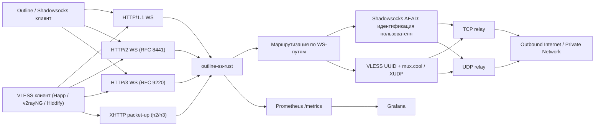

<p align="center">
  <picture>
    <source media="(prefers-color-scheme: dark)" srcset="docs/logo-dark.png">
    
  </picture>
</p>

# outline-ss-rust

`outline-ss-rust` — релей Shadowsocks и VLESS на Rust по образцу `outline-ss-server`. Принимает Shadowsocks AEAD- или VLESS-трафик поверх WebSocket или XHTTP и ретранслирует его к произвольным TCP- и UDP-адресатам. Есть несколько пользователей, шифр и `fwmark` на пользователя, метрики Prometheus и API управления пользователями в рантайме; стека управления Outline нет.

Реальные имена узлов, домены и адреса парка в этом документе заменены условными: `fleet.example` — домен парка. Соответствие — в локальном некоммитируемом `FLEET.local.md`.

Документ описывает серверный бинарь: транспорты, конфигурационный файл, control API, развёртывание и метрики. Клиент — `bins/outline-ws-rust`.

*English version: [README.md](README.md)*

## Протоколы и транспорты

- WebSocket поверх HTTP/1.1
- WebSocket поверх HTTP/2 — RFC 8441 Extended CONNECT
- WebSocket поверх HTTP/3 — RFC 9220 Extended CONNECT
- Shadowsocks AEAD (включая SS-2022) поверх WebSocket, TCP и UDP
- VLESS поверх WebSocket: TCP, UDP и mux.cool с XUDP per-packet addressing (принимают xray, Happ и Hiddify)
- VLESS поверх XHTTP, режимы `packet-up` (long-lived GET плюс POST'ы с порядковым номером) и `stream-one` (один full-duplex POST); режим выбирается на сессию через `?mode=` в URL запроса; заголовки `X-Padding` и в стиле SSE. Для CDN, блокирующих WebSocket-апгрейд (принимают xray, sing-box и Hiddify)
- Cross-transport session resumption, в том числе поверх XHTTP: припаркованный VLESS-upstream переподключается после XHTTP-реконнекта, и при смене носителя клиентом (откат h3→h2)
- Несколько пользователей с независимыми паролями Shadowsocks и/или VLESS UUID
- Шифр на пользователя
- Общие эндпоинты носителей (`[[endpoint]]`): пользователь работает на каждом эндпоинте своего kind
- Linux `fwmark` на исходящих сокетах на пользователя
- IPv4 и IPv6: слушатели и upstream-адресаты
- Метрики Prometheus и JSON дашборда Grafana
- Опциональный встроенный TLS для слушателя HTTP/1.1 и HTTP/2
- Опциональный встроенный QUIC/TLS-слушатель для HTTP/3

## Поддержка возможностей

| Область | Статус | Примечание |
| --- | --- | --- |
| Shadowsocks AEAD TCP | Поддерживается | Потоковый режим в бинарных WebSocket-фреймах |
| Shadowsocks AEAD UDP | Поддерживается | Один UDP-пакет на бинарный WebSocket-фрейм |
| Шифры | Поддерживается | `aes-128-gcm`, `aes-256-gcm`, `chacha20-ietf-poly1305`, `2022-blake3-aes-128-gcm`, `2022-blake3-aes-256-gcm`, `2022-blake3-chacha20-poly1305` |
| Multi-user | Поддерживается | Пользователь определяется по ключу, которым расшифровался первый chunk |
| Шифр на пользователя | Поддерживается | `method` пользователя переопределяет `[shadowsocks].method` |
| Эндпоинты носителей | Поддерживается | Глобальный список `[[endpoint]]` (`path`, `kind`, `padded`); каждый пользователь работает на каждом эндпоинте своего kind |
| `fwmark` на пользователя | Поддерживается | Только Linux, `SO_MARK` требует `CAP_NET_ADMIN` |
| HTTP/1.1 WebSocket | Поддерживается | Обычный `ws://` или `wss://` |
| HTTP/2 WebSocket | Поддерживается | RFC 8441 Extended CONNECT |
| HTTP/3 WebSocket | Поддерживается | RFC 9220 Extended CONNECT |
| Встроенный TLS для h1/h2 | Поддерживается | Опционально, на основном TCP-слушателе |
| Встроенный QUIC/TLS для h3 | Поддерживается | Опционально, на `[server.h3].listen` (может занимать тот же порт, что и `[server].listen`, по UDP); список ALPN настраивается |
| IPv6 | Поддерживается | Слушатели и upstream-резолвинг |
| Метрики Prometheus | Поддерживается | Отдельный слушатель, метки с низкой кардинальностью |
| Дашборд Grafana | Поддерживается | JSON в [grafana/](grafana) |
| Outline динамические ключи | Вне бинаря | Клиентские конфиги генерирует `ops/access-keys`, а не сам бинарь; см. [Генерация клиентских конфигов](#генерация-клиентских-конфигов) |
| VLESS поверх WebSocket | Поддерживается | TCP, UDP, mux.cool с XUDP per-packet addressing, до 8 одновременных под-соединений на сессию; поверх HTTP/1.1, HTTP/2 и HTTP/3 |
| VLESS поверх XHTTP packet-up | Поддерживается | Long-lived GET плюс POST'ы с порядковым номером на одном HTTP/2 (или HTTP/3) соединении; reorder-буфер принимает POST'ы не по порядку; downlink-кольцо переживает обрыв GET'а в полёте (CDN рвут длинные запросы примерно через 100 с); `X-Padding` и заголовки в стиле SSE (`text/event-stream`, `Cache-Control: no-store`, `X-Accel-Buffering: no`) |
| VLESS поверх XHTTP stream-one | Поддерживается | Один двунаправленный запрос: тело запроса — uplink, тело ответа — downlink. Включается через `?mode=stream-one` на том же base path. Требует h2 или h3 (h1 → 505); на h3 bidi-стрим делится через `RequestStream::split`, каждая половина работает в своём task |
| Resumption через XHTTP | Поддерживается | Сервер выдаёт `X-Outline-Session` на первом запросе, паркует VLESS-upstream при разрыве носителя и переподключает его на следующем запросе с `X-Outline-Resume`, в том числе при смене носителя (клиент не смог h3 и переподключился по h2 с тем же токеном) |
| HTTP fallback (маскировка) | Поддерживается | Reverse-proxy не совпавших с маршрутами HTTP/1.1 и HTTP/2 запросов (а с `apply_to_h3` — и HTTP/3) на бэкенд (haproxy, nginx, caddy) вместо `404`. Опциональный заголовок HAProxy PROXY protocol v1/v2 передаёт бэкенду IP клиента |
| SNI fallback (L4-маскировка) | Поддерживается | Подсматривает ClientHello на TLS-слушателе и сплайсит соединения с чужим SNI (сырой TCP вместе с захваченным ClientHello) на бэкенд с собственным сертификатом. nginx-style wildcards в `match_sni`; без PROXY protocol v1/v2 бэкенд видит peer `127.0.0.1` |
| VLESS REALITY / XTLS / Vision | Не поддерживается | Вне области применения |
| Outline management API | Не поддерживается | Только data plane |
| SIP003 plugin negotiation | Не поддерживается | Вне области применения |

## Архитектура

Документация по архитектуре: [docs/ARCHITECTURE.ru.md](docs/ARCHITECTURE.ru.md).



## Структура репозитория

- [src/server/](src/server): транспортные слушатели, обработка WebSocket Upgrade, TCP- и UDP-relay, control API
- [src/crypto/](src/crypto): шифрование/расшифровка Shadowsocks AEAD для потоков и UDP-пакетов
- [src/config/](src/config): загрузка конфигурации из флагов CLI, переменных окружения и TOML
- [src/metrics/](src/metrics): экспортёр Prometheus и семейства метрик
- [src/protocol/](src/protocol): типы wire-протокола, реэкспортируемые из общего крейта `outline-wire` (SOCKS-совместимый target address), и серверные сущности VLESS / VLESS mux
- [src/server/nat/](src/server/nat): таблица UDP NAT-сессий
- [src/fwmark.rs](src/fwmark.rs): хелперы Linux `SO_MARK` для исходящих сокетов
- [config.toml](config.toml): пример конфигурации
- [systemd/outline-ss-rust.service](systemd/outline-ss-rust.service): systemd unit
- [grafana/outline-ss-rust-dashboard.json](grafana/outline-ss-rust-dashboard.json): дашборд Grafana
- [PATCHES.ru.md](PATCHES.ru.md): указатель на общий для монорепо реестр патчей к vendored-крейтам

## Транспортная модель

### TCP

TCP-эндпоинт переносит стандартный Shadowsocks AEAD-поток в бинарных WebSocket-фреймах:

1. Клиент открывает WebSocket-соединение на эндпоинте `ws_ss_tcp` (или combined `ws_ss`).
2. Клиент отправляет зашифрованный Shadowsocks-поток в бинарных фреймах.
3. Сервер буферизует и расшифровывает поток, пока целевой адрес не придёт целиком.
4. Сервер подключается к цели и ретранслирует байты в обоих направлениях.

Границы WebSocket-фреймов игнорируются: зашифрованный поток может быть разрезан между фреймами на любом байте.

### UDP

UDP-эндпоинт ожидает ровно один Shadowsocks AEAD UDP-пакет на бинарный WebSocket-фрейм:

1. Клиент открывает WebSocket-соединение на эндпоинте `ws_ss_udp` (или combined `ws_ss`).
2. Каждый бинарный фрейм содержит один зашифрованный UDP-пакет.
3. Сервер расшифровывает пакет, извлекает целевой адрес и пересылает датаграмму.
4. Каждый ответ upstream возвращается отдельным зашифрованным бинарным WebSocket-фреймом.

Каждая входящая датаграмма обрабатывается в отдельной relay-задаче, не больше 256 одновременных задач на WebSocket-соединение (`UDP_MAX_CONCURRENT_RELAY_TASKS` в `src/server/constants.rs`). Датаграмма, пришедшая при достигнутом лимите, отбрасывается и логируется на уровне `warn`.

UDP NAT-таблица: сервер держит один UDP-сокет на `(user_id, fwmark, target_addr)`, общий для всех WebSocket-сессий этого пользователя. Следствия:

- Source port на стороне upstream не меняется, пока живёт NAT-запись, поэтому stateful UDP-протоколы (QUIC, DTLS, часть игровых и VoIP-протоколов) сохраняют ассоциацию.
- Пакеты upstream, пришедшие между датаграммами клиента (push от сервера, продолжение QUIC-стримов), доставляются в текущую активную WebSocket-сессию.
- После переподключения WebSocket существующий upstream-сокет используется повторно, upstream не видит новой ассоциации.

Запись вытесняется через `tuning.udp_nat_idle_timeout_secs` без исходящего трафика (300 с в профиле по умолчанию `large`). Задача вытеснения запускается каждые 60 с.

## Модель эндпоинтов

Каждый путь носителя, который отдаёт сервер, — одна запись в едином глобальном списке `[[endpoint]]`, который читается один раз при старте:

```toml
[[endpoint]]
path = "/tcp"
kind = "ws_ss_tcp"

[[endpoint]]
path = "/pss"
kind = "ws_ss"
padded = true
```

Каждая запись — `{ path, kind, padded }`:

- `path` — URL-путь, к которому подключается клиент. Должен быть уникален среди всех эндпоинтов независимо от kind; дубликат останавливает старт с ошибкой `duplicate endpoint path`.
- `kind` — протокол и форма носителя (`EndpointKind`), одно из значений:

| `kind` | Носитель | Что несёт |
| --- | --- | --- |
| `ws_ss` | WebSocket | Combined Shadowsocks: один путь, обе ноги (TCP и UDP) |
| `ws_ss_tcp` | WebSocket | Split Shadowsocks: только TCP-нога |
| `ws_ss_udp` | WebSocket | Split Shadowsocks: только UDP-нога |
| `ws_vless` | WebSocket | VLESS: TCP, UDP и mux.cool, мультиплексированные на одном пути |
| `xhttp_ss` | XHTTP | Combined Shadowsocks: один base-путь, обе ноги |
| `xhttp_ss_tcp` | XHTTP | Split Shadowsocks: только TCP-нога |
| `xhttp_ss_udp` | XHTTP | Split Shadowsocks: только UDP-нога |
| `xhttp_vless` | XHTTP | VLESS: TCP, UDP и mux.cool, мультиплексированные на одном base-пути |

  Эндпоинты `ws_*` обслуживаются на основном TCP-слушателе (HTTP/1.1, HTTP/2) и, если он настроен, на HTTP/3 (`[server.h3].listen`). Эндпоинты `xhttp_*` обслуживаются по HTTP/1.1, HTTP/2 и HTTP/3. Версия HTTP определяется слушателем, к которому подключается клиент, а не эндпоинтом.
- `padded` — опционально, по умолчанию `false` (алиас `padding`). Оборачивает каждый chunk на этом эндпоинте в padding-кадр; см. [Carrier-padding](#carrier-padding).

Эндпоинты заменяют старые поля по категориям `ws_path_tcp` / `ws_path_udp` / `ws_path_ss` / `ws_path_vless` / `xhttp_path_*` и переопределения путей на пользователя рядом с ними; что теперь несёт пользователь, см. [Модель пользователей](#модель-пользователей). Список читается только при старте, как и H3 path registry (см. [Управляющий эндпоинт](#управляющий-эндпоинт)): control API управляет пользователями на настроенных эндпоинтах, но не может добавить, удалить или перепривязать эндпоинт. Новый эндпоинт требует рестарта.

## Carrier-padding

Опциональный padding прикладного уровня на носителях WebSocket и XHTTP против классификаторов, которые сопоставляют размер TLS-записей с размером проксируемой нагрузки («proxy-inside-TLS», TLS-in-TLS). Каждый Shadowsocks-chunk на padded-эндпоинте оборачивается в кадр `real_len | pad_len | real | pad` до попадания во внешний TLS-record, поэтому размер зашифрованной записи больше не повторяет размер Shadowsocks-payload. Идея та же, что у padding в AnyTLS, но реализована внутри существующих носителей, без второго прокси-протокола.

- На эндпоинт. Padding — атрибут эндпоинта (`[[endpoint]] padded = true`). Остальные эндпоинты сохраняют обычный wire Shadowsocks-over-WS / XHTTP, поэтому сторонние клиенты (Happ, Outline, xray, sing-box) на непаддированных эндпоинтах не затронуты.
- Задаётся в конфиге с обеих сторон, без согласования. Capability-бита на проводе нет: клиент `outline-ws-rust` тоже обязан включить `[padding]`, иначе его обычные кадры попадут в padding-декодер и сессия упадёт. По умолчанию выключено; padding-кадров на проводе нет, пока обе стороны его не включат (нарезке начала сессии на h1/h2 padding не нужен, см. [`docs/PADDING.ru.md`](../../docs/PADDING.ru.md)).
- Cover-трафик. При `cover = true` downlink на простаивающем соединении отправляет кадры только из паддинга со случайным интервалом от `cover_jitter_min_ms` до `cover_jitter_max_ms` (по умолчанию 250 и 1500 мс), чтобы паузы не выдавали тайминг.

Действует для SS и VLESS поверх WebSocket (h1/h2/h3) и поверх XHTTP. UDP паддится по датаграмме на любом WS-носителе: и SS-UDP (split — `padded = true` на его эндпоинте, combined — на общем эндпоинте), и VLESS-UDP. Полный справочник: [`docs/PADDING.ru.md`](../../docs/PADDING.ru.md); параметры — в блоке `[padding]` в [config.toml](config.toml).

## Модель пользователей

Записи `[[users]]` содержат только учётные данные; собственного пути у пользователя нет. Поля записи:

- `id`
- `password` (Shadowsocks) и/или `vless_id` (VLESS), хотя бы одно из двух
- `method`
- `fwmark`
- `enabled`
- `aliases` (карта source IP → учётный alias)

Пользователь с `password` работает на каждом эндпоинте `ws_ss` / `ws_ss_tcp` / `ws_ss_udp` / `xhttp_ss` / `xhttp_ss_tcp` / `xhttp_ss_udp` сервера; пользователь с `vless_id` — на каждом эндпоинте `ws_vless` / `xhttp_vless`. Один пользователь может держать оба поля и использовать оба семейства протоколов. Пользователь без `method` использует `[shadowsocks].method`.

Возможные схемы:

- один общий набор эндпоинтов для всех пользователей, различаемых только ключом Shadowsocks или VLESS UUID
- разные пользователи на разных шифрах
- разные пользователи с разной политикой маршрутизации Linux через `fwmark`
- один ключ, разделённый на несколько учётных идентичностей по source IP через `aliases` (см. [Алиасы по source IP](#алиасы-по-source-ip))

Какие пути существуют и какой протокол и носитель обслуживает каждый, решается один раз на весь сервер в [`[[endpoint]]`](#модель-эндпоинтов).

## Конфигурация

По умолчанию сервер читает `config.toml` из текущего каталога. Другой путь задаётся флагом `--config` (или `OUTLINE_SS_CONFIG`):

```bash
cargo run -- --config ./config.toml
```

Пример конфигурации: [config.toml](config.toml). Все таблицы разбираются с `deny_unknown_fields`: неизвестный или опечатанный ключ, а также удалённая секция вроде `[dashboard]` останавливают сервер на старте с ошибкой разбора.

Нужен хотя бы один слушатель data plane — `[server].listen` или `[server.h3].listen`; иначе сервер завершается с ошибкой `configure at least one data-plane listener: listen or h3_listen`. Поднимаются только заданные слушатели.

## Короткие команды сборки

Cross-сборки под musl используют `cargo-zigbuild` через aliases из корневого `.cargo/config.toml`. Запускайте их из корня репозитория:

```bash
cargo ss-build-musl-x86_64
cargo ss-release-musl-x86_64
cargo ss-build-musl-aarch64
cargo ss-release-musl-aarch64
cargo ss-build-musl-arm
cargo ss-release-musl-arm
cargo ss-build-musl-armv7
cargo ss-release-musl-armv7
```

Они разворачиваются в `cargo zigbuild [--release] -p outline-ss-rust --target <triple>` для `x86_64-unknown-linux-musl`, `aarch64-unknown-linux-musl`, `arm-unknown-linux-musleabi` и `armv7-unknown-linux-musleabihf`. Нужны `cargo-zigbuild` и `zig`.

`mips` и `mipsel` не входят в текущий stable-набор таргетов Rustup. Для сборки под них используйте закреплённый старый toolchain или сборку через `build-std`; aliases и release-workflows их не покрывают.

### Ключи конфигурации

Ключи записаны как `[таблица].ключ`. Флаги CLI и переменные окружения для ключей, у которых они есть, перечислены в разделе [Переменные окружения и флаги CLI](#переменные-окружения-и-флаги-cli); флаг или переменная переопределяет значение из TOML. Для `tuning.*` значение по умолчанию указано по профилям в виде `small` / `medium` / `large`.

| Ключ | По умолчанию | Назначение |
| --- | --- | --- |
| `[server].listen` | нет | Основной TCP-слушатель для HTTP/1.1 и HTTP/2 |
| `[server].cert_path` / `[server].key_path` | нет | Встроенный TLS основного слушателя; эта пара — сертификат по умолчанию, когда SNI ни с чем не совпал. Старые имена `tls_cert_path` / `tls_key_path` принимаются как алиасы |
| `[[server.certs]]` | нет | Дополнительные пары cert/key, выбираемые по SNI на основном слушателе. Запись: `cert_path`, `key_path`, опционально `sni = [...]`. Без `sni` имена берутся из SAN сертификата (Subject CN — только если DNS SAN нет). Wildcard SAN-записи пропускаются, потому что резолвер сравнивает SNI точно; перечисляйте имена явно |
| `[server.h3].listen` | нет | Адрес QUIC-слушателя HTTP/3. Без него HTTP/3 выключен |
| `[server.h3].cert_path` / `[server.h3].key_path` | наследуются из `[server]` | Сертификат по умолчанию для QUIC-слушателя |
| `[[server.h3.certs]]` | наследуется из `[[server.certs]]` | Сертификаты по SNI для QUIC-слушателя, та же форма, что у `[[server.certs]]`. Явное пустое `certs = []` отключает наследование |
| `[server.h3].alpn` | `["h3"]` | ALPN-протоколы QUIC-эндпоинта. Поддерживается только `"h3"` (HTTP/3 и WebSocket поверх HTTP/3); пустой список отвергается |
| `[server.h3].initial_mtu` | не задан (старт с 1400) | Стартовый размер QUIC-датаграммы как размер UDP-payload (MTU пути минус 28 для IPv4, 48 для IPv6). Диапазон 1200–1452. Задавать только на узле, где путь меньше 1500: без него сервер стартует с 1400, ядро отбивает каждую датаграмму с `EMSGSIZE`, и quinn откатывается на минимум QUIC 1200 вместо наибольшего проходящего размера — это около 12% каждого пакета плюс ретраи на каждом хендшейке. Узел с закреплённым значением не пробует MTU выше него |
| `[server.h3].mtu_first_probe` | не задан | Первая проба поиска MTU пути как размер UDP-payload (1200–1452). Задавать, когда пути клиентов заведомо пропускают этот размер: поиск подтверждает его одной пробой вместо лесенки 1426 → 1439 → 1445 → 1452. Путь, который его не пропускает, стоит одного отвергнутого размера перед обычным поиском, поэтому не ставить 1452, если клиенты за более узким туннелем (например, 1448). Подтверждённая первая проба становится потолком каждого соединения, поэтому ниже реального MTU пути её тоже не ставить: 1448 на пути 1452 ограничит все соединения значением 1448. Без закреплённого `initial_mtu` старт — 1400, поэтому значения 1400 и меньше ни на что не влияют. При заданном `initial_mtu` игнорируется |
| `[server.h3].udp_datagrams` | `true` | Соглашаться на UDP по HTTP/3 datagram (RFC 9297) на `ws_h3` / `xhttp_h3`. Клиент предлагает их заголовком запроса `x-outline-udp-datagram: 1`; сервер возвращает его, только если ключ включён и у соединения есть размер датаграммы. `false` оставляет UDP в потоке. Читается при старте; изменение требует перезапуска. См. [UDP по HTTP/3 datagram](#udp-по-http3-datagram) |
| `[metrics].listen` | нет | Prometheus-слушатель. Без него метрики не отдаются |
| `[metrics].path` | `/metrics` | Путь Prometheus-эндпоинта |
| `[outbound].prefer_ipv4` | `false` | Предпочитать IPv4 для upstream DNS и connect. Включать, если IPv6-путь хоста сломан |
| `[outbound].ipv6_prefix` | нет | IPv6 CIDR (например, `2001:db8:dead::/64`). Каждый upstream IPv6 TCP-connect и UDP NAT-сокет биндится на случайный адрес из префикса вместо источника, выбранного ядром. Типовая настройка: `ip -6 addr add 2001:db8:dead::1/64 dev eth0`, тогда весь /64 on-link, и `IPV6_FREEBIND` (на Linux включается автоматически) позволяет `bind()` взять любой адрес префикса. Если FREEBIND недоступен, добавьте AnyIP-маршрут: `ip -6 route add local 2001:db8:dead::/64 dev lo`. IPv4 upstream не затрагивается. См. [`docs/OUTBOUND-IPV6.ru.md`](../../docs/OUTBOUND-IPV6.ru.md) |
| `[outbound].ipv6_interface` | нет | Альтернатива `ipv6_prefix` для хостов с DHCPv6 / SLAAC, где префикс заранее неизвестен. Имя интерфейса (например, `eth0`); пул — global-unicast IPv6-адреса, назначенные ему сейчас (`getifaddrs(3)`), каждый исходящий сокет биндится на случайный из них. Используются только адреса, настроенные на хосте, поэтому обратный трафик работает при обычном SLAAC без AnyIP-маршрутов и NDP-прокси. С kernel privacy extensions (`sysctl -w net.ipv6.conf.<iface>.use_tempaddr=2`) каждый новый временный адрес попадает в пул на следующем обновлении — получается ротация source по соединениям. В пул попадают только адреса `2000::/3`; loopback, link-local, ULA (`fc00::/7`), multicast, IPv4-mapped, discard (`100::/64`) и прочие неглобальные диапазоны отфильтровываются. Если пул пуст в момент bind, сокет биндится на wildcard-адрес и пишется строка `DEBUG`. Только Linux и macOS. Взаимоисключим с `ipv6_prefix` и `ipv6_prefix_interface` |
| `[outbound].ipv6_prefix_interface` | нет | Берёт текущий глобальный /64 указанного интерфейса как префикс для случайного source: адреса генерируются по всему префиксу, а сам префикс пересчитывается на каждом обновлении и следует за префиксом провайдера, меняющимся при переподключении. Требует, чтобы весь префикс маршрутизировался обратно на хост (NDP-прокси, `ndppd`). Взаимоисключим с `ipv6_prefix` и `ipv6_interface` |
| `[outbound].ipv6_refresh_secs` | `30` | Интервал перечитывания адресов интерфейса для `ipv6_interface` / `ipv6_prefix_interface` |
| `[outbound].ipv6_sticky` | `true` | При включённой ротации source закрепляет один адрес на каждый upstream destination IP на `ipv6_sticky_ttl_secs` вместо нового на каждый connect. Cloudflare привязывает cookie `cf_clearance` к source IP клиента, поэтому при новом source на каждый запрос сайт вроде `claude.ai` каждый раз показывает challenge «Verifying you are human». Ротация сохраняется между разными адресатами и после TTL. У кэша закреплений есть LRU-лимит и TTL на запись; стартовая проба достижимости по-прежнему проверяет случайные source. Без префикса или интерфейса не действует. `false` возвращает случайный source на каждый connect |
| `[outbound].ipv6_sticky_ttl_secs` | `1800` | TTL закрепления source. Ставьте выше срока жизни challenge-clearance у origin (у Cloudflare около 30 мин) |
| `tuning_profile` | `large` | Пресет ресурсных лимитов: `small` / `medium` / `large`. Задаёт flow-control окна H2/H3, лимиты стримов, таймауты сессий и NAT, глобальные лимиты UDP- и XHTTP-задач и сессий |
| `[tuning]` | значения профиля | Переопределения отдельных ключей поверх профиля; ключи ниже |
| `tuning.client_active_ttl_secs` | `180` / `300` / `300` | TTL для вычисления `client_active` / `client_up`. Должен быть > 0 |
| `tuning.udp_nat_idle_timeout_secs` | `120` / `240` / `300` | Время жизни UDP NAT-записи после последней исходящей датаграммы. Должен быть > 0 |
| `tuning.udp_nat_max_entries` | `4096` / `16384` / `65536` | Глобальный лимит живых UDP NAT-записей (по одной на `(user, fwmark, target)`). Каждая запись держит upstream-сокет и reader-задачу до вытеснения по простою, поэтому лимит ограничивает число дескрипторов и задач, которые аутентифицированный клиент может создать, рассылая пакеты на много адресов. При достижении лимита датаграммы к новым адресам отбрасываются и считаются в `outline_ss_udp_nat_capacity_dropped_total`; живые записи этим путём не вытесняются. `0` отключает лимит |
| `tuning.udp_nat_max_entries_per_user` | `1024` / `2048` / `4096` | Лимит живых UDP NAT-записей на пользователя поверх `udp_nat_max_entries`. Без него один пользователь, рассылающий пакеты на много адресов, может занять всю таблицу и не дать остальным открывать новые адреса до вытеснения по простою. Датаграммы к новым адресам пользователя, выбравшего свой лимит, отбрасываются (тоже в `outline_ss_udp_nat_capacity_dropped_total`); его живые записи работают, а слот освобождается при вытеснении одной из них. `0` отключает лимит |
| `tuning.udp_max_concurrent_relay_tasks` | `1024` / `2048` / `4096` | Глобальный лимит одновременных UDP-relay-задач по всем WebSocket-сессиям. `0` отключает лимит |
| `tuning.udp_replay_max_sessions` | `16384` / `65536` / `262144` | Ограничивает по отдельности обе anti-replay карты: окна сессий SS-2022 и legacy-соли запросов. При достижении лимита новый `client_session_id` (SS-2022) или соль (legacy) отбрасывается — это ограничивает память против клиента, который их перебирает. `0` отключает оба лимита и вместе с ними legacy-фильтр по солям |
| `tuning.udp_replay_max_sessions_per_user` | `4096` / `8192` / `16384` | Лимит записей replay-стора на пользователя (окна SS-2022 и legacy-соли суммарно) поверх `udp_replay_max_sessions`. Без него один пользователь, отправляющий уникальные session id или соли, может заполнить глобальный лимит, после чего отбрасываются новые сессии других пользователей. С ним пользователь, выбравший лимит, теряет только свои новые сессии (считаются с `reason="max_sessions_per_user"` в `outline_ss_udp_replay_store_full_dropped_total`). Клиент SS-2022 использует один или несколько `client_session_id`; legacy UDP создаёт новую соль на каждую датаграмму, поэтому на нагруженных legacy-развёртываниях поднимайте лимит или отключайте его (`0`) |
| `tuning.tcp_handshake_replay_max_salts` | `16384` / `65536` / `262144` | Сколько недавно виденных солей TCP-handshake Shadowsocks хранится для anti-replay. Захваченный handshake, отправленный повторно дословно, выводит тот же session key и снова расшифровывается, поэтому соль запоминается, а повтор отклоняется. Записи истекают через `udp_nat_idle_timeout_secs`. При достижении лимита новая соль не записывается и handshake пропускается (fail-open), это считается в `outline_ss_tcp_handshake_replay_store_full_total`. `0` отключает фильтр |
| `tuning.xhttp_max_sessions` | `16384` / `65536` / `262144` | Глобальный лимит живых XHTTP-сессий. Сессия создаётся первым запросом с новым корректным session id — до аутентификации Shadowsocks/VLESS внутри relay, — поэтому лимит ограничивает то, что может занять пир, знающий base path и отправляющий уникальные id. При достижении лимита запрос, создающий новую сессию, получает HTTP 503 (`outline_ss_xhttp_sessions_rejected_total{reason="max_sessions"}`); запросы к живому id обслуживаются всегда. `0` отключает лимит |
| `tuning.xhttp_max_sessions_per_ip` | `0` (выкл.) во всех профилях | Лимит живых XHTTP-сессий на source IP поверх `xhttp_max_sessions`. При достижении лимита запрос, создающий новую сессию, получает HTTP 503 (`reason="max_sessions_per_ip"`); живой id обслуживается. Ключ — транспортный адрес пира, а за CDN или reverse-proxy это edge-IP, общий для всех клиентов: за CDN оставляйте `0`, включайте только там, где клиенты подключаются напрямую |
| `tuning.xhttp_max_concurrent_relay_tasks` | `1024` / `2048` / `4096` | Глобальный лимит одновременных XHTTP-relay-задач. При достижении лимита запрос, создающий сессию, получает HTTP 503 и задача не запускается (`reason="max_relay_tasks"`). `0` отключает лимит |
| `tuning.dns_cache_max_entries` | `16384` / `65536` / `262144` | Лимит записей upstream DNS-кэша; при `262144` худший случай около 30–40 МиБ (около 120 байт плюс разрешённые адреса на запись). Ключ — `(port, prefer_ipv4_upstream, host)`, host приходит от клиента, поэтому без лимита клиент, резолвящий уникальные имена, растит кэш на TTL плюс часовое окно stale-fallback, а освобождается он только 5-минутным свипом. При достижении лимита вставка вытесняет по приближённому LRU, сначала протухшие записи. `0` отключает лимит |
| `tuning.ws_data_channel_capacity` | `16` / `64` / `128` | Ёмкость канала на сессию, в чанках, между upstream-reader и WebSocket-writer (TCP-relay) или NAT-reader и WebSocket-writer (UDP-relay). Слишком мало — кратковременная задержка writer'а тормозит чтение upstream, это видно как опустевший буфер видеоплеера. Слишком много — растёт худший случай памяти на сессию (`capacity × 16 KiB` для TCP). Должно быть > 0 |
| `tuning.h2_*` / `tuning.h3_*` | по профилю | Flow-control окна H2/H3, лимиты стримов, буфер записи и порог backpressure H3, UDP-буферы сокета H3; см. `TuningProfile` в [src/config/tuning.rs](src/config/tuning.rs) и [Лимиты QUIC](#лимиты-quic) |
| `[[endpoint]]` | нет | Эндпоинты носителей: `path` (уникален среди всех эндпоинтов), `kind` (см. [Модель эндпоинтов](#модель-эндпоинтов)), `padded` (bool, по умолчанию `false`, алиас `padding`; см. [Carrier-padding](#carrier-padding)). `padded` можно поменять через `PATCH /control/config`, действует после рестарта; пути читаются только при старте, см. [Управляющий эндпоинт](#управляющий-эндпоинт) |
| `[http_root].auth` | `false` | HTTP Basic auth на `/` (как в OpenConnect); после 3 неверных паролей сервер отдаёт `403`. Остальные не совпавшие пути по-прежнему получают `404` |
| `[http_root].realm` | `Authorization required` | Текст запроса пароля для `/` |
| `[access_keys]` | игнорируется | Читается внешним генератором `ops/access-keys`, а не этим бинарём. Секция разбирается, чтобы существующие конфиги загружались при `deny_unknown_fields`, и игнорируется. Поля: `public_host`, `public_scheme`, `url_base`, `file_extension`, `print`, `write_dir`. См. [Генерация клиентских конфигов](#генерация-клиентских-конфигов) |
| `[shadowsocks].method` | `chacha20-ietf-poly1305` | Шифр Shadowsocks по умолчанию |
| `[[users]]` `password` | нет | Пароль Shadowsocks |
| `[[users]]` `vless_id` | нет | VLESS UUID; должен быть уникален среди пользователей |
| `[[users]]` `aliases` | нет | Карта source IP → alias для учёта (метрики, ключ NAT, логи): `{ alias = "cidr-или-ip" \| ["cidr", ...] }`. Longest-prefix match, IPv4 и IPv6. Имена alias не должны совпадать с id пользователей и другими alias. Только прямые подключения. См. [Алиасы по source IP](#алиасы-по-source-ip) |
| `[[users]]` `enabled` | `true` | `false` блокирует пользователя (маршрутов и аутентификации нет), не удаляя запись |
| `[control]` | нет | HTTP API управления пользователями в рантайме (cargo feature `control`, включена по умолчанию). См. [Управляющий эндпоинт](#управляющий-эндпоинт) |
| `[control].listen` | нет | Адрес управляющего слушателя, например `127.0.0.1:7001`. Это отдельный сокет; не выставляйте его в интернет |
| `[control].token` | нет | Bearer-токен, обязательный в каждом запросе. Предпочтительнее `token_file` |
| `[control].token_file` | нет | Файл с bearer-токеном; взаимоисключим с `token` |
| `[cluster]` | выключен | Членство в mesh-кластере (relay между узлами по шардам). Поля: `enabled`, `shard_id` (`0..16`, уникален в кластере, обязателен при включении), `cluster_psk` (общий секрет в base64), `mesh_listen` (`host:port` mesh QUIC-слушателя), `mesh_relay_budget_ms` (по умолчанию `4000`) и записи `[[cluster.peers]]` (`shard`, `addr`). См. [`docs/CLUSTER.ru.md`](../../docs/CLUSTER.ru.md) и [`docs/CLUSTER-DEPLOY.ru.md`](../../docs/CLUSTER-DEPLOY.ru.md) |
| `[session_resumption]` | выключен | Cross-transport session resumption: `enabled`, `orphan_ttl_tcp_secs`, `orphan_ttl_udp_secs`, `orphan_per_user_cap`, `orphan_global_cap`, `downlink_buffer_bytes` (по умолчанию `0`, отключает v2 downlink replay). См. [`docs/SESSION-RESUMPTION.ru.md`](docs/SESSION-RESUMPTION.ru.md) |
| `[padding]` | выкл. | Параметры padding-кадров и cover-трафика; какие эндпоинты паддятся, задаёт `[[endpoint]] padded`. См. [Carrier-padding](#carrier-padding) |
| `[http_fallback]` | выкл. | См. [HTTP fallback](#4-http-fallback-на-внешний-веб-сервер-маскировка) |
| `[sni_fallback]` | выкл. | См. [SNI-роутинг](#5-sni-роутинг-для-чужих-tls-доменов-l4-маскировка) |

### Параметры пользователя

```toml
[[users]]
id = "alice"
password = "change-me"
fwmark = 1001
method = "aes-256-gcm"
vless_id = "550e8400-e29b-41d4-a716-446655440000"

[users.aliases]
alice-mobile = ["10.0.0.0/8", "203.0.113.5"]
alice-office = "192.0.2.0/24"
```

Для `2022-blake3-aes-128-gcm`, `2022-blake3-aes-256-gcm` и `2022-blake3-chacha20-poly1305` параметр `password` — это сырой PSK в base64 длиной ровно 16, 32 и 32 байта соответственно, например `openssl rand -base64 32`.

### Алиасы по source IP

`[users.aliases]` делит один ключ на несколько учётных идентичностей по source IP
клиента. После обычной аутентификации (по ключу Shadowsocks или VLESS UUID)
сервер выбирает метку: совпавший alias, если source IP попал в одну из его
подсетей, иначе базовый `id`. Метка используется для метрик на пользователя,
ключа UDP NAT и логов. Аутентификация, ключ и контроль доступа не меняются.

```toml
[[users]]
id = "team"
password = "shared-secret"

[users.aliases]
home   = "203.0.113.0/24"
mobile = ["10.0.0.0/8", "2001:db8::/48"]
```

- Значение: одна строка CIDR/IP или список. Голый адрес — host-маршрут (`/32` или `/128`). Пересекающиеся подсети допустимы; выигрывает самый длинный префикс.
- Уникальность: имена alias не должны совпадать ни с одним `id` пользователя или другим alias. Каждый становится отдельным time series `user="…"`, и коллизия смешала бы учёт. Такой конфиг отвергается при старте и в control API.
- Кардинальность: каждый alias добавляет одно значение метки в семейства метрик на пользователя.
- Покрытие: работает там, где сервер видит IP клиента: SS поверх WS/XHTTP TCP и все носители VLESS (WS/XHTTP/H3). SS-UDP поверх WebSocket использует базовый `id`, потому что на relay-слое адрес peer недоступен.
- CDN: source IP — это напрямую подключённый peer. За CDN или L4-прокси это IP прокси, поэтому алиасы работают только на прямых подключениях. Входящий PROXY protocol и `X-Forwarded-For` сервер не читает.

### VLESS поверх XHTTP

За CDN, который блокирует WebSocket-апгрейд, добавьте эндпоинт `xhttp_vless` рядом с `ws_vless` (или вместо него). Сервер регистрирует `<path>/{id}` для каждого эндпоинта `xhttp_vless`; `{id}` — непрозрачный токен сессии, который выбирает клиент. Любой пользователь с `vless_id` работает на обоих носителях.

```toml
[server]
listen = "0.0.0.0:443"
cert_path = "/etc/letsencrypt/live/example/fullchain.pem"
key_path  = "/etc/letsencrypt/live/example/privkey.pem"

# Опционально: оставляем WS-эндпоинт для клиентов на прямых соединениях.
[[endpoint]]
path = "/vless"
kind = "ws_vless"

# Обязательно для XHTTP.
[[endpoint]]
path = "/xh"
kind = "xhttp_vless"

[[users]]
id = "alice"
vless_id = "550e8400-e29b-41d4-a716-446655440000"
```

Один эндпоинт `xhttp_vless` обслуживает оба режима XHTTP; клиент выбирает режим на сессию в query URL:

| Режим | URL клиента | Что куда |
| --- | --- | --- |
| `packet-up` (по умолчанию) | `https://example.com/xh/<id>` | `GET <id>` — long-lived downlink; короткие `POST <id>` с `X-Xhttp-Seq: N` несут uplink. Reorder-буфер принимает POST'ы не по порядку. Downlink-кольцо переживает обрыв GET'а в полёте (CDN рвёт примерно через 100 с): следующий GET с тем же `<id>` продолжает с непрочитанной позиции. |
| `stream-one` | `https://example.com/xh/<id>?mode=stream-one` | Один двунаправленный `POST <id>?mode=stream-one`: тело запроса — uplink, тело ответа — downlink. Требует h2 или h3 (h1 → 505). На h3 bidi-стрим QUIC делится на половины отправки и приёма, каждая в своём task. |

Cross-transport session resumption по умолчанию выключен; включается `[session_resumption].enabled = true`. Он работает через XHTTP-реконнект, в том числе при смене носителя: клиент, у которого не удался h3-дозвон, может откатиться на h2 с тем же токеном `X-Outline-Resume`, и сервер переподключит припаркованный VLESS-upstream вместо нового соединения к цели. Токен `X-Outline-Session`, выданный на первом запросе, возвращается в каждом следующем ответе GET/POST/stream-one этой сессии, поэтому клиенту не нужно состояние, кроме самого токена.

Байт-потоковая сессия возобновляется и между прокси-протоколами: сессия, припаркованная по Shadowsocks, переприцепляется к VLESS-носителю той же записи `[[users]]`, и наоборот. Эта запись держит и `password`, и `vless_id`, а обе ноги паркуются под её `id`. Так сессии остаются живыми у клиента, чей аплинк перевыбирает активный wire в смешанном наборе SS/VLESS. Фрейминг для клиента строится из аутентифицированного пользователя возобновляющего потока, так что от протокола парковки ничего не переносится; переходы считаются в `outline_ss_orphan_resume_cross_protocol_total{parked,resumed}`. Датаграммные и mux-парковки остаются внутри своего протокола: они держат состояние фрейминга, которое другой протокол выразить не может. Полные правила и то, что гарантирует owner check, когда он остаётся единственным сигналом идентичности на этом пути: [`docs/SESSION-RESUMPTION.ru.md`](docs/SESSION-RESUMPTION.ru.md).

Когда настроен эндпоинт `xhttp_vless`, внешний генератор `ops/access-keys` пишет для каждого VLESS-пользователя два URI `vless://...?type=xhttp&path=...`, с `mode=packet-up` и с `mode=stream-one`, в подписку `<user>.json` и в `<user>.txt`. xray, sing-box, Hiddify, v2rayNG и Shadowrocket принимают оба URI, и пользователь выбирает тот режим, который проходит в его сети. См. [Генерация клиентских конфигов](#генерация-клиентских-конфигов).

### VLESS поверх WebSocket/TLS

VLESS inbound принимает VLESS поверх WebSocket на основном слушателе HTTP/1.1 или HTTP/2 и, если он настроен, на слушателе HTTP/3 (`[server.h3].listen`). На публичных развёртываниях используйте TLS (`[server].cert_path` / `[server].key_path`): VLESS только аутентифицирует UUID и не шифрует. Поддерживаемые команды: TCP CONNECT, UDP (датаграммы с префиксом длины) и mux.cool с XUDP per-packet addressing (мультиплексирование как в xray, до 8 одновременных под-соединений на сессию; XUDP `GlobalID` разбирается, но между реконнектами не переиспользуется). REALITY, XTLS, Vision, flow, fallback и sniffing не реализованы.

```toml
[server]
listen = "0.0.0.0:443"
cert_path = "/etc/letsencrypt/live/example/fullchain.pem"
key_path  = "/etc/letsencrypt/live/example/privkey.pem"

[[endpoint]]
path = "/tcp"
kind = "ws_ss_tcp"

[[endpoint]]
path = "/udp"
kind = "ws_ss_udp"

[[endpoint]]
path = "/vless"
kind = "ws_vless"

[[users]]
id = "alice"
vless_id = "550e8400-e29b-41d4-a716-446655440000"
```

Пример клиентского URI для Happ, v2rayNG или Hiddify:

```text
vless://550e8400-e29b-41d4-a716-446655440000@example.com:443?type=ws&security=tls&path=%2Fvless&encryption=none#example:alice
```

Разносите VLESS и Shadowsocks по разным записям `[[endpoint]]`, по одной на kind. Запись `[[users]]` может сочетать `password` (Shadowsocks) и `vless_id` (VLESS) или нести только `vless_id`; в обоих случаях она работает на каждом эндпоинте своего kind (или kind'ов).

### Управляющий эндпоинт

Cargo feature `control` (включена по умолчанию) добавляет HTTP API управления `[[users]]` в рантайме. Изменения пользователей применяются к работающему data plane через `ArcSwap` и записываются обратно в конфиг-файл, с которым запущен сервер.

```toml
[control]
listen = "127.0.0.1:7001"
token_file = "/etc/outline-ss-rust/control.token"
```

Каждый запрос обязан содержать `Authorization: Bearer <token>`. Биндите слушатель на loopback или management-сеть. Эквиваленты в CLI: `--control-listen`, `--control-token`, `--control-token-file` (и переменные `OUTLINE_SS_CONTROL_*`). Сборка с `--no-default-features` исключает модуль управления; она же отключает feature `jemalloc` из набора по умолчанию, поэтому для сохранения аллокатора добавьте `--features jemalloc`.

Браузерный дашборд, который раньше поднимался на отдельном слушателе этого бинаря, теперь — сервис `outline-ui` в k3s (`https://ui.k3s.fleet.example/ss`); он агрегирует `/control` API всех серверов, см. [`bins/outline-ui/README.ru.md`](../outline-ui/README.ru.md). Этот бинарь отдаёт только API ниже.

| Метод | Путь | Назначение |
| --- | --- | --- |
| `GET` | `/control/users` | Список пользователей (только метаданные, без секретов) |
| `POST` | `/control/users` | Создать пользователя. Тело: `{ "id": "...", "password": "...", "vless_id": "...", "method": "...", "fwmark": 0, "enabled": true, "aliases": {...} }`; нужно хотя бы одно из `password` / `vless_id` |
| `GET` | `/control/users/{id}` | Метаданные одного пользователя |
| `PATCH` | `/control/users/{id}` | Изменить `password`, `vless_id`, `method`, `fwmark`, `enabled`, `aliases`; поле со значением `null` очищается, отсутствующее поле не меняется |
| `DELETE` | `/control/users/{id}` | Удалить пользователя |
| `POST` | `/control/users/{id}/block` | Заблокировать (`enabled = false`) без удаления |
| `POST` | `/control/users/{id}/unblock` | Разблокировать |
| `GET` | `/control/defaults` | Шифр по умолчанию на весь сервер (`[shadowsocks].method`) |
| `GET` | `/control/config` | Конфигурация сервера: mesh-кластер, слушатели/TLS, session resumption, outbound, padding, HTTP/SNI fallback, профиль тюнинга, эндпоинты |
| `PATCH` | `/control/config` | Записать изменения этих секций в конфиг-файл. К работающему процессу не применяется: в ответе `"requires_restart": true`. Возвращает `400`, если сервер запущен без конфиг-файла |

```bash
curl -H "Authorization: Bearer $TOKEN" http://127.0.0.1:7001/control/users
curl -XPOST -H "Authorization: Bearer $TOKEN" -H 'Content-Type: application/json' \
  -d '{"id":"carol","password":"s3cret"}' http://127.0.0.1:7001/control/users
curl -XPOST -H "Authorization: Bearer $TOKEN" http://127.0.0.1:7001/control/users/carol/block
```

Каждое изменение пользователя записывается в конфиг-файл (`--config` / `OUTLINE_SS_CONFIG`) до того, как попадает в data plane, поэтому ответ `201`/`200` означает, что изменение переживёт рестарт. Файл патчится, а не пересобирается: меняется только запись `[[users]]`, названная в запросе; остальные пользователи, секции, порядок ключей и комментарии остаются байт в байт. Запись идёт через временный файл и `rename` с сохранением режима и владельца, поэтому падение во время записи оставляет прежний конфиг целым. Если запись не удалась, запрос завершается ошибкой и в работающем процессе ничего не меняется.

Если сервер запущен без конфиг-файла (пользователи из `--user` / `OUTLINE_SS_USERS`), изменения пользователей действуют только в текущем процессе и теряются при рестарте; на старте пишется предупреждение.

Эндпоинты (`[[endpoint]]`) резолвятся один раз при старте: роутеры Axum и H3 регистрируют только пути, известные на старте. Control API может создавать, блокировать и удалять пользователей на этих эндпоинтах, но не может добавить, удалить или перепривязать эндпоинт; новый эндпоинт требует рестарта.

### HTTP Basic auth на `/`

При `[http_root].auth = true` запрос `GET /` получает HTTP Basic challenge. Имя пользователя игнорируется; пароль сравнивается за постоянное время с паролями настроенных Shadowsocks-пользователей. `[http_root].realm` задаёт текст запроса. После трёх неудачных попыток в одной браузерной сессии сервер отвечает `403 Forbidden`. Запросы к остальным не совпавшим путям получают `404 Not Found`.

### Переменные окружения и флаги CLI

У каждой переменной есть одноимённый флаг CLI (`OUTLINE_SS_LISTEN` → `--listen`). Флаг или переменная переопределяет ключ TOML.

| Переменная | Флаг CLI | Ключ TOML |
| --- | --- | --- |
| `OUTLINE_SS_CONFIG` | `--config` | (путь к конфиг-файлу) |
| `OUTLINE_SS_LISTEN` | `--listen` | `[server].listen` |
| `OUTLINE_SS_TLS_CERT_PATH` | `--tls-cert-path` | `[server].cert_path` |
| `OUTLINE_SS_TLS_KEY_PATH` | `--tls-key-path` | `[server].key_path` |
| `OUTLINE_SS_H3_LISTEN` | `--h3-listen` | `[server.h3].listen` |
| `OUTLINE_SS_H3_CERT_PATH` | `--h3-cert-path` | `[server.h3].cert_path` |
| `OUTLINE_SS_H3_KEY_PATH` | `--h3-key-path` | `[server.h3].key_path` |
| `OUTLINE_SS_METRICS_LISTEN` | `--metrics-listen` | `[metrics].listen` |
| `OUTLINE_SS_METRICS_PATH` | `--metrics-path` | `[metrics].path` |
| `OUTLINE_SS_PREFER_IPV4_UPSTREAM` | `--prefer-ipv4-upstream[=true\|false]` | `[outbound].prefer_ipv4` |
| `OUTLINE_SS_OUTBOUND_IPV6_PREFIX` | `--outbound-ipv6-prefix` | `[outbound].ipv6_prefix` |
| `OUTLINE_SS_OUTBOUND_IPV6_INTERFACE` | `--outbound-ipv6-interface` | `[outbound].ipv6_interface` |
| `OUTLINE_SS_OUTBOUND_IPV6_PREFIX_INTERFACE` | `--outbound-ipv6-prefix-interface` | `[outbound].ipv6_prefix_interface` |
| `OUTLINE_SS_OUTBOUND_IPV6_REFRESH_SECS` | `--outbound-ipv6-refresh-secs` | `[outbound].ipv6_refresh_secs` |
| `OUTLINE_SS_OUTBOUND_IPV6_STICKY` | `--outbound-ipv6-sticky` | `[outbound].ipv6_sticky` |
| `OUTLINE_SS_OUTBOUND_IPV6_STICKY_TTL_SECS` | `--outbound-ipv6-sticky-ttl-secs` | `[outbound].ipv6_sticky_ttl_secs` |
| `OUTLINE_SS_HTTP_ROOT_AUTH` | `--http-root-auth[=true\|false]` | `[http_root].auth` |
| `OUTLINE_SS_HTTP_ROOT_REALM` | `--http-root-realm` | `[http_root].realm` |
| `OUTLINE_SS_METHOD` | `--method` | `[shadowsocks].method` |
| `OUTLINE_SS_TUNING_PROFILE` | `--tuning-profile` | `tuning_profile` |
| `OUTLINE_SS_USERS` | `--user` | `[[users]]` |
| `OUTLINE_SS_CONTROL_LISTEN` | `--control-listen` | `[control].listen` |
| `OUTLINE_SS_CONTROL_TOKEN` | `--control-token` | `[control].token` |
| `OUTLINE_SS_CONTROL_TOKEN_FILE` | `--control-token-file` | `[control].token_file` |

`OUTLINE_SS_USERS` принимает записи `id=password` через запятую:

```bash
OUTLINE_SS_USERS=alice=secret1,bob=secret2
```

Пользователи, заданные так, заменяют список `[[users]]` из файла. `method`, `fwmark`, `vless_id` и `aliases` пользователя задаются только в TOML. Эндпоинты тоже только в TOML: у `[[endpoint]]` нет ни флага, ни переменной.

## Режимы развёртывания

### 1. Простой WebSocket

Для тестов или доверенных приватных сетей:

```toml
[server]
listen = "0.0.0.0:3000"

[[endpoint]]
path = "/tcp"
kind = "ws_ss_tcp"

[[endpoint]]
path = "/udp"
kind = "ws_ss_udp"

[shadowsocks]
method = "chacha20-ietf-poly1305"
```

### 2. Встроенный TLS для HTTP/1.1 и HTTP/2

```toml
[server]
listen = "0.0.0.0:5443"
cert_path = "/etc/outline-ss-rust/tls/fullchain.pem"
key_path  = "/etc/outline-ss-rust/tls/privkey.pem"

[[endpoint]]
path = "/tcp"
kind = "ws_ss_tcp"

[[endpoint]]
path = "/udp"
kind = "ws_ss_udp"
```

Обслуживает `wss://` на основном TCP-слушателе, RFC 8441 — на том же сокете.

Чтобы обслуживать несколько доменов на одном слушателе, добавьте пары cert/key в `[[server.certs]]`. Пара `cert_path` / `key_path` из `[server]` возвращается, когда SNI не совпал ни с одной записью массива или клиент SNI не прислал:

```toml
[server]
listen = "0.0.0.0:5443"
cert_path = "/etc/letsencrypt/live/default.example.com/fullchain.pem"
key_path  = "/etc/letsencrypt/live/default.example.com/privkey.pem"

[[server.certs]]
cert_path = "/etc/letsencrypt/live/api.example.com/fullchain.pem"
key_path  = "/etc/letsencrypt/live/api.example.com/privkey.pem"
sni = ["api.example.com", "api2.example.com"]   # явный список

[[server.certs]]
cert_path = "/etc/letsencrypt/live/shop.example.com/fullchain.pem"
key_path  = "/etc/letsencrypt/live/shop.example.com/privkey.pem"
# `sni` не указан — имена извлекаются из SAN сертификата (и Subject CN
# как последний фолбэк). Wildcard SAN-записи пропускаются.
```

QUIC-слушатель принимает ту же форму в `[[server.h3.certs]]`. Если в `[server.h3]` не заданы ни `cert_path` / `key_path`, ни `certs`, QUIC-слушатель наследует сертификаты TCP-слушателя.

Перезагрузка сертификатов. Каждый настроенный файл cert/key (пара по умолчанию и каждая запись `[[server.certs]]` / `[[server.h3.certs]]`) опрашивается раз в 5 минут (`CERT_RELOAD_POLL_INTERVAL_SECS`) и перезагружается при изменении содержимого, без рестарта и сигналов. Новые соединения получают новый сертификат после ближайшего опроса; установленные соединения сохраняют тот, по которому прошли handshake. Опрос вместо inotify/kqueue ловит и атомарный `rename`, и подмену симлинка, которые делают ACME-клиенты (certbot, lego, acme.sh, Caddy) при обновлении. Если перезагрузка не удалась, например сертификат заменили раньше ключа, продолжает работать прежний сертификат, ошибка логируется, а следующий опрос пробует снова.

### 3. Встроенный HTTP/3

```toml
[server]
listen = "0.0.0.0:5443"
cert_path = "/etc/outline-ss-rust/tls/fullchain.pem"
key_path  = "/etc/outline-ss-rust/tls/privkey.pem"

[server.h3]
listen = "0.0.0.0:5443"
# `cert_path` / `key_path` (и массив `[[server.h3.certs]]`) наследуются
# из `[server]`, если их не задавать здесь — поэтому в типовой
# развёртке сертификат конфигурируется один раз.
```

HTTP/3 всегда использует TLS, и UDP-порт должен быть доступен клиентам.

### 4. HTTP fallback на внешний веб-сервер (маскировка)

Без fallback сервер отвечает `404 Not Found` на любой запрос, не попавший в путь WebSocket / XHTTP / metrics, и по этой реакции зонд отличает слушатель от обычного веб-сервера. С `[http_fallback]` такие запросы проксируются на бэкенд (haproxy, nginx, caddy), и `curl https://your-host/` или TLS-сканер видит то, что отдаёт бэкенд.

```toml
[http_fallback]
backend = "http://127.0.0.1:8080"   # пока только http://
# request_timeout_secs = 30
# add_x_forwarded_for = true
# add_x_forwarded_proto = true
# add_x_forwarded_host = true
# proxy_protocol = "v1"             # либо "v2"; пропустить — выкл.
# backend_proto = "h1"              # либо "h2" (h2c prior-knowledge) к бэкенду
# apply_to_h1 = true                # по умолчанию true; TCP-листенер (h1 + h2)
# apply_to_h3 = false               # по умолчанию false; HTTP/3-листенер, нужна [server.h3]
```

Что проксируется:

- Любой запрос, не совпавший с маршрутами WebSocket / XHTTP / metrics / control. Приоритет: сначала маршруты WebSocket и XHTTP, затем `[http_root].auth` на `/`, если включён, затем fallback.
- Hop-by-hop заголовки (`Connection`, `Keep-Alive`, `TE`, `Trailers`, `Transfer-Encoding`, `Upgrade`, `Proxy-*`) удаляются в обе стороны, включая заголовки, перечисленные в `Connection:`. Тела передаются потоком в обе стороны.
- `Host` заменяется на authority бэкенда, как делает nginx с `proxy_set_header Host $proxy_host;`.
- `X-Forwarded-For`, `X-Forwarded-Proto` и `X-Forwarded-Host` добавляются или выставляются по переключателям выше. `X-Forwarded-Proto` отражает, терминировал ли входящий слушатель TLS.

PROXY protocol:

- `proxy_protocol = "v1"` (текстовый) или `"v2"` (бинарный) пишет заголовок HAProxy PROXY protocol в начало TCP-соединения с бэкендом. Бэкенд должен ждать именно эту версию (`proxy_protocol on;` в директиве `listen` nginx, `accept-proxy` в `bind` haproxy).
- Адрес назначения в заголовке — bind-адрес входящего слушателя. Для `0.0.0.0` / `[::]` заголовок вырождается в UNKNOWN (v1) / UNSPEC (v2); локальный адрес конкретного соединения не используется.

HTTP/3 (`apply_to_h3`):

- По умолчанию fallback покрывает только TCP-слушатель (`apply_to_h1 = true`). `apply_to_h3 = true` распространяет тот же reverse-proxy на слушатель HTTP/3 и требует `[server.h3]`. Переключатели независимы; при обоих включённых один бэкенд отвечает на пробы и на 443/TCP, и на 443/UDP.
- Любой HTTP/3-запрос, который не является XHTTP base path, WS-over-h3 CONNECT или auth-challenge на `/`, уходит на тот же `backend` с тем же `backend_proto`, удалением hop-by-hop и обработкой `X-Forwarded-*`, что и на TCP. `[http_root].auth` на `/` имеет приоритет над fallback, как и на TCP.
- `X-Forwarded-Proto` на этом пути всегда `https`: QUIC всегда зашифрован.
- Тело запроса буферизуется целиком до пересылки, не больше 256 KiB (`MAX_FALLBACK_BODY_BYTES`, как лимит POST у XHTTP); тело больше получает `413 Payload Too Large`. Тело ответа передаётся обратно через QUIC по частям, поэтому большой файл или SSE-поток не держатся в памяти. Трейлеры передаются в обе стороны, если их поддерживает `backend_proto`.
- PROXY protocol на этом пути всегда v2 с `Transport=DGRAM`, так что бэкенд видит, что origin был UDP/QUIC. `proxy_protocol = "v1"` вместе с `apply_to_h3 = true` отвергается при загрузке конфига: у v1 нет UDP-формы. Используйте `"v2"` или отключите PROXY protocol.

Ограничения:

- URL бэкенда — только `http://host:port`; HTTPS и Unix-сокеты не поддерживаются.
- На каждый входящий запрос открывается отдельное TCP-соединение к бэкенду (без пула). Не используйте fallback как балансировщик.

### 5. SNI-роутинг для чужих TLS-доменов (L4-маскировка)

HTTP fallback срабатывает после того, как TLS терминирован здесь: SNI наш, но путь или Host не совпал ни с одним маршрутом. `[sni_fallback]` работает уровнем ниже: подсматривает ClientHello до handshake и, если SNI не наш, сплайсит сырой TCP-поток (вместе с захваченным ClientHello) на бэкенд, который обслуживает чужие SNI своим сертификатом. Для пассивного наблюдателя слушатель выглядит как haproxy-frontend с маршрутизацией по SNI.

Требует встроенного TLS на основном TCP-слушателе (`[server].cert_path` и `[server].key_path` или хотя бы одна запись `[[server.certs]]`).

`match_sni` — список SNI, которые терминируются локально. Совпавшие соединения идут в наш TLS-стек, где [резолвер сертификатов по SNI](#6-несколько-сертификатов-на-одном-листенере-выбор-по-sni) выбирает сертификат; остальные сплайсятся на бэкенд. Добавляя домен в `[[server.certs]]`, добавьте его и в `match_sni`, иначе его трафик уйдёт на бэкенд чужих SNI, хотя сертификат для него у нас есть.

Правило маршрутизации: подсмотренный SNI сначала ищется в `HashMap` точных совпадений, затем в списке wildcards, затем используется catch-all бэкенд. Точное совпадение побеждает wildcard независимо от того, в каком списке оно объявлено. Поэтому wildcard `*.example.com` в `match_sni` оставляет апекс локальным, а точное `px.example.com` в `match_sni` бэкенда отправляет наружу только этот хост (см. пример с вырезкой ниже).

Есть два взаимоисключающих формата бэкенда.

Один бэкенд: все чужие SNI идут к одному upstream.

```toml
[server]
listen = "0.0.0.0:443"
cert_path = "/etc/letsencrypt/live/your-host/fullchain.pem"
key_path  = "/etc/letsencrypt/live/your-host/privkey.pem"

[sni_fallback]
backend = "127.0.0.1:8443"               # haproxy / nginx / caddy
match_sni = ["vpn.example.com",
             "*.api.example.com"]        # обязательно, nginx-style wildcards
# allow_no_sni = false                   # коннекты без SNI → на бэкенд
# proxy_protocol = "v2"                  # v1 / v2 / пропустить. НАСТОЯТЕЛЬНО
                                         # рекомендуется — иначе бэкенд не увидит
                                         # реальный IP клиента в логах
# max_client_hello_bytes = 8192          # коннект закрывается, если ClientHello
                                         # больше этого размера
```

Несколько бэкендов: разные чужие SNI идут на разные upstream. Замените `backend = "..."` одной или несколькими таблицами `[[sni_fallback.backends]]`. Побеждает первое совпадение; запись без `match_sni` — catch-all и должна быть последней. В этом режиме `proxy_protocol` задаётся в каждой записи (ключ верхнего уровня отвергается):

```toml
[sni_fallback]
match_sni = ["vpn.example.com"]          # остаётся на нашем TLS-терминаторе
allow_no_sni = false
# max_client_hello_bytes = 8192

[[sni_fallback.backends]]
backend = "127.0.0.1:8443"
match_sni = ["nginx.example.com", "*.nginx.example.com"]
proxy_protocol = "v2"

[[sni_fallback.backends]]
backend = "127.0.0.1:9443"
match_sni = ["caddy.example.com"]

[[sni_fallback.backends]]
backend = "127.0.0.1:10443"
# `match_sni` нет → catch-all; должен быть последним
```

Вырезка: всё под `*.example.com` терминируется локально, кроме `px.example.com`, который уходит на отдельный upstream:

```toml
[sni_fallback]
match_sni = ["*.example.com"]            # апекс → локальный TLS-терминатор
allow_no_sni = false

[[sni_fallback.backends]]
backend = "127.0.0.1:10443"
match_sni = ["px.example.com"]           # exact-вырезка побеждает апекс-wildcard
proxy_protocol = "v2"

[[sni_fallback.backends]]
backend = "127.0.0.1:11443"              # catch-all для всего, что вне *.example.com
proxy_protocol = "v1"
```

С таким конфигом `cloud.example.com` и `m.example.com` терминируются локально (совпадение по wildcard в `match_sni`), `px.example.com` сплайсится на `:10443` (точное совпадение бьёт wildcard), `evil.com` уходит на `:11443` (catch-all).

Порядок принятия решения:

1. Прочитать из входящего сокета столько байт, сколько нужно `rustls::server::Acceptor` для разбора полного ClientHello (`max_client_hello_bytes`, по умолчанию 8192). ClientHello больше лимита считается некорректным, соединение закрывается, и мусор не уходит на бэкенд.
2. Таблица точных совпадений: каждая точная запись из `match_sni` и из каждого `[[sni_fallback.backends]].match_sni` при старте индексируется в один `HashMap`. SNI ищется сначала там. Локальные записи вставляются раньше бэкендовых, поэтому SNI, заявленный и там и там, остаётся локальным; среди бэкендов побеждает порядок объявления.
3. Проход по wildcards: при промахе проверяются wildcards (`*.foo.bar`, без учёта регистра, ровно одна метка слева) в порядке приоритета: сначала локальные, затем бэкенды в порядке объявления. Решает первое совпадение.
4. Catch-all: при промахе в обоих случаях используется catch-all бэкенд (форма с одним `backend = "..."` всегда работает как catch-all; в режиме нескольких бэкендов это запись без `match_sni`). Если catch-all нет, соединение закрывается со строкой `WARN`. Соединения без SNI следуют `allow_no_sni`: `true` → локально, `false` → catch-all.
5. Локальный маршрут: захваченные байты возвращаются в наш TLS-терминатор через обёртку `PrependStream`; выбор сертификата, `[http_fallback]`, WebSocket и XHTTP дальше работают как на несплайснутом соединении. Маршрут на бэкенд: открыть новое TCP-соединение, при необходимости записать заголовок HAProxy PROXY protocol, записать захваченный ClientHello и выполнять `tokio::io::copy_bidirectional`, пока одна из сторон не закроется.

Включайте PROXY protocol на этом уровне: байты пересылаются как сырой TCP, и без него бэкенд видит `127.0.0.1` как peer каждого сплайснутого соединения, а его логи, ACL и rate limit не различают клиентов. Как и в `[http_fallback]`, адрес назначения в заголовке — bind-адрес слушателя (UNKNOWN / UNSPEC для `0.0.0.0` / `[::]`).

Неудачные peek'и. Поток, из которого так и не удалось получить ClientHello, учитывается в `outline_ss_sni_peek_failed_total{reason=...}`:

| `reason` | Что это | Уровень лога |
| --- | --- | --- |
| `peer_closed` | Пир закрыл соединение (FIN/EOF/RST), не отправив ClientHello | `debug` |
| `read_failed` | Чтение из входящего сокета упало по другой причине | `warn` |
| `oversized` | Байты шли, но ClientHello не сложился в пределах `max_client_hello_bytes` | `warn` |
| `malformed` | rustls отверг байты как TLS-handshake | `warn` |
| `timeout` | Полный ClientHello не пришёл до pre-auth дедлайна handshake (см. ниже) | `debug` |

`peer_closed` дают TCP-пробы живости, сканеры портов и клиенты, которые рано отключаются; на любом публичном порту его поток не прекращается, поэтому он пишется на `debug` и наблюдается через счётчик. Рост `malformed` означает, что со слушателем говорят чем-то похожим на TLS, но не TLS.

Pre-auth таймаут handshake. Каждое принятое TLS-соединение сразу после accept занимает один из `TLS_MAX_CONCURRENT_CONNECTIONS` (4096) permit'ов. Пир, который подключился и молчит или шлёт по байту (slowloris), иначе держал бы permit бесконечно, а 4096 таких соединений остановили бы accept-цикл. Вся неаутентифицированная фаза — опциональный SNI-peek плюс rustls-handshake — укладывается в один дедлайн 10 с (`TLS_HANDSHAKE_TIMEOUT_SECS`). По его истечении соединение закрывается и permit освобождается; таймаут учитывается как `outline_ss_sni_peek_failed_total{reason="timeout"}`, если сработал на peek, и как `outline_ss_tls_handshake_failed_total{reason="timeout"}`, если на handshake.

Ограничения:

- Только TLS. У plain (без TLS) `[server].listen` нет SNI для маршрутизации; валидация отвергает такую конфигурацию.
- Порт назначения в PROXY-заголовке — bind-порт слушателя, а не локальный порт соединения.
- Wildcards в `match_sni` покрывают только одну метку слева (nginx-style); без wildcard внутри метки и без регулярных выражений. Резолвер сертификатов сравнивает SNI точно, wildcard SAN-записи там пропускаются.
- Слушатель HTTP/3 не покрыт: SNI на h3 разбирает quinn до того, как его видит наш код.

### 6. Несколько сертификатов на одном листенере (выбор по SNI)

`[sni_fallback]` решает, наше ли соединение или его нужно отдать чужому бэкенду. Несколько собственных доменов на одном слушателе, например `vpn.example.com` и `api.example.com` на одном сокете `:443`, каждый со своим сертификатом Let's Encrypt, настраиваются массивами `[[server.certs]]` и `[[server.h3.certs]]` одинаковой формы на обоих транспортах:

```toml
[server]
listen = "0.0.0.0:443"
# Default-сертификат, возвращается когда SNI не совпал ни с одной
# записью ниже (и когда клиент SNI не прислал).
cert_path = "/etc/letsencrypt/live/default.example.com/fullchain.pem"
key_path  = "/etc/letsencrypt/live/default.example.com/privkey.pem"

[[server.certs]]
cert_path = "/etc/letsencrypt/live/vpn.example.com/fullchain.pem"
key_path  = "/etc/letsencrypt/live/vpn.example.com/privkey.pem"
sni = ["vpn.example.com"]                       # явный список

[[server.certs]]
cert_path = "/etc/letsencrypt/live/api.example.com/fullchain.pem"
key_path  = "/etc/letsencrypt/live/api.example.com/privkey.pem"
# `sni` не указан — имена возьмутся из SAN сертификата

[server.h3]
listen = "0.0.0.0:443"
# `cert_path` / `key_path` и `[[server.h3.certs]]` наследуются из
# `[server]`, если их не задавать здесь — поэтому QUIC-слушатель
# автоматически получает тот же набор доменов, что и TCP.
```

Как это работает:

- Слушатель ставит собственный rustls `ResolvesServerCert`. Во время handshake он читает SNI из ClientHello, приводит к нижнему регистру и ищет по нему `CertifiedKey`. Сравнение точное, без учёта регистра. Wildcard SAN-записи вроде `*.example.com` пропускаются при загрузке со строкой `WARN`; чтобы wildcard-сертификат обслуживал конкретные имена, перечислите их в `sni = [...]`.
- При `sni = [...]` регистрируются только эти имена; SAN сертификата не добавляется. Без `sni` имена берутся из DNS-записей `subjectAltName`, а из Subject CN — только если DNS SAN нет.
- SNI, не совпавший ни с одной записью, или ClientHello без SNI получает `cert_path` / `key_path` по умолчанию. Без сертификата по умолчанию handshake падает с `unrecognized_name`.
- QUIC-слушатель наследует массив TCP-слушателя, если в `[server.h3]` нет `certs`. Явное `certs = []` на стороне H3 отключает наследование.
- Этот выбор происходит внутри нашего TLS-стека: разные сертификаты, один слушатель, один процесс. Он не зависит от `[sni_fallback]`, который пересылает чужие SNI, вообще не терминируя TLS. Можно включить оба: чужие SNI уходят на сплайс-бэкенд, а каждый SNI из `match_sni` (или отсутствующий SNI при `allow_no_sni = true`) терминируется локально с сертификатом, выбранным этим резолвером.

## Генерация клиентских конфигов

Этот бинарь клиентские артефакты не генерирует. Генерация переехала в
`ops/access-keys` (2026-08-11): Python-пакет читает тот же `config.toml` и
пишет три файла на пользователя в каталог, который раздаёт узел: `<user>.conf`
(Outline YAML), `<user>.json` (подписка Xray-JSON) и `<user>.txt` (все ссылки
пользователя, по одной в строке).

См. [`ops/access-keys/README.md`](../../ops/access-keys/README.md).

Секция `[access_keys]` остаётся в `config.toml`; генератор читает из неё
`public_host`, `public_scheme`, `url_base`, `file_extension` и `write_dir`.
Сервер разбирает секцию, чтобы существующие конфиги загружались при
`deny_unknown_fields`, и игнорирует все её ключи. Флаги `--print-access-keys`,
`--write-access-keys-dir`, `--public-host`, `--public-scheme`,
`--access-key-url-base` и `--access-key-file-extension` удалены, как и
control-эндпоинт `GET /control/users/{id}/access-urls` вместе с кнопками
дашборда, которые его вызывали.

## Наблюдаемость

### Prometheus

Метрики отдаются на отдельном слушателе:

```toml
[metrics]
listen = "127.0.0.1:9090"
path = "/metrics"

[tuning]
client_active_ttl_secs = 300
```

Пример конфигурации scrape:

```yaml
scrape_configs:
  - job_name: outline-ss-rust
    static_configs:
      - targets:
          - 127.0.0.1:9090
```

Экспортируемые метрики:

- WebSocket Upgrade и разрывы по транспорту и HTTP-протоколу
- Счётчики аутентифицированных сессий на клиента
- Временны́е метки `last seen` на клиента
- `client_active` / `client_up` на клиента по `tuning.client_active_ttl_secs`
- Активные WebSocket-сессии
- Продолжительность WebSocket-сессий
- Счётчики зашифрованных фреймов и байт WebSocket
- Счётчики TCP-сессий по пользователям
- Успешные и неуспешные TCP upstream-подключения и их задержка по пользователям
- Активные исходящие TCP-соединения
- Пропускная способность TCP payload по направлениям и пользователям
- Успешные, таймаут и ошибочные UDP-события по пользователям
- UDP replay drops по пользователям (anti-replay Shadowsocks-2022)
- Задержка UDP relay по пользователям
- Пропускная способность UDP payload по пользователям
- Суммарная пропускная способность на клиента по TCP и UDP
- Счётчики ответных UDP-датаграмм
- UDP по HTTP/3 datagram: датаграммы, откат на поток, отбросы и итог согласования
- RSS и виртуальная память процесса
- Количество потоков процесса
- Виртуальная память по категориям: анонимные, file-backed, stack и специальные отображения
- Крупнейшие виртуальные отображения и промежутки из `/proc/self/smaps`
- Информация о сборке и конфигурации

Глобальный аллокатор бинаря — `jemalloc` (cargo feature `jemalloc`, по умолчанию); `mimalloc` остаётся feature для отката. Оба выделяют память в анонимных отображениях, а не в области `[heap]`, поэтому `[heap]`- и trim-метрики не экспортируются. Под jemalloc используйте `outline_ss_process_heap_*` (allocated, resident и их разность — фрагментация), под mimalloc — RSS и метрики анонимных отображений.

### Grafana

Импортируйте [grafana/outline-ss-rust-dashboard.json](grafana/outline-ss-rust-dashboard.json) в Grafana. Панели:

- активные сессии и активные TCP upstream
- доля ошибок TCP connect
- доля таймаутов и ошибок UDP
- частота WebSocket upgrade и disconnect
- частота сессий на клиента и `last seen`
- активные клиенты по TTL
- суммарный трафик на клиента (TCP + UDP)
- p95 задержки TCP connect
- TCP- и UDP-throughput по пользователям
- частота UDP-запросов и ответных датаграмм
- UDP replay drops по пользователям и протоколу
- UDP по HTTP/3 datagram: частота датаграмм и откатов на поток, отбросы по причинам, итог согласования

## UDP по HTTP/3 datagram

На `ws_h3` и `xhttp_h3` сервер может возить клиентский UDP (Shadowsocks / SS2022 и VLESS) фреймами HTTP/3 DATAGRAM (RFC 9297), привязанными к потоку запроса, с откатом на поток для каждого пакета.

```toml
[server.h3]
# Соглашаться на UDP по HTTP/3 datagram (по умолчанию true). false: не
# соглашаться никогда, UDP остаётся в потоке, как раньше. Читается один раз при
# старте: действует после перезапуска.
# udp_datagrams = true
```

- Согласование. Клиент шлёт `x-outline-udp-datagram: 1`; сервер возвращает заголовок, если `udp_datagrams` включён и доступен `max_datagram_size()`. SETTINGS содержат также `H3_DATAGRAM=1` и `ENABLE_CONNECT_PROTOCOL=1`. Без согласия провод не меняется.
- Размеры. Максимальный UDP-payload 1452, стартовый MTU 1400 (`[server.h3].initial_mtu` его переопределяет; если закрепить 1200 без нужды, около 10% пакетов пойдут по 1200). Пакет больше текущего `max_datagram_size()` идёт по потоку. Буферы датаграмм — 1 MiB. QUIC браузеров внутри туннеля использует пакеты около 1250 байт, которые после PMTUD влезают на приёме; до PMTUD крупные пакеты идут по потоку. Поиск MTU пути пробует до 1452 с шагом до 4 байт, поэтому более узкий путь (туннель провайдера) находится с точностью до нескольких байт, а не с недобором до 20.
- VLESS. Только обычный UDP (mux / XUDP отклоняются). Датаграммы вниз начинаются после первой датаграммы вверх, поэтому ни одна не приходит раньше заголовка ответа VLESS.
- Padding. Пока идут датаграммы, writer придерживает cover-кадры; cover датаграммой не отправляется.
- Выкатка. Серверы раньше клиентов, чтобы датаграммы начали использоваться; любой порядок работает. Откат: `udp_datagrams = false` (здесь или в `[quic]` клиента) и перезапуск этого сервиса; пересборка не нужна.

Метрики: `outline_ss_udp_h3_datagrams_total{direction,transport,proto}` (`up` принято, `down` передано в QUIC; `transport` — носитель, `ws_h3` / `xhttp_h3`), `outline_ss_udp_h3_datagram_fallback_total{direction,transport,proto,reason}` (пакеты, ушедшие по потоку на согласованной сессии; `reason` для `down`: `too_large`, `send_failed`, `unarmed` (VLESS до первой uplink-датаграммы клиента); для `up`: `stream`), `outline_ss_udp_h3_datagram_dropped_total{reason}` (`unknown_stream`, `closed_stream` (поток закрыт менее 10 с назад), `malformed`, `queue_full` (всплеск переполнил очередь приёма потока), `queue_stalled` (она переполнилась, когда потребитель не читал 50 мс)) и `outline_ss_udp_h3_datagram_sessions_total{transport,state}` (`negotiated` / `declined`). При выкатке смотрите `sessions_total{state="negotiated"}` по узлам.

MTU пути у QUIC-соединений, которые могут нести датаграммы, сэмплируется раз в 10 с. Счётчики сбрасываются и при закрытии, MTU — нет, поэтому соединение короче 10 с не добавляет точку в гистограмму. Меток у этих метрик нет, потому что одно соединение может нести оба носителя: `outline_ss_quic_path_mtu_bytes` (гистограмма; 1200 — минимум QUIC, к которому quinn откатывается после black hole, и тогда downlink-пакеты примерно от 1100 байт получают `too_large` и идут по потоку), `outline_ss_quic_black_holes_total` (сэмплы, в которых соединение обнаружило MTU black hole, каждое обнаружение сбрасывает MTU пути до 1200; не больше одного на сэмпл, потому что умирающее соединение срабатывает тысячи раз в минуту) и `outline_ss_quic_mtu_probes_lost_total` (потерянные пробы DPLPMTUD).

## UDP-буферы сокета HTTP/3

Сервер запрашивает у ОС UDP-буферы сокета размером `tuning.h3_udp_socket_buffer_bytes` на приём и отправку: 4 МиБ в `small`, 8 МиБ в `medium`, 32 МиБ в `large` (по умолчанию). Ядро ограничивает размер своим лимитом. Если результат меньше запрошенного, сервер пишет:

```
HTTP/3 UDP receive buffer capped by OS — increase net.core.rmem_max
```

(и то же для буфера отправки с `net.core.wmem_max`). Поднимите лимиты ОС до запуска сервиса.

Linux:

```bash
sysctl -w net.core.rmem_max=33554432
sysctl -w net.core.wmem_max=33554432
```

Чтобы значения сохранились после перезагрузки, добавьте в `/etc/sysctl.d/99-quic.conf`:

```
net.core.rmem_max=33554432
net.core.wmem_max=33554432
```

macOS:

```bash
sysctl -w kern.ipc.maxsockbuf=33554432
```

### Лимиты QUIC

Значения с источником `tuning.*` зависят от профиля и указаны как `small` / `medium` / `large`; остальные — константы в [src/server/constants.rs](src/server/constants.rs).

| Параметр | Значение | Источник | Назначение |
| --- | --- | --- | --- |
| UDP-буфер сокета (отправка и приём) | 4 / 8 / 32 МиБ | `tuning.h3_udp_socket_buffer_bytes` | Буфер ядра для всплесков пакетов; если ядро урезает его, под нагрузкой появляются дропы |
| Окно приёма QUIC-стрима | 1 / 4 / 16 МиБ | `tuning.h3_stream_window_bytes` | Потолок пропускной способности стрима при высоком RTT |
| Окно приёма QUIC-соединения | 4 / 16 / 64 МиБ | `tuning.h3_connection_window_bytes` | Потолок пропускной способности соединения |
| Буфер записи WebSocket поверх H3 | 128 / 256 / 512 КиБ | `tuning.h3_write_buffer_bytes` | Собирает исходящие данные в меньшее число записей |
| Порог backpressure WebSocket поверх H3 | 1 / 4 / 16 МиБ | `tuning.h3_max_backpressure_bytes` | Объём буферизованных данных, выше которого соединение медленного клиента разрывается |
| Максимальный UDP-payload | 1452 байта | `H3_MAX_UDP_PAYLOAD_SIZE` | Наибольший payload на пути 1500 байт (1500 − 48 для IPv6 UDP); оставляет место под HTTP/3-датаграммы вложенного QUIC. Стартовый MTU — 1400 (`H3_DEFAULT_INITIAL_MTU`) |
| Буферы H3-датаграмм (отправка и приём) | 1 MiB | `H3_DATAGRAM_BUFFER_BYTES` | UDP по HTTP/3 datagram, на соединение |
| Интервал QUIC keep-alive | 10 с | `H3_QUIC_PING_INTERVAL_SECS` | Поддерживает записи NAT и файрволов |
| QUIC idle timeout | 120 с | `H3_QUIC_IDLE_TIMEOUT_SECS` | Время неактивности, после которого сервер закрывает соединение |

## Установка и эксплуатация

### `install-server.sh`

[install-server.sh](../../install-server.sh) ставит сервер на Linux из GitHub-релизов. Запускайте от `root` на целевом хосте:

```bash
curl -fsSL https://raw.githubusercontent.com/balookrd/outline-proxy/main/install-server.sh -o install-server.sh
chmod +x install-server.sh
./install-server.sh --help
sudo ./install-server.sh
```

Режимы установки:

- По умолчанию — последний stable-релиз сервера под архитектуру хоста
- `CHANNEL=nightly` — rolling prerelease nightly
- `VERSION=v1.2.3` — конкретный stable-тег

Примеры:

```bash
./install-server.sh --help
sudo ./install-server.sh
sudo CHANNEL=nightly ./install-server.sh
sudo VERSION=v1.2.3 ./install-server.sh
sudo ./install-server.sh --remove
sudo ./install-server.sh --purge
```

Что делает скрипт:

- определяет архитектуру хоста и скачивает соответствующий артефакт релиза
- устанавливает бинарь в `/usr/local/bin/outline-ss-rust`
- создаёт системного пользователя и группу `outline-ss-rust`, если их нет
- создаёт `/etc/outline-ss-rust` и `/var/lib/outline-ss-rust`
- скачивает `config.toml` и systemd unit из того же релизного тега
- выполняет `systemctl daemon-reload`
- при первой установке сервис не запускает
- при обновлении перезапускает сервис, если он работал

После первой установки:

1. Отредактируйте `/etc/outline-ss-rust/config.toml`.
2. Запустите сервис: `sudo systemctl enable --now outline-ss-rust`.
3. Проверьте статус: `systemctl status outline-ss-rust --no-pager`.
4. Проверьте логи: `journalctl -u outline-ss-rust -e --no-pager`.

Для обновления запустите скрипт повторно: он скачает выбранный релиз, заменит бинарь, сохранит существующий конфиг и перезапустит `outline-ss-rust.service`, если тот был активен. Остановленный сервис остаётся остановленным.

Поддерживаются архитектуры, для которых публикуются релизные артефакты: `x86_64-unknown-linux-musl` и `aarch64-unknown-linux-musl`.

Переопределения:

| Переменная | По умолчанию | Действие |
| --- | --- | --- |
| `CHANNEL` | `stable` | Канал релизов, `stable` или `nightly` |
| `VERSION` | последний | Установить конкретный stable-тег; нельзя совмещать с `CHANNEL=nightly` |
| `REPO` | `balookrd/outline-proxy` | Ставить из другого GitHub-репозитория или форка |
| `SERVICE_NAME` | `outline-ss-rust.service` | Имя unit'а |
| `INSTALL_BIN_DIR` | `/usr/local/bin` | Каталог бинаря |
| `CONFIG_DIR` | `/etc/outline-ss-rust` | Каталог конфигурации |
| `STATE_DIR` | `/var/lib/outline-ss-rust` | State-каталог |
| `SERVICE_USER` / `SERVICE_GROUP` | `outline-ss-rust` | Учётная запись, от которой работает сервис |

Удаление:

```bash
sudo ./install-server.sh --remove   # остановить+отключить сервис, снять unit, бинарь и backup'ы
sudo ./install-server.sh --purge    # дополнительно удалить конфиг, state-каталог и сервис-юзера/группу
```

- `--remove` (синоним `--uninstall`): останавливает и отключает `outline-ss-rust.service`, удаляет systemd unit (затем `daemon-reload`), бинарь и его backup'ы `.bak.*`. Сохраняет `/etc/outline-ss-rust`, `/var/lib/outline-ss-rust` и пользователя и группу `outline-ss-rust`, поэтому повторная установка переиспользует конфиг.
- `--purge`: всё, что делает `--remove`, плюс удаляет `/etc/outline-ss-rust`, `/var/lib/outline-ss-rust` и пользователя и группу `outline-ss-rust`. Оба режима пропускают отсутствующие артефакты, а не падают, поэтому их можно запускать повторно.

### systemd

Unit: [systemd/outline-ss-rust.service](systemd/outline-ss-rust.service). Ручная установка:

1. Установите бинарь в `/usr/local/bin/outline-ss-rust`.
2. Положите конфигурацию в `/etc/outline-ss-rust/config.toml`.
3. Скопируйте unit-файл в `/etc/systemd/system/outline-ss-rust.service`.
4. Создайте сервисную учётную запись:
   `sudo useradd --system --home /var/lib/outline-ss-rust --shell /usr/sbin/nologin outline-ss-rust`
5. Создайте каталоги:
   `sudo install -d -o outline-ss-rust -g outline-ss-rust /var/lib/outline-ss-rust /etc/outline-ss-rust`
6. Перечитайте конфигурацию systemd и запустите сервис:
   `sudo systemctl daemon-reload && sudo systemctl enable --now outline-ss-rust`

Unit задаёт:

- `Restart=on-failure`, `RestartSec=3`
- логирование в journald
- `LimitNOFILE=1048576`
- `LimitSTACK=8M`, чтобы потоки не резервировали слишком большие анонимные stack-отображения
- `CAP_NET_BIND_SERVICE` и `CAP_NET_ADMIN` как ambient capabilities
- изоляцию: `ProtectSystem=strict`, `ProtectHome`, `PrivateTmp`, `PrivateDevices`, `NoNewPrivileges`, `MemoryDenyWriteExecute` и связанные флаги; `ReadWritePaths=/etc/outline-ss-rust` позволяет control API записывать конфиг-файл

Без привилегированных портов и `fwmark` capabilities можно убрать.

На Linux runtime также ставит размер стеков worker- и blocking-потоков Tokio в 2 MiB, чтобы процесс не наследовал большие виртуальные stack-отображения на поток от окружения хоста.

### Логирование

Логи пишутся через `tracing`. Unit задаёт:

```text
RUST_LOG=outline_ss_rust=info,tower_http=info
```

Уровень `debug` включайте только при отладке: он логирует каждое событие жизненного цикла WebSocket-соединения.

### Безопасность

- Используйте `wss://`, если сеть не доверенная приватная.
- Не выставляйте `[metrics].listen` наружу без собственного контроля доступа.
- HTTP/3 требует, чтобы UDP-порт был доступен клиентам.
- `fwmark` работает только на Linux и требует `CAP_NET_ADMIN` или root.
- Путь каждого `[[endpoint]]` должен быть уникален; дубликат не проходит валидацию при старте.
- UDP-трафик Shadowsocks-2022 проходит anti-replay фильтр со скользящим окном по session ID; дубликаты `packet_id` отбрасываются и считаются в `outline_ss_udp_replay_dropped_total`. Стор хранит не больше `tuning.udp_replay_max_sessions` сессий; пакеты с новыми session ID сверх лимита отбрасываются и считаются в `outline_ss_udp_replay_store_full_dropped_total` — это ограничивает память против клиента, перебирающего session ID. Поверх глобального лимита `tuning.udp_replay_max_sessions_per_user` ограничивает записи одного аутентифицированного пользователя, чтобы он не заполнил стор и не вытеснил сессии других; у дропов есть метка `reason` (`max_sessions` — глобальный лимит, `max_sessions_per_user` — пользователь на своём лимите).
- TCP-handshake Shadowsocks проходит anti-replay фильтр по соли запроса. Захваченный handshake (`salt || AEAD(header) || …`), отправленный повторно дословно, выводит тот же session key и снова расшифровывается: для SS-2022 окно таймстампа ±30 с ещё проходит, у legacy AEAD таймстампа нет. Поэтому одна аутентификация не мешает повторному исполнению запроса. Сервер запоминает соли запросов на всех носителях (WebSocket, HTTP/3, XHTTP) и отклоняет повтор до подключения к upstream, это считается в `outline_ss_tcp_handshake_replay_dropped_total`. Стор хранит не больше `tuning.tcp_handshake_replay_max_salts` солей с TTL `udp_nat_idle_timeout_secs`; при переполнении handshake пропускается и считается `outline_ss_tcp_handshake_replay_store_full_total`. Фильтр важнее всего на plaintext SS-входе; за TLS-носителем повторённые записи отвергает внешний TLS.
- Legacy UDP (до 2022) не несёт ни счётчика пакетов, ни таймстампа, поэтому дедуплицируется по соли запроса во втором ограниченном наборе с тем же лимитом, вытеснением и счётчиками. Без таймстампа защита покрывает только соли, которые ещё в памяти: после вытеснения соли та же датаграмма принимается снова. Полная защита от повтора требует шифра `2022-*`; переводите UDP-пользователей на SS-2022 там, где это важно.
- HTTP-аутентификация на `/` сравнивает пароли за постоянное время.

## Совместимость протоколов

- WebSocket поверх HTTP/2 использует RFC 8441 Extended CONNECT.
- WebSocket поверх HTTP/3 использует RFC 9220.
- Workspace вендорит и патчит `h3`, `sockudo-ws`, `quinn-proto`, `rustls` и `hyper`. Реестр — корневой [PATCHES.ru.md](../../PATCHES.ru.md).
- Вендоренный `sockudo-ws` отправляет QUIC FIN (`poll_shutdown` в `src/stream/transport_stream.rs`) после WebSocket Close-фрейма. Без этого дроп `SendStream` отправляет `RESET_STREAM`, который часть H3-клиентов и промежуточных узлов считает ошибкой соединения и отвечает `H3_INTERNAL_ERROR`, закрывая всё QUIC-соединение.
- QUIC idle timeout — 120 с, интервал QUIC keep-alive PING — 10 с. На HTTP/3 сервер не шлёт WebSocket Ping; живость держит QUIC keep-alive. На WebSocket поверх TCP (h1/h2) сервер шлёт WebSocket Ping раз в 60 с на TCP-relay-сессиях (`WS_TCP_KEEPALIVE_PING_INTERVAL_SECS`) и закрывает сессию, от которой 3 × 60 с не пришло ни одного фрейма.
- Эти закрытия соединений не считаются ошибками (`classify_*` в `src/server/transport/mod.rs`): `ApplicationClose: H3_NO_ERROR`, `ApplicationClose: 0x0` или application close с кодом 0, QUIC idle timeout, локально закрытые или сброшенные QUIC-соединения, отменённые или закрытые соединения hyper и TLS-пир, закрывший соединение без `close_notify`.

## Ограничения

- Нет Outline management API
- Бинарь не генерирует клиентские ключи доступа (см. [Генерация клиентских конфигов](#генерация-клиентских-конфигов))
- Нет SIP003 plugin negotiation
- UDP NAT-записи общие между переподключениями одного пользователя, но не между пользователями и не между целевыми адресами
- На WebSocket один зашифрованный Shadowsocks UDP-пакет идёт в одном бинарном фрейме

## Запуск тестов

Из корня репозитория:

```bash
cargo test -p outline-ss-rust
```

Тесты покрывают, в частности:

- шифрование Shadowsocks-потоков и UDP-пакетов
- идентификацию пользователей со смешанными шифрами
- IPv6 TCP- и UDP-relay
- WebSocket upgrade по HTTP/2 RFC 8441
- WebSocket upgrade по HTTP/3 RFC 9220

CI-гейт всего workspace описан в корневом [AGENTS.md](../../AGENTS.md).

## Лицензия

Смотрите [LICENSE](../../LICENSE).
