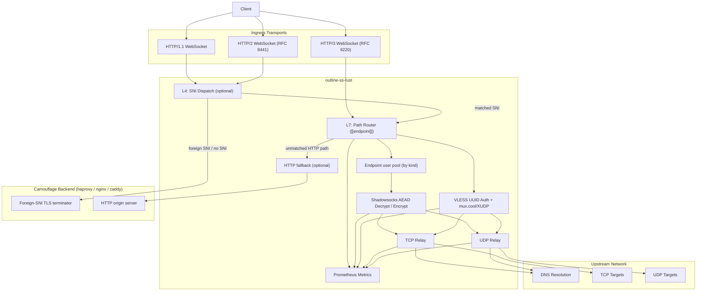
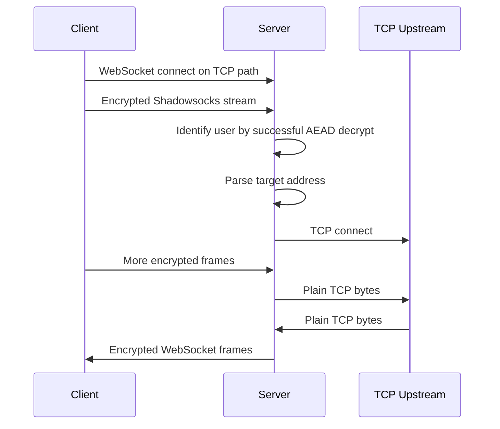
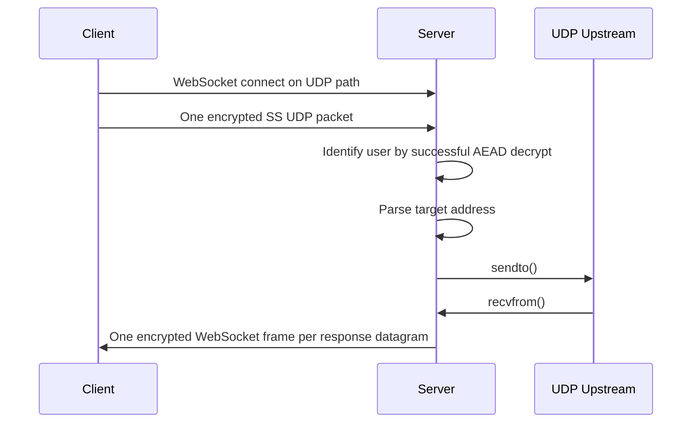
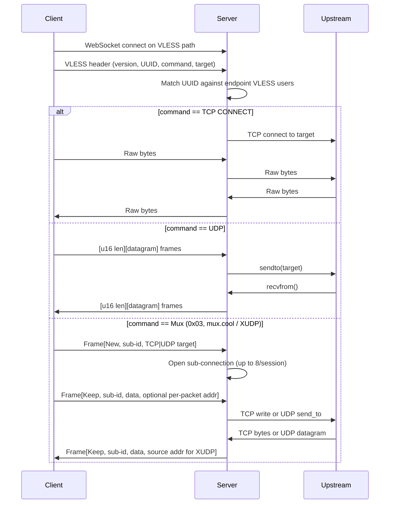

# Architecture

This document describes the runtime architecture of `outline-ss-rust`: which listeners the server opens, how a request is routed to a user and a relay, and how traffic reaches the upstream network. It is written for operators and for developers changing the server data plane.

*Русская версия: [ARCHITECTURE.ru.md](ARCHITECTURE.ru.md)*

## Component diagram

## Listeners

| Listener | TOML key | CLI flag | Serves |
|---|---|---|---|
| Main TCP | `[server] listen` | `--listen` | HTTP/1.1 and HTTP/2 (ALPN): WebSocket and XHTTP endpoints, `/` auth-root, HTTP fallback. TLS is on when a cert is configured (`[server] cert_path`/`key_path`, `[[server.certs]]`, `--tls-cert-path`/`--tls-key-path`) |
| QUIC | `[server.h3] listen` | `--h3-listen` | HTTP/3: WebSocket over RFC 9220, XHTTP, optional HTTP fallback (`apply_to_h3`) |
| Metrics | `[metrics] listen`, `[metrics] path` | `--metrics-listen`, `--metrics-path` | Prometheus scrape endpoint, plain HTTP |
| Control | `[control] listen` | `--control-listen` | Control API (`/control/*`), bearer token from `[control] token` / `token_file` |
| Cluster mesh | `[cluster] mesh_listen` | — | QUIC mesh between cluster peers, see [`CLUSTER.md`](../../../docs/CLUSTER.md) |

The metrics and control listeners are separate sockets, so scrapes and control calls never go through the public WebSocket ingress path. Bind them to loopback or a private network.

## Camouflage layers

Three independent sections change how the public listener answers traffic that is not a valid proxy session. Two are fallbacks for the unmatched surface (L4 SNI dispatch, L7 HTTP fallback); the third, carrier padding, changes the wire shape of the matched proxy carriers. All three are off by default.

### L4: SNI dispatch (`[sni_fallback]`)

Active only when the main TCP listener terminates TLS; config validation rejects `[sni_fallback]` without TLS. Before `tokio_rustls::TlsAcceptor::accept` runs, every incoming stream is peeked with a throw-away `rustls::server::Acceptor`:

1. Read into a buffer until the Acceptor delivers a parsed ClientHello. If `max_client_hello_bytes` (default 8192) is exceeded, the connection is treated as a malformed handshake and closed locally, so it never reaches the backend logs.
2. The buffered bytes are kept verbatim and never re-read from the wire.
3. The peeked SNI is resolved against the `SniLookup` table, built once at startup from the config. The table has three layers, consulted in order:
   - exact-match `HashMap<String, SniRoute>`: every `Exact` entry from the section-level `match_sni` and from each backend's `match_sni`;
   - wildcard `Vec<(SniMatcher, SniRoute)>`: every `Wildcard { suffix }` entry, local entries first, then backends in declaration order;
   - `catch_all: Option<usize>`: index of the backend without `match_sni`.

   Lookup is exact → wildcard scan → catch-all. The exact lookup is one hash probe; the wildcard scan is linear and runs only on a miss. Local entries are inserted before backend entries, so an SNI claimed by both lists resolves to `Local`; among backends, declaration order wins. An exact entry anywhere in the config beats any wildcard regardless of declaration order, so "the wildcard apex stays local, this one host goes to a backend" needs one exact entry, not a particular ordering. A connection without SNI is spliced to the backend unless `allow_no_sni = true`.
4. If the route resolves to `Local`, the captured bytes are replayed into the local TLS terminator through a `PrependStream` wrapper that drains the prefix on `poll_read` before reading the socket. The handshake then continues normally and the dispatcher hands off to L7.
5. If the route resolves to `Backend(idx)`, the dispatcher splices to `config.backends[idx]`. Two config modes are supported:
   - Single backend (`backend = "host:port"` at section level): the only backend is implicitly a catch-all, so every foreign SNI lands on it.
   - Multiple backends (`[[sni_fallback.backends]]` array): each entry has its own `backend`, an optional `match_sni` list and an optional `proxy_protocol`. An entry with no (or empty) `match_sni` is the catch-all and must be the last entry; a connection that matches no backend is dropped. Use this to route different domains to different upstreams (for example nginx on `:8443` for one domain, caddy on `:9443` for another) without a separate haproxy in front.

   In both modes a new TCP connection is opened to the selected upstream, an optional HAProxy PROXY-protocol v1/v2 header is prepended, the captured ClientHello is written, and `tokio::io::copy_bidirectional` runs until either side closes.

The HTTP/3 listener does not go through SNI dispatch: quinn parses SNI before our code sees the connection, and routing it would need a separate layer.

### L7: HTTP fallback (`[http_fallback]`)

Applies to every HTTP request on a fallback-enabled listener that matches neither a configured WebSocket / XHTTP endpoint nor the `/` auth-root. Instead of returning `404`, the fallback adapter reverse-proxies the request to `backend` (`http://host:port`):

- Hop-by-hop headers (RFC 7230 §6.1 plus anything listed in `Connection:`) are stripped in both directions.
- `Host` is rewritten to the backend authority (same as nginx `proxy_set_header Host $proxy_host;`).
- The URI is rebuilt in origin-form so the backend parses it as a normal request, not a proxy CONNECT.
- `X-Forwarded-For`, `X-Forwarded-Proto` and `X-Forwarded-Host` are appended/set by `add_x_forwarded_for`, `add_x_forwarded_proto` and `add_x_forwarded_host` (all default `true`). On the TCP path `X-Forwarded-Proto` reflects whether the inbound listener terminated TLS; the HTTP/3 path always reports `https`.
- `proxy_protocol = "v1" | "v2"` prepends a HAProxy PROXY-protocol header to the upstream TCP connection so the backend logs the real client IP. Default: off.
- `backend_proto = "h1" | "h2"` selects the HTTP version used towards the upstream, independent of the inbound version. `"h1"` (default) uses `hyper::client::conn::http1`; `"h2"` uses `hyper::client::conn::http2` in prior-knowledge mode (h2c, no ALPN), for gRPC gateways or nginx upstreams configured for h2c.
- `request_timeout_secs` bounds connect plus response per request. Default: 30.

Two toggles select the inbound listeners the fallback applies to (at least one must be `true`):

| Key | Default | Listener | Behaviour |
|---|---|---|---|
| `apply_to_h1` | `true` | Main TCP (HTTP/1.1 and HTTP/2 via ALPN) | The adapter is the axum router fallback handler in place of `404` |
| `apply_to_h3` | `false` | QUIC (HTTP/3), requires `[server.h3]` | `server::h3::http::handle_h3_request` calls the adapter for every non-CONNECT request that matches neither an XHTTP base path nor the `/` auth-root |

On both paths the auth-root (`[http_root] auth = true` for `/`) has priority over the fallback. On HTTP/3 the request body is buffered before forwarding, the response body is streamed back chunk by chunk over QUIC, and trailers are forwarded in both directions when `backend_proto` carries them. `apply_to_h3` defaults to `false` so that upgrading the binary does not start forwarding QUIC traffic to a backend that was set up for TCP only.

PROXY-protocol headers on the upstream TCP socket carry `Transport=STREAM` (`0x11` / `0x21`) for h1/h2 inbound and `Transport=DGRAM` (`0x12` / `0x22`) for h3 inbound, so the backend can tell the origin transport. v1 has no UDP form, so `proxy_protocol = "v1"` is rejected at config load when `apply_to_h3 = true`; use `"v2"` or disable PROXY-protocol.

Both fallbacks use `transport::proxy_protocol::encode_proxy_protocol`, so the v1/v2 wire form is identical between L4 splices and L7 connects. The destination address is the inbound listener's bind address (TCP listener for `apply_to_h1`, h3 listener for `apply_to_h3`), degrading to UNKNOWN (v1) / UNSPEC (v2) when bound to `0.0.0.0` / `[::]`.

### Wire shape: carrier padding (`[padding]`)

The two fallbacks handle the unmatched surface of the listener; carrier padding changes the matched carriers. Each Shadowsocks chunk or VLESS frame on a padded WS / XHTTP path is wrapped in a `real_len | pad_len | real | pad` frame (codec in `crates/outline-wire/src/padding.rs`) before it reaches the outer TLS record layer. The encrypted record size then no longer follows the proxied payload size, which is the correlation TLS-in-TLS classifiers key on.

- SS-TCP relay: decodes inbound frames before the AEAD layer (`handle_tcp_binary_frame`) and frames the downlink in `ChannelSink`.
- SS-UDP relay (`run_udp_relay`) and VLESS relay (`run_vless_relay`): decode each inbound message before parsing and pass each downlink message through `frame_downlink_message`.

Padding is enabled per endpoint (`[[endpoint]] padded = true`) and must match the client config: there is no capability bit on the wire. Pad sizes and optional idle cover traffic are set in `[padding]` (`min_bytes`, `max_bytes`, `cover`, `cover_jitter_min_ms`, `cover_jitter_max_ms`). Padding works at the `Message` layer shared by all WS / XHTTP carriers, so it applies to SS and VLESS over WS (h1/h2/h3) and over XHTTP. UDP is padded per datagram on every WS carrier: SS-UDP (split: set `padded = true` on the UDP endpoint; combined: on the shared endpoint) and VLESS-UDP. Full reference: [`../../../docs/PADDING.md`](../../../docs/PADDING.md).

## Request routing

Paths come from the `[[endpoint]]` list. Each entry has a `path`, a `kind` and an optional `padded` flag; every endpoint must use a distinct path, otherwise config load fails.

| `kind` | Carrier | Protocol |
|---|---|---|
| `ws_ss` | WebSocket | Shadowsocks, TCP and UDP on one path (combined) |
| `ws_ss_tcp` / `ws_ss_udp` | WebSocket | Shadowsocks, separate TCP and UDP paths (split) |
| `ws_vless` | WebSocket | VLESS |
| `xhttp_ss` | XHTTP | Shadowsocks, combined |
| `xhttp_ss_tcp` / `xhttp_ss_udp` | XHTTP | Shadowsocks, split |
| `xhttp_vless` | XHTTP | VLESS |

The HTTP version (h1/h2/h3) is chosen by the listener, not by the endpoint.

Users (`[[users]]`) are credentials and are not bound to paths. The route for a Shadowsocks endpoint holds the pool of all Shadowsocks users; the route for a VLESS endpoint holds all VLESS users (entries with `vless_id`). The route table is built in `server/endpoint_routes.rs` at startup and rebuilt when the control API changes users.

At request time:

1. The request path is matched against the registered endpoint routes.
2. The route's user pool for that endpoint kind becomes the candidate set.
3. Shadowsocks decryption or VLESS UUID matching tries only those candidates.

Users that share a path are told apart by key: each user may have its own password and its own cipher (`method`).

## User identification

There is no username inside the Shadowsocks payload. The server identifies the user by successfully decrypting:

- the first valid TCP stream chunk, or
- the first valid UDP packet.

Users may have different ciphers, so the decryptor iterates over the candidate set and tries each user's own cipher.

To skip the O(N) AEAD probe when the same client reconnects, each Shadowsocks route owns a bounded LRU `peer_addr -> user_index` (`PeerUserCache`, capacity `TCP_PEER_USER_CACHE_CAPACITY` = 4096). The cache is filled only after a successful AEAD verification, so a spoofed source address cannot redirect another peer's hint. A stale hint (cipher mismatch, user removed, list reordered) is corrected by the next full scan. The TLS path injects `ConnectInfo<SocketAddr>` per accepted connection so the upgrade handler keys the same cache.

## TCP data path

Behaviour:

- WebSocket message boundaries are ignored for TCP.
- The server buffers decrypted bytes until a full target address is available.
- Once the target is known, the relay copies bytes in both directions.
- The user's `fwmark`, if set, is applied before the outbound TCP connect.

## UDP data path

Behaviour:

- Each WebSocket binary frame must contain exactly one Shadowsocks UDP packet.
- Each upstream UDP response becomes its own encrypted WebSocket binary frame.
- The user's `fwmark`, if set, is applied to the outbound UDP socket.
- Shadowsocks-2022 UDP traffic passes a sliding-window anti-replay filter keyed on the per-session `client_session_id`; duplicate `packet_id`s are dropped before the relay step, and idle sessions are reaped on the same cadence as NAT-entry eviction.

## VLESS data path

An `[[endpoint]]` with `kind = "ws_vless"` accepts VLESS streams on the main HTTP/1.1 or HTTP/2 listener, and on the HTTP/3 listener when `[server.h3] listen` is set. VLESS authentication is stateless UUID matching against every enabled VLESS user (any `[[users]]` entry with a `vless_id`). The VLESS layer adds no encryption, so a public deployment needs TLS on the main listener or the HTTP/3 listener.

Behaviour:

- UUID lookup is linear over the endpoint's VLESS user pool; an unknown UUID is rejected and logged.
- For `COMMAND_UDP`, each client frame is length-prefixed (`u16` BE); each upstream response is framed the same way.
- For `COMMAND_MUX` (mux.cool / XUDP), one VLESS stream multiplexes up to 8 concurrent sub-connections (`MAX_MUX_SUB_CONNS`), each with its own session id. Sub-connections can be TCP or UDP; UDP Keep frames carry a per-packet destination (XUDP), and replies are tagged with the upstream source address.
- The XUDP `GlobalID` on New frames is parsed and logged, but UDP sessions are not reused across WebSocket reconnects.
- The user's `fwmark` is applied to both TCP connects and UDP sockets opened for a VLESS session.

## Transport requirements

### HTTP/1.1

Standard WebSocket upgrade; `ws://` or `wss://`.

### HTTP/2

RFC 8441 Extended CONNECT. Requires:

- a client that implements WebSocket over HTTP/2;
- any reverse proxy in front of the server to pass Extended CONNECT through instead of downgrading to HTTP/1.1.

### HTTP/3

RFC 9220 Extended CONNECT over QUIC. Requires:

- a TLS certificate for the QUIC listener (`[server.h3]` cert or one inherited from `[server]`);
- UDP reachability of `[server.h3] listen`;
- an HTTP/3-capable client.

This path depends on patched vendored crates. See [PATCHES.md](../../../PATCHES.md) ([Русский](../../../PATCHES.ru.md)).

## Metric labels

Labels are kept low-cardinality:

| Label | Values |
|---|---|
| `transport` | `tcp`, `udp` |
| `protocol` | `http1`, `http2`, `http3`, `xhttp_h1`, `xhttp_h2`, `xhttp_h3`, `socket` [verify: no current code path constructs `Protocol::Socket`; it is only matched in `nat/reader.rs`] |
| `app_protocol` | `shadowsocks`, `vless` |
| `user` | user id (or IP alias from `[users.aliases]`) |
| `result` | `success`, `error` (for example `outline_ss_tcp_upstream_connects_total`, `outline_ss_udp_requests_total`) |
| `direction` | traffic direction for byte counters |

There are no labels for target hostname, target IP or per-connection id. Adding one would make the series count grow with the number of distinct targets or connections.

## Failure domains

The data plane has four layers:

1. Ingress transport: HTTP/1.1, HTTP/2, HTTP/3, TLS, QUIC.
2. User identification and decryption: endpoint user pool and AEAD session setup.
3. Relay: TCP connect or UDP send/receive.
4. Egress routing: DNS, outbound reachability, optional `fwmark`.

During incident response:

- handshake failures belong to the ingress layer;
- authentication mismatches belong to the decryption layer;
- connection failures belong to the relay or egress layer;
- throughput and latency are visible in Prometheus and Grafana.

## Security boundaries

- TLS for HTTP/1.1 and HTTP/2 is terminated in-process when the main listener has a certificate.
- QUIC for HTTP/3 is terminated in-process when `[server.h3]` is configured.
- Users are separated by independent secrets (password or `vless_id`) and optionally by cipher (`method`). Paths do not separate users: every user works on every endpoint of its kind.
- Outbound policy can be separated per user with `fwmark`.

## Production setup

1. Configure a TLS certificate on the main listener if clients connect with `wss://` directly.
2. Bind `[metrics] listen` and `[control] listen` to loopback or a private network.
3. Use per-user cipher overrides (`method`) only for compatibility or migration.
4. On public deployments enable the camouflage layers: `[sni_fallback]` splices foreign SNIs to a real TLS frontend (for example a default haproxy / nginx server block), `[http_fallback]` reverse-proxies unmatched HTTP paths to a regular origin. Without them a probe gets a `404` or a failed TLS handshake from the listener. Set `proxy_protocol` on `[sni_fallback]`; without it the backend logs the server's address instead of the client IP.
