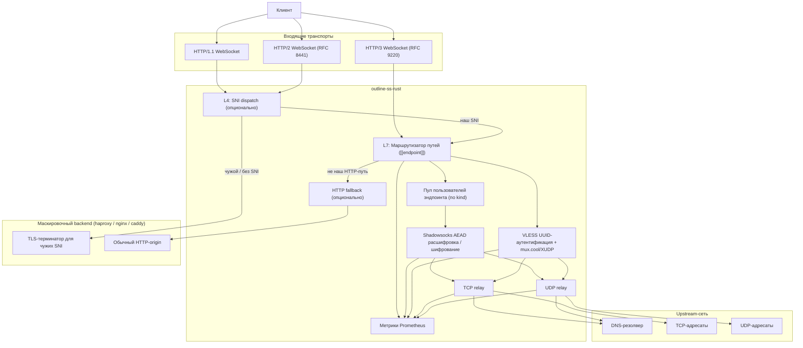
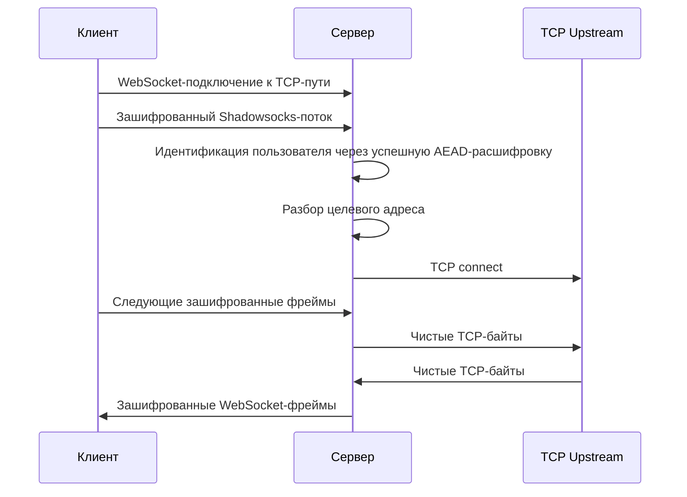
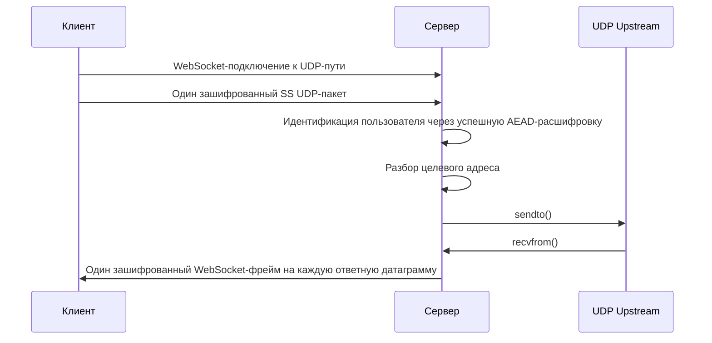
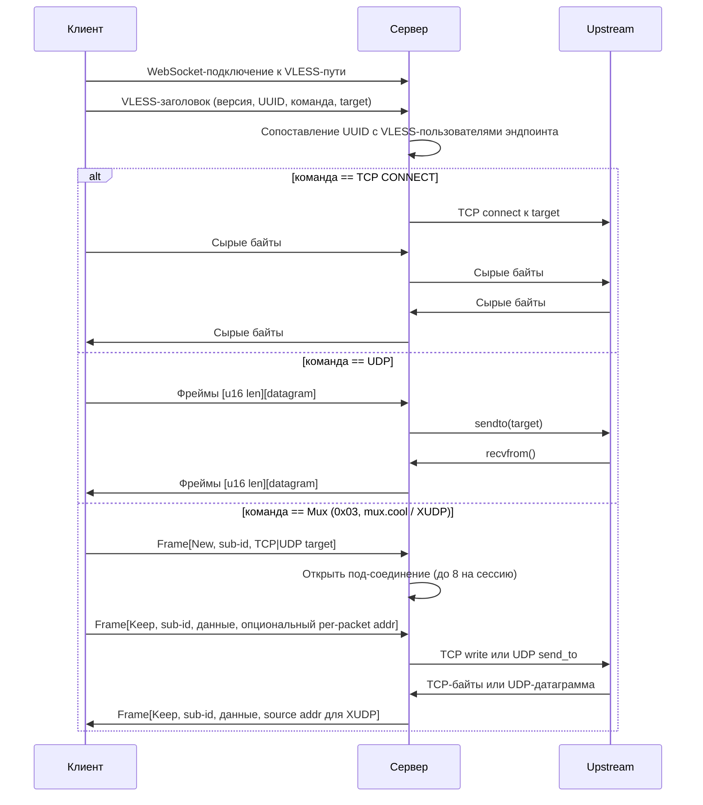

# Архитектура

Документ описывает архитектуру времени выполнения `outline-ss-rust`: какие слушатели открывает сервер, как запрос сопоставляется с пользователем и relay и как трафик уходит в upstream-сеть. Документ для операторов и для разработчиков, меняющих серверный data plane.

*English version: [ARCHITECTURE.md](ARCHITECTURE.md)*

## Схема компонентов

## Слушатели

| Слушатель | Ключ TOML | Флаг CLI | Что обслуживает |
|---|---|---|---|
| Основной TCP | `[server] listen` | `--listen` | HTTP/1.1 и HTTP/2 (ALPN): WebSocket- и XHTTP-эндпоинты, auth-root `/`, HTTP fallback. TLS включается, если задан сертификат (`[server] cert_path`/`key_path`, `[[server.certs]]`, `--tls-cert-path`/`--tls-key-path`) |
| QUIC | `[server.h3] listen` | `--h3-listen` | HTTP/3: WebSocket по RFC 9220, XHTTP, опционально HTTP fallback (`apply_to_h3`) |
| Метрики | `[metrics] listen`, `[metrics] path` | `--metrics-listen`, `--metrics-path` | Эндпоинт для скрейпа Prometheus, plain HTTP |
| Control | `[control] listen` | `--control-listen` | Control API (`/control/*`), bearer-токен из `[control] token` / `token_file` |
| Mesh кластера | `[cluster] mesh_listen` | — | QUIC-mesh между узлами кластера, см. [`CLUSTER.ru.md`](../../../docs/CLUSTER.ru.md) |

Слушатели метрик и control — отдельные сокеты: скрейпы и вызовы control API не проходят через публичный WebSocket-ingress. Привязывайте их к loopback или приватной сети.

## Слои маскировки

Три независимые секции меняют то, как публичный слушатель отвечает на трафик, не являющийся корректной прокси-сессией. Две из них — fallback для неподходящей под маршруты поверхности (L4 SNI dispatch, L7 HTTP fallback); третья, carrier-padding, меняет форму на проводе у подходящих прокси-носителей. Все три по умолчанию выключены.

### L4: SNI dispatch (`[sni_fallback]`)

Работает только когда основной TCP-слушатель терминирует TLS; без TLS валидация конфига отвергает `[sni_fallback]`. До вызова `tokio_rustls::TlsAcceptor::accept` каждый принятый стрим подсматривается одноразовым `rustls::server::Acceptor`:

1. Байты читаются в буфер, пока Acceptor не отдаст распарсенный ClientHello. Если превышен `max_client_hello_bytes` (по умолчанию 8192), соединение считается некорректным handshake и закрывается локально, в логи бэкенда оно не попадает.
2. Захваченные байты сохраняются дословно и повторно с провода не читаются.
3. Подсмотренный SNI ищется в таблице `SniLookup`, которая строится один раз при старте из конфига. У таблицы три слоя, опрашиваются по порядку:
   - exact-`HashMap<String, SniRoute>`: каждая `Exact`-запись из `match_sni` секции и из `match_sni` каждого бэкенда;
   - wildcard-`Vec<(SniMatcher, SniRoute)>`: каждая `Wildcard { suffix }`-запись, сначала локальные, потом бэкенды в порядке объявления;
   - `catch_all: Option<usize>`: индекс бэкенда без `match_sni`.

   Порядок поиска: exact → wildcard-скан → catch-all. Exact-поиск — одна проверка по хешу; wildcard-скан линейный и запускается только при промахе. Локальные записи вставляются раньше бэкендовых, поэтому SNI, заявленный в обоих списках, уходит в `Local`; среди бэкендов выигрывает порядок объявления. Exact-запись в любом месте конфига побеждает любой wildcard независимо от порядка объявления, поэтому для схемы «wildcard на апекс остаётся локально, один хост уходит на бэкенд» достаточно одной exact-записи. Соединение без SNI сплайсится на бэкенд, если не задан `allow_no_sni = true`.
4. Если маршрут — `Local`, захваченные байты воспроизводятся в локальный TLS-терминатор через обёртку `PrependStream`: на `poll_read` она сначала отдаёт префикс, потом читает сокет. Handshake продолжается обычным путём, и диспатчер передаёт соединение на L7.
5. Если маршрут — `Backend(idx)`, диспатчер сплайсит соединение на `config.backends[idx]`. Режимов конфигурации два:
   - Один бэкенд (`backend = "host:port"` на уровне секции): единственный бэкенд неявно catch-all, все чужие SNI идут к нему.
   - Несколько бэкендов (массив `[[sni_fallback.backends]]`): у каждой записи свой `backend`, опциональный список `match_sni` и опциональный `proxy_protocol`. Запись без `match_sni` (или с пустым списком) — catch-all и должна стоять последней; соединение, не подошедшее ни к одному бэкенду, сбрасывается. Так разные домены уходят к разным upstream (например, nginx на `:8443` для одного домена, caddy на `:9443` для другого) без отдельного haproxy впереди.

   В обоих режимах открывается новое TCP-соединение к выбранному upstream, при необходимости префиксится заголовок HAProxy PROXY-protocol v1/v2, дописывается захваченный ClientHello и запускается `tokio::io::copy_bidirectional` до закрытия одной из сторон.

HTTP/3-слушатель через SNI dispatch не проходит: quinn разбирает SNI раньше, чем наш код видит соединение, и маршрутизация по нему потребовала бы отдельного слоя.

### L7: HTTP fallback (`[http_fallback]`)

Применяется к каждому HTTP-запросу на слушателе с включённым fallback, который не попал ни в сконфигурированный WebSocket- / XHTTP-эндпоинт, ни в auth-root `/`. Вместо `404` fallback-адаптер проксирует запрос в `backend` (`http://host:port`):

- Hop-by-hop заголовки (RFC 7230 §6.1 и всё, что перечислено в `Connection:`) срезаются в обе стороны.
- `Host` заменяется на authority бэкенда (как nginx `proxy_set_header Host $proxy_host;`).
- URI пересобирается в origin-form, чтобы бэкенд разбирал его как обычный запрос, а не как proxy CONNECT.
- `X-Forwarded-For`, `X-Forwarded-Proto` и `X-Forwarded-Host` добавляются/выставляются тумблерами `add_x_forwarded_for`, `add_x_forwarded_proto` и `add_x_forwarded_host` (все по умолчанию `true`). На TCP-пути `X-Forwarded-Proto` отражает, терминировал ли входящий слушатель TLS; HTTP/3-путь всегда отдаёт `https`.
- `proxy_protocol = "v1" | "v2"` префиксит заголовок HAProxy PROXY-protocol к upstream TCP-соединению, чтобы бэкенд логировал реальный IP клиента. По умолчанию выключено.
- `backend_proto = "h1" | "h2"` выбирает HTTP-версию в сторону upstream независимо от входящей версии. `"h1"` (по умолчанию) использует `hyper::client::conn::http1`; `"h2"` — `hyper::client::conn::http2` в режиме prior-knowledge (h2c, без ALPN), для gRPC-gateway или nginx-upstream, настроенных на h2c.
- `request_timeout_secs` ограничивает подключение и ответ на один запрос. По умолчанию 30.

Два тумблера выбирают входящие слушатели, к которым применяется fallback (хотя бы один должен быть `true`):

| Ключ | По умолчанию | Слушатель | Поведение |
|---|---|---|---|
| `apply_to_h1` | `true` | Основной TCP (HTTP/1.1 и HTTP/2 по ALPN) | Адаптер стоит fallback-обработчиком axum-роутера вместо `404` |
| `apply_to_h3` | `false` | QUIC (HTTP/3), нужен `[server.h3]` | `server::h3::http::handle_h3_request` вызывает адаптер для каждого не-CONNECT запроса, который не попал ни в базовый путь XHTTP, ни в auth-root `/` |

На обоих путях auth-root (`[http_root] auth = true` для `/`) имеет приоритет над fallback. На HTTP/3 тело запроса буферизуется до отправки, тело ответа стримится обратно через QUIC по частям, трейлеры пробрасываются в обе стороны, если их поддерживает выбранный `backend_proto`. `apply_to_h3` по умолчанию `false`, чтобы обновление бинаря не начало отправлять QUIC-трафик на бэкенд, настроенный только под TCP.

Заголовки PROXY-protocol в upstream TCP-сокете несут `Transport=STREAM` (`0x11` / `0x21`) для входящих h1/h2 и `Transport=DGRAM` (`0x12` / `0x22`) для входящего h3 — по ним бэкенд различает исходный транспорт. У v1 нет UDP-формы, поэтому `proxy_protocol = "v1"` при `apply_to_h3 = true` отвергается при загрузке конфига; используйте `"v2"` или отключите PROXY-protocol.

Оба fallback используют `transport::proxy_protocol::encode_proxy_protocol`, поэтому wire-форма v1/v2 одинакова у L4-сплайсов и L7-подключений. Адрес назначения — bind-адрес входящего слушателя (TCP для `apply_to_h1`, h3 для `apply_to_h3`); при bind на `0.0.0.0` / `[::]` он заменяется на UNKNOWN (v1) / UNSPEC (v2).

### Форма на проводе: carrier-padding (`[padding]`)

Два fallback работают с неподходящей поверхностью слушателя; carrier-padding меняет сами подходящие носители. Каждый Shadowsocks-чанк или VLESS-кадр на padded WS- / XHTTP-пути оборачивается в кадр `real_len | pad_len | real | pad` (кодек в `crates/outline-wire/src/padding.rs`) до попадания во внешний TLS-record. Размер зашифрованной записи после этого не повторяет размер проксируемого payload — а именно по этой корреляции работают классификаторы TLS-in-TLS.

- SS-TCP relay: декодирует входящие кадры до AEAD-слоя (`handle_tcp_binary_frame`) и оборачивает downlink в `ChannelSink`.
- SS-UDP relay (`run_udp_relay`) и VLESS relay (`run_vless_relay`): декодируют каждое входящее сообщение до разбора и пропускают каждое downlink-сообщение через `frame_downlink_message`.

Padding включается на эндпоинте (`[[endpoint]] padded = true`) и должен совпадать с конфигом клиента: бита возможности на проводе нет. Размеры паддинга и опциональный idle cover-трафик задаются в `[padding]` (`min_bytes`, `max_bytes`, `cover`, `cover_jitter_min_ms`, `cover_jitter_max_ms`). Padding работает на уровне `Message`, общем для всех носителей WS / XHTTP, поэтому действует для SS и VLESS поверх WS (h1/h2/h3) и поверх XHTTP. UDP паддится по датаграмме на любом WS-носителе: SS-UDP (split — `padded = true` на UDP-эндпоинте; combined — на общем эндпоинте) и VLESS-UDP. Полный справочник: [`../../../docs/PADDING.md`](../../../docs/PADDING.md).

## Маршрутизация запросов

Пути берутся из списка `[[endpoint]]`. У каждой записи есть `path`, `kind` и опциональный флаг `padded`; пути всех эндпоинтов должны различаться, иначе конфиг не загрузится.

| `kind` | Носитель | Протокол |
|---|---|---|
| `ws_ss` | WebSocket | Shadowsocks, TCP и UDP на одном пути (combined) |
| `ws_ss_tcp` / `ws_ss_udp` | WebSocket | Shadowsocks, отдельные пути TCP и UDP (split) |
| `ws_vless` | WebSocket | VLESS |
| `xhttp_ss` | XHTTP | Shadowsocks, combined |
| `xhttp_ss_tcp` / `xhttp_ss_udp` | XHTTP | Shadowsocks, split |
| `xhttp_vless` | XHTTP | VLESS |

Версию HTTP (h1/h2/h3) выбирает слушатель, а не эндпоинт.

Пользователи (`[[users]]`) — это учётные данные, к путям они не привязаны. Маршрут Shadowsocks-эндпоинта содержит пул всех Shadowsocks-пользователей, маршрут VLESS-эндпоинта — всех VLESS-пользователей (записи с `vless_id`). Таблица маршрутов строится в `server/endpoint_routes.rs` при старте и перестраивается, когда control API меняет пользователей.

В момент поступления запроса:

1. Путь запроса сопоставляется с зарегистрированными маршрутами эндпоинтов.
2. Пул пользователей маршрута для этого `kind` становится набором кандидатов.
3. Расшифровка Shadowsocks или сопоставление VLESS UUID перебирает только этих кандидатов.

Пользователи на одном пути различаются ключом: у каждого может быть свой пароль и свой шифр (`method`).

## Идентификация пользователя

Внутри полезной нагрузки Shadowsocks нет имени пользователя. Сервер определяет пользователя по успешной расшифровке:

- первого корректного фрагмента TCP-потока или
- первого корректного UDP-пакета.

У пользователей могут быть разные шифры, поэтому дешифратор перебирает набор кандидатов и для каждого пробует его шифр.

Чтобы не повторять O(N) AEAD-перебор при переподключении того же клиента, у каждого Shadowsocks-маршрута есть ограниченный LRU `peer_addr -> user_index` (`PeerUserCache`, ёмкость `TCP_PEER_USER_CACHE_CAPACITY` = 4096). Кеш заполняется только после успешной AEAD-проверки, поэтому подделка source-адреса не может перенаправить хинт другого клиента. Устаревший хинт (не тот шифр, пользователь удалён, список переставлен) исправляется следующим полным перебором. На TLS-пути в каждое принятое соединение передаётся `ConnectInfo<SocketAddr>`, чтобы upgrade-обработчик использовал тот же ключ кеша.

## Путь данных TCP

Поведение:

- Границы WebSocket-сообщений для TCP игнорируются.
- Сервер буферизует расшифрованные байты, пока не получит полный целевой адрес.
- После определения адреса relay копирует байты в обе стороны.
- `fwmark` пользователя, если задан, применяется до исходящего TCP-подключения.

## Путь данных UDP

Поведение:

- Каждый WebSocket binary frame должен содержать ровно один Shadowsocks UDP-пакет.
- Каждый UDP-ответ upstream становится отдельным зашифрованным WebSocket binary frame.
- `fwmark` пользователя, если задан, применяется к исходящему UDP-сокету.
- UDP-трафик Shadowsocks-2022 проходит скользящий anti-replay фильтр по `client_session_id` сессии: дубликаты `packet_id` отбрасываются до шага relay, а простаивающие сессии вычищаются с той же периодичностью, что и NAT-записи.

## Путь данных VLESS

Эндпоинт `[[endpoint]]` с `kind = "ws_vless"` принимает VLESS-потоки на основном слушателе HTTP/1.1 или HTTP/2, а также на HTTP/3-слушателе, если задан `[server.h3] listen`. Аутентификация VLESS — stateless-сопоставление UUID с каждым включённым VLESS-пользователем (любой записью `[[users]]` с `vless_id`). Слой VLESS шифрования не добавляет, поэтому публичному развёртыванию нужен TLS на основном слушателе или HTTP/3-слушатель.

Поведение:

- Поиск UUID линейный по пулу VLESS-пользователей эндпоинта; неизвестный UUID отклоняется и логируется.
- Для `COMMAND_UDP` каждый клиентский фрейм несёт префикс длины (`u16` BE); ответы upstream упаковываются так же.
- Для `COMMAND_MUX` (mux.cool / XUDP) один VLESS-стрим мультиплексирует до 8 одновременных под-соединений (`MAX_MUX_SUB_CONNS`) со своими session id. Под-соединения бывают TCP и UDP; UDP Keep-фреймы несут адрес получателя на каждый пакет (XUDP), ответы помечаются адресом источника upstream.
- XUDP `GlobalID` в New-фреймах разбирается и логируется, но UDP-сессии между переподключениями WebSocket не переиспользуются.
- `fwmark` пользователя применяется и к TCP-подключениям, и к UDP-сокетам VLESS-сессии.

## Требования транспортов

### HTTP/1.1

Стандартный WebSocket upgrade; `ws://` или `wss://`.

### HTTP/2

RFC 8441 Extended CONNECT. Требования:

- клиент с поддержкой WebSocket поверх HTTP/2;
- обратный прокси перед сервером, если есть, должен пропускать Extended CONNECT, а не понижать соединение до HTTP/1.1.

### HTTP/3

RFC 9220 Extended CONNECT поверх QUIC. Требования:

- TLS-сертификат для QUIC-слушателя (свой в `[server.h3]` или унаследованный из `[server]`);
- UDP-доступность `[server.h3] listen`;
- клиент с поддержкой HTTP/3.

Этот путь зависит от пропатченных vendored-крейтов. Подробности — в [PATCHES.md](../../../PATCHES.md) ([Русский](../../../PATCHES.ru.md)).

## Метки метрик

Кардинальность меток держится низкой:

| Метка | Значения |
|---|---|
| `transport` | `tcp`, `udp` |
| `protocol` | `http1`, `http2`, `http3`, `xhttp_h1`, `xhttp_h2`, `xhttp_h3`, `socket` [проверить: в текущем коде `Protocol::Socket` нигде не создаётся, только сравнивается в `nat/reader.rs`] |
| `app_protocol` | `shadowsocks`, `vless` |
| `user` | id пользователя (или IP-алиас из `[users.aliases]`) |
| `result` | `success`, `error` (например, `outline_ss_tcp_upstream_connects_total`, `outline_ss_udp_requests_total`) |
| `direction` | направление трафика у счётчиков байт |

Меток с именем хоста-адресата, IP адресата и идентификатором соединения нет. Любая из них дала бы число серий, растущее с числом разных адресатов или соединений.

## Границы отказов

В data plane четыре слоя:

1. Ingress-транспорт: HTTP/1.1, HTTP/2, HTTP/3, TLS, QUIC.
2. Идентификация пользователя и расшифровка: пул пользователей эндпоинта и настройка AEAD-сессии.
3. Relay: TCP connect или UDP send/receive.
4. Egress-маршрутизация: DNS, исходящая доступность, опциональный `fwmark`.

При разборе инцидента:

- сбои handshake относятся к ingress-слою;
- несовпадения аутентификации — к слою расшифровки;
- ошибки подключения — к слою relay или egress;
- пропускная способность и задержка видны в Prometheus и Grafana.

## Границы безопасности

- TLS для HTTP/1.1 и HTTP/2 терминируется в процессе, если у основного слушателя есть сертификат.
- QUIC для HTTP/3 терминируется в процессе, если настроен `[server.h3]`.
- Пользователи разделены независимыми секретами (пароль или `vless_id`) и, опционально, шифром (`method`). Пути пользователей не разделяют: каждый пользователь работает на каждом эндпоинте своего `kind`.
- Исходящую политику можно разделить по пользователям через `fwmark`.

## Настройка для продакшена

1. Задайте TLS-сертификат основному слушателю, если клиенты подключаются по `wss://` напрямую.
2. Привяжите `[metrics] listen` и `[control] listen` к loopback или приватной сети.
3. Переопределяйте шифр на пользователя (`method`) только для совместимости или миграции.
4. На публичных развёртываниях включите слои маскировки: `[sni_fallback]` сплайсит чужие SNI на настоящий TLS-фронтенд (например, default server block haproxy / nginx), `[http_fallback]` проксирует неподходящие HTTP-пути на обычный origin. Без них проба получает от слушателя `404` или оборванный TLS handshake. Задайте `proxy_protocol` в `[sni_fallback]`: без него бэкенд логирует адрес сервера вместо IP клиента.
