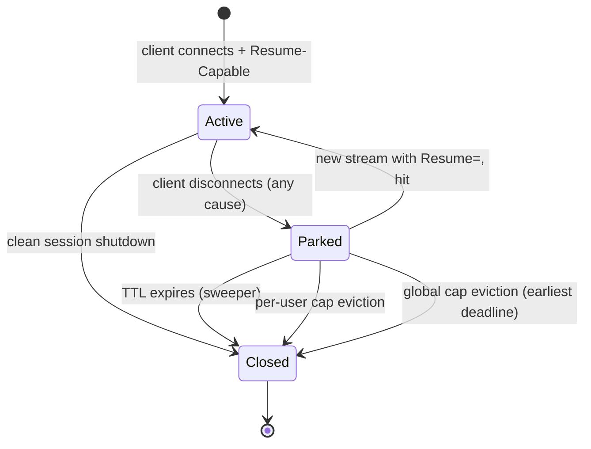

# Session resumption

This document specifies the wire format and runtime semantics of cross-transport session resumption in `outline-ss-rust`: how a session is parked when its carrier closes, how a later connect reattaches to it, and the v1/v2 replay protocols that recover bytes lost with the old carrier. It is written for developers of the `outline-ss-rust` ↔ `outline-ws-rust` pair and for operators enabling `[session_resumption]`.

*Русская версия: [SESSION-RESUMPTION.ru.md](SESSION-RESUMPTION.ru.md)*

## Purpose and scope

Session resumption lets a compatible client move an existing logical session from one ingress transport to another (for example from WebSocket over HTTP/3 to WebSocket over HTTP/2) without re-establishing the upstream connection to the destination host. The use case is a path between client and server where intermittent UDP loss breaks QUIC but TCP still works, or the other way round.

The same mechanism lets the `outline-ws-rust` TUN client survive the death of a shared carrier. Many flows are multiplexed onto one QUIC connection; when it collapses (connection-level `H3_INTERNAL_ERROR`, idle timeout), every flow on it would otherwise be reset. Instead the client redials the same uplink, presents each flow's Session ID and reattaches its parked upstream, so the application sees no disconnect. This consumer needs both protocol halves: v1 (Ack-Prefix) replays the uplink tail, v2 (Symmetric Downlink Replay) replays the downstream bytes the server had already written to the dead carrier. For a download or SSE flow, where the payload travels downstream, a resume without v2 leaves a gap in the server's reply. v2 is off by default on the server (`downlink_buffer_bytes = 0`), so this consumer needs a non-zero `downlink_buffer_bytes`. The TUN client also parks many flows of one user at once, so `orphan_per_user_cap` must be set well above its default of 4 (see [Resource exhaustion](#resource-exhaustion)).

### What is preserved

- The `TcpStream` to the upstream target (TCP relays).
- The upstream `UdpSocket` and its NAT binding (UDP relays).
- Per-user metric counters (keyed by user id).
- For VLESS mux: every sub-connection (TCP and UDP) of the mux, parked as one unit.

### What is not preserved

- Cryptographic state of the inner protocol (Shadowsocks AEAD nonce, VLESS request). Each new transport stream does a full handshake.
- TCP bytes in flight at the moment of the disconnect, unless the client and server negotiated the v1/v2 replay protocols below. Without them nothing is retransmitted at the application layer; the upstream socket's kernel buffer keeps what was already queued.
- UDP datagrams that arrive from the upstream while the session is parked. There is no back-buffer: SS-UDP drops them, VLESS-UDP leaves them in the kernel receive buffer until it overflows (see [UDP behaviour](#udp-behaviour)).
- Sessions across a server restart. The orphan registry is in memory only.

### Compatibility

Session resumption is opt-in on both sides. Clients that do not advertise it get the same behaviour as without the feature. Third-party clients (sing-box, v2ray-core, the official Outline client) are unaffected:

- the negotiation uses `X-Outline-*` headers that other clients do not send and ignore in responses;
- no bytes are added to handshakes that do not negotiate.

The feature is for the `outline-ss-rust` ↔ `outline-ws-rust` pair; it is not a public protocol.

## Identifiers

A Session ID is 16 bytes from a CSPRNG (`ring::rand::SystemRandom`), minted by the server. In a cluster (`[cluster]`) the id also carries the home server's shard, obfuscated under the cluster key so it still looks random on the wire (see [`docs/CLUSTER.md`](../../../docs/CLUSTER.md)). The client treats the id as an opaque byte string and echoes it back on resume.

### Lifetime

| Event | Effect |
|---|---|
| Connect with `X-Outline-Resume-Capable: 1` or `X-Outline-Resume` while resumption is enabled | Server mints a new Session ID and returns it in `X-Outline-Session` |
| Client transport stream closes or fails (any reason) | Server moves the upstream state into the orphan registry under the issued Session ID, with a TTL |
| New stream arrives with `X-Outline-Resume: <id>` | After authentication the server takes the parked state from the registry and attaches it to the new stream |
| TTL expires without resume | The sweeper destroys the parked state (closes upstream sockets) |

A Session ID is owned by exactly one authenticated user. A resume request for a Session ID owned by another user is rejected (see [Security considerations](#security-considerations)).

## Wire format

### WebSocket and XHTTP transports (HTTP/1.1, HTTP/2, HTTP/3)

The negotiation rides on HTTP request and response headers of the WebSocket Upgrade, the Extended CONNECT (h2/h3) or the XHTTP request. Header names are defined in `crates/outline-wire/src/resume.rs`.

#### Request headers

| Header | Format | Meaning |
|---|---|---|
| `X-Outline-Resume-Capable` | `1` | Client wants a Session ID for this session. `outline-ws-rust` sends it on every dial |
| `X-Outline-Resume` | 32 lowercase hex chars | Client asks to resume the parked session with this id |
| `X-Outline-Resume-Ack-Prefix` | `1` | v1 capability, see [Ack-Prefix protocol (v1)](#ack-prefix-protocol-v1) |
| `X-Outline-Resume-Symmetric-Replay` | `1` | v2 capability, see [Symmetric downlink replay (v2)](#symmetric-downlink-replay-v2) |
| `X-Outline-Resume-Down-Acked` | decimal `u64` | v2 downstream offset, sent only on resume requests |

`X-Outline-Resume` should only be sent with a Session ID the client received recently.

#### Response headers

| Header | Format | Meaning |
|---|---|---|
| `X-Outline-Session` | 32 lowercase hex chars | Session ID under which this stream will park on disconnect |
| `X-Outline-Resume-Ack-Prefix` | `1` | Server confirms v1 |
| `X-Outline-Resume-Symmetric-Replay` | `1` | Server confirms v2 |

The response headers are written at upgrade time, before the first data frame authenticates the user. Two consequences:

- `X-Outline-Session` always carries a newly minted id, also on a resume request. After a resume hit the session parks under this new id the next time its carrier closes; the old id is consumed.
- The headers do not report whether the resume hit or missed. There is no `X-Outline-Resume-Result` header. A client that negotiated v1 learns about a hit from the `"ORSM"` control frame, which the server sends only on a hit.

### VLESS Addons

For a carrier without HTTP headers the server also parses resume opcodes in the VLESS request Addons block (`crates/outline-wire/src/vless.rs`). No current client sends them: raw QUIC, the only such carrier, was removed.

| Direction | Tag | Length | Meaning |
|---|---|---|---|
| Request | `0x10` | 1 (`0x01`) | Resume-capable |
| Request | `0x11` | 16 | Session ID to resume |
| Response | `0x10` | 16 | Issued Session ID |
| Response | `0x11` | 1 | Result: `0x00` hit, `0x02` miss-unknown (an owner mismatch is reported as miss-unknown) |

### Negotiation matrix

```
Client sends                Server returns (HTTP headers)      Server action after auth
───────────────────────────────────────────────────────────────────────────────────────
(nothing)                   (nothing)                          Plain session, cannot be resumed
Resume-Capable              Session=<new>                      Fresh session, parks under <new>
Resume-Capable + Resume=X   Session=<new>                      Hit: attach X's upstream, park later under <new>
                                                               Miss: fresh session, parks under <new>
```

When `enabled = false` the server sends none of these headers.

## Server semantics

### Orphan registry

One in-memory registry per server process (`server/resumption/registry.rs`):

```
struct OrphanRegistry {
    by_id:        DashMap<SessionId, ParkedEntry>,       // ParkedEntry = { owner, deadline, parked }
    reservations: DashMap<SessionId, Arc<Notify>>,       // parks in flight
    per_user:     DashMap<Arc<str>, Mutex<Vec<SessionId>>>,
    ...
}
```

A `Parked` value has one of four shapes (`server/resumption/parked.rs`):

```
enum Parked {
    Tcp(ParkedTcp),                       // upstream reader/writer halves, up_acked counter, v2 ring
    VlessUdpSingle(ParkedVlessUdpSingle), // connected UdpSocket + half-decoded length-prefixed frame
    VlessMux(ParkedVlessMux),             // sub-connections by mux id + half-decoded mux frame
    SsUdpStream(ParkedSsUdpStream),       // NAT keys this stream was the responder for
}
```

A periodic task calls `sweep_expired` every 5 seconds (`ORPHAN_SWEEP_INTERVAL_SECS`) and destroys entries whose deadline has passed.

### Park sequence

When a client transport stream closes and a Session ID was issued for it:

1. Reserve the Session ID in `reservations` (see [Park-before-resume barrier](#park-before-resume-barrier)).
2. Drain the in-flight write path to the upstream so no bytes stay in the writer's buffer.
3. Stop forwarding to the closed client side. For TCP this means stopping the task that copies from the upstream reader to the client. For SS-UDP the stream detaches itself from each NAT entry it was the responder for (`detach_session_for_stream`).
4. Build the `Parked` value with the upstream sockets, reader handles and per-user counter handles.
5. If the user already has `orphan_per_user_cap` parked entries, evict the user's oldest entry.
6. If the registry holds `orphan_global_cap` entries, evict the entry with the earliest deadline.
7. Insert into `by_id` with `deadline = now + orphan_ttl_tcp_secs` (TCP) or `orphan_ttl_udp_secs` (UDP and mux shapes), append the id to the user's `per_user` list, and clear the reservation.

#### Close signal per carrier

On WebSocket carriers (h1/h2/h3) the close is visible to the relay: a Close frame, or the death of the TCP/QUIC stream under it, ends the relay's carrier read and the park sequence starts within milliseconds.

XHTTP packet-up has no such signal. The downlink GET and each uplink POST are separate requests; a client that stops POSTing looks the same as one that has gone quiet, and a dropped GET only frees the downlink slot for a reattach. The close is therefore sent as a header: the client's final POST carries `X-Xhttp-Fin`, which closes the session's uplink, so the relay reads EOF and parks. `outline-ws-rust` sends it on an explicit `close()` and on a plain drop of the transport (which is how the TUN data plane tears flows down). A client that is killed, or whose network dies, sends nothing; the session is then removed only by the XHTTP session idle eviction (3 × the relay keepalive interval, 180 s in production), which is too late for a soft switch that needs the park to exist when the redial arrives. The FIN closes the uplink, so it must be the session's last POST; otherwise the rest of the upload is discarded.

#### Park on carrier failure

The park sequence also runs when the carrier failed, not only when it closed cleanly: a receive error on the relay's carrier read (a collapsed H3/QUIC connection, a reset TCP connection, an H2 stream error) must park before the error is reported, the same as a Close frame. The TUN client starts a carrier migration only when its carrier died without a clean close (`!closed_cleanly()`); if the server parked only on clean closes, every migration resume would miss. Regression tests: `ss_resume_hit_after_dirty_carrier_death` and `vless_resume_hit_after_dirty_carrier_death` (`bins/outline-ss-rust/src/server/tests/resumption/`), which reset the carrier with `SO_LINGER = 0` instead of closing it.

#### Park-before-resume barrier

The Session ID is reserved at the start of the park sequence, before the reader is harvested (step 3 awaits the relay task), and the reservation is cleared once the entry is committed or the park is abandoned. Without it, a fast client redial that arrives while its own session is still parking would look the id up before it is in `by_id`, miss, and start a fresh session, losing the mid-stream bytes. With the reservation, a concurrent resume waits up to 5 s (`RESERVATION_WAIT`) for the park to commit or be abandoned. The same reservation covers the cluster edge-switch / failover path, where the redial arrives on an independent network stream.

### Resume sequence

On a new stream that carries `X-Outline-Resume`:

1. Authenticate the stream as usual (Shadowsocks key match or VLESS UUID).
2. Take the id from `by_id`. Outcomes:
   - Not found: if a park for this id is in flight (reserved, not committed), wait up to `RESERVATION_WAIT` for it to commit or be abandoned, then check `by_id` again. If still absent: miss (`unknown`), continue as a fresh session.
   - Owner mismatch (parked under another user): the entry is put back so its owner can still claim it, a `WARN` "resume rejected due to owner mismatch (security event)" is logged, and the miss is counted as `reason="unknown"`. Continue as a fresh session.
   - Expired (deadline passed, sweeper has not run yet): evict, miss (`expired`), continue as a fresh session.
   - Hit: the entry is removed from `by_id` and `per_user`.
3. On a hit, attach the parked state to the new stream's relay:
   - TCP: move the upstream writer/reader halves into the new relay state and start the copy tasks.
   - SS-UDP: for each parked NAT key call `register_session(new_sender, ...)`, which points the NAT entry's sender slot at the new client without rebinding the UDP socket.
   - VLESS-UDP: reuse the connected socket and the half-decoded frame buffer.
   - VLESS mux: start one reader task per parked sub-connection against the new stream.
4. If v1 (and v2) were negotiated, send the control frames before any upstream→client relay bytes (see below).

### TCP behaviour

The upstream `TcpStream` is split into `OwnedReadHalf` / `OwnedWriteHalf`. While parked:

- No task reads the reader half. The kernel receive window back-pressures the upstream peer: the advertised window drops to zero as the kernel buffer fills.
- No task writes the writer half; there is no client traffic.

On resume both halves get new copy tasks against the new client stream.

### Cross-protocol resume

A parked byte-stream (TCP) session can be resumed by a carrier of either proxy protocol: a session parked over Shadowsocks reattaches to a VLESS carrier and the other way round. This holds on all three resume paths: the two direct ones and the cluster mesh splice.

Why it is correct. Nothing in a `Parked::Tcp` belongs to the protocol that created it: the upstream socket halves, the cumulative `up_acked` counter (bytes written to the upstream socket, the same quantity under either protocol) and the v2 downlink ring (filled before encryption) are all plaintext-level. What each protocol owes its client on resume, a VLESS `[VERSION, 0x00]` response header or a fresh Shadowsocks response cipher, is derived from the resuming stream's own authenticated user, never from the park. On the mesh the relay body is application plaintext.

Why it is needed. A client whose uplink rerolls its active wire over a set mixing SS and VLESS wires (`shuffle_wires`) lands on a different protocol than the one that parked in about half of the rerolls, with the same account and the same Session ID: a group with `shared_resume` shares one id across its uplinks, and the id carries no protocol. Refusing these resumes broke session continuity on every such reroll.

Datagram and mux parks do not cross protocols. They hold framing state the other protocol cannot express:

- a VLESS mux park is a map of sub-connections keyed by mux stream id plus a half-decoded mux frame; Shadowsocks has no multiplexing;
- a VLESS-UDP park is one connected socket plus a half-decoded 2-byte-length-prefixed frame; an SS-UDP carrier is many-target and frames each datagram with its own header;
- an SS-UDP park is a set of NAT keys whose responder slots are re-pointed under SS coding; a VLESS-UDP session is single-target.

On the mesh these combinations are also unreachable through the shape probe (an SS OPEN names exactly one shape, a VLESS OPEN admits every shape except the SS datagram), so the refusals there are structural guards, counted as `outline_ss_mesh_relay_rejected_total{reason="protocol_mismatch"}`.

Successful crossings are counted on `outline_ss_orphan_resume_cross_protocol_total{parked,resumed}`, a subset of `outline_ss_orphan_resume_hit_total`, recorded by the node that owns the park.

### UDP behaviour

UDP cannot be back-pressured. While the client is gone:

- SS-UDP: the stream has detached from its NAT entries, so datagrams that the NAT reader receives from the upstream are dropped. The NAT entries keep ageing normally and can expire before the resume.
- VLESS-UDP (single target) and UDP sub-connections of a VLESS mux: no task reads the socket; datagrams stay in the kernel receive buffer, and further ones are dropped by the kernel once it is full.
- The park must not depend on the old carrier draining. A VLESS-UDP downlink pump blocked on a full stream sees the park signal, a stream that is already closed at park time still parks the socket, and the wait for the pump is bounded (`PARK_HARVEST_WAIT`, 2 s). An SS-UDP NAT reader on `xhttp_h3` does not wait on the sender of a carrier the session has moved away from: on the slot change it drops the one in-flight datagram and delivers the following ones to the new carrier.

### VLESS mux

VLESS mux carries several sub-connections (TCP and UDP) over one carrier stream. On disconnect:

- The mux is parked as one unit (`Parked::VlessMux`); individual sub-connections are not parked separately.
- Each TCP sub-connection is parked like a TCP relay (idle reader/writer halves).
- Each UDP sub-connection keeps its socket; no task reads it.
- `orphan_per_user_cap` counts the mux as one session.
- Resume restores the whole mux; partial resume is not supported. Parking and reattaching single sub-connections would need a Session ID → sub-connection mapping on both sides, and the client would have to keep per-sub-connection state.

## Client semantics

`outline-ws-rust` (`crates/outline-transport/src/resumption.rs`):

1. Sends `X-Outline-Resume-Capable: 1` on every dial and stores the `X-Outline-Session` value from the response in a resume cache.
2. When a carrier closes or fails mid-session, opens a new transport, possibly of a different kind, and sends the cached id in `X-Outline-Resume`.
3. If v1 was negotiated and the `"ORSM"` frame arrives, the resume hit: the client replays the uplink tail and the upper layer does not see the disconnect.
4. On a miss the new session is fresh and the upper layer is notified that the previous session is gone.

The SOCKS mid-session retry path bounds the number of redials per session with `tcp_mid_session_retry_budget` (default 1).

## Ack-Prefix protocol (v1)

Base resumption parks the upstream `TcpStream` and reattaches it on a later connect with `X-Outline-Resume`. Bytes the client sent in WebSocket frames that never reached the server before the client–server connection died are not retransmitted: the client cannot tell which of its bytes were forwarded upstream and which were lost, so a plain replay would duplicate bytes.

The Ack-Prefix protocol closes this gap for the upstream direction: on every resume hit the server reports the exact byte count it has forwarded upstream, and the client replays only the bytes after that offset.

### v1 capability negotiation

The protocol is active only if both sides advertise it. If either side does not, the session falls back to base resume semantics (no replay; the client must accept a session-level disconnect).

| Side | Header | Format | Meaning |
|---|---|---|---|
| Client request | `X-Outline-Resume-Ack-Prefix` | `1` | Client will parse the control frame on resume hits |
| Server response | `X-Outline-Resume-Ack-Prefix` | `1` | Server will emit the control frame on resume hits |

The capability is independent of `Resume-Capable` / `Resume`. A client that wants the protocol advertises it on every connect, including the first connect of a session, so the server confirms support before the first park/resume cycle. The server echoes it only when resumption is enabled.

### v1 control frame

The server sends one SS-WS or VLESS-WS data frame before any upstream→client relay bytes on a resumed session when all of the following hold:

1. The connect is a resume request (`X-Outline-Resume: <id>`).
2. The orphan take succeeded (hit).
3. The owner check passed.
4. The client sent `X-Outline-Resume-Ack-Prefix: 1`.
5. The server echoed `X-Outline-Resume-Ack-Prefix: 1`.

The plaintext payload is exactly 14 bytes:

```
+0  : magic        "ORSM"           4 bytes  ASCII
+4  : version      0x01             1 byte
+5  : flags        0x00             1 byte   reserved (must be 0 in v1)
+6  : up_acked     u64 BE           8 bytes  bytes the server forwarded upstream
                                              over the lifetime of this session
                                              (including all prior reattaches)
+14 : (end)
```

For SS-WS the 14 bytes go through the relay's normal AEAD encryption, like any data frame. For VLESS-WS the 14 bytes are the WS frame payload.

#### v1 fields

| Field | Meaning |
|---|---|
| `magic` | ASCII `"ORSM"` (Outline Resume Sync Message). With the version and flags checks it separates the control frame from upstream bytes that happen to start with the same prefix |
| `version` | `0x01`. A client that sees an unknown version must drop the session and reconnect without the capability |
| `flags` | Reserved. A client that sees non-zero bits must drop the session |
| `up_acked` | Total upstream-direction bytes the server has written to the upstream `TcpStream` over the session lifetime. Monotonic across parks and reattaches, never reset. Stored in `ParkedTcp::upstream_bytes_acked` |

### v1 server emission

On a resume hit, after authentication and the orphan take, before restarting the upstream→client relay task, the server:

1. Reads the parked `upstream_bytes_acked` counter.
2. Builds the 14-byte payload.
3. Sends it as the first data frame on the new transport, through the resuming connection's SS / VLESS layer.

Only after the frame is written to the sink does the server start the relay path that copies upstream bytes to the client.

On an endpoint with `padded = true` the frame is carrier-padded like any other downlink message, on every path that emits it (direct resume, cluster edge, and the v2 `"ORDR"` frame). Carrier padding has no on-wire capability bit, so a client on a padded path decodes every downlink message as a padding frame; an unpadded control frame would be consumed as framing and desynchronise the AEAD stream behind it, and the session would fail with a decryption error.

The frame is not sent:

- on fresh sessions (no resume requested);
- on resume misses: the parked state was not attached, so there is no counter;
- on resume hits where the client did not advertise the capability.

### v1 client parsing

When the client requested a resume, advertised the capability and the response carries `X-Outline-Resume-Ack-Prefix: 1`, the client treats the first decrypted data frame on the new transport as the control frame:

1. Check `magic == "ORSM"`.
2. Check `version == 0x01`.
3. Check `flags == 0x00`.
4. Read `up_acked` (big-endian `u64`).

If any check fails, the client drops the session and falls back to a fresh connect without the capability: continuing could corrupt the upstream byte stream.

If the checks pass, `up_acked` is the offset into the client's replay buffer: bytes `0..up_acked` were already forwarded upstream and are skipped; bytes `up_acked..client_up_sent` were in flight and are replayed onto the new transport before normal client→upstream forwarding resumes.

If `up_acked > client_up_sent` (the server claims more forwarded than the client sent), the client drops the session. If `up_acked` is older than the oldest offset still in the client's replay buffer (the buffer was overwritten), the client cannot rebuild the missing bytes and drops the session.

### Downlink direction in v1

v1 covers only the upstream direction. Bytes the server wrote to the carrier that did not reach the client before the disconnect are lost under v1. Protocols with their own application-level retry (HTTP request bodies, idempotent RPCs) recover; protocols that treat the byte stream as one ordered log (SSH, raw TCP, custom binary streams) are corrupted by a v1-only resume. The downstream direction is covered by v2 below, which requires v1.

### v1 compatibility matrix

| Client capability | Server capability | Resume hit | Behaviour |
|---|---|---|---|
| Off | Any | Any | Base resume semantics (no replay; session drop on byte loss) |
| On | Off | Any | Server does not echo the capability; client falls back to base |
| On | On | No (fresh / miss) | No control frame; fresh session; nothing to replay |
| On | On | Yes | Server emits the control frame; client replays from the offset |

## Symmetric downlink replay (v2)

v1 recovers upstream bytes (client → server → upstream) that crossed the WebSocket but never reached the upstream before the carrier died. v2 does the same for the downstream direction: bytes the server wrote to the carrier that the client never received.

v2 builds on v1. Both capabilities are negotiated separately, and the v2 frame is sent after the v1 frame on every resume hit where v2 is active. v2 without v1 is not a valid configuration: the server does not echo `X-Outline-Resume-Symmetric-Replay: 1` unless the client also advertised `X-Outline-Resume-Ack-Prefix: 1`, and the client does not advertise v2 without v1.

### v2 capability negotiation

| Side | Header | Format | Meaning |
|---|---|---|---|
| Client request | `X-Outline-Resume-Symmetric-Replay` | `1` | Client will parse the v2 control frame on resume hits |
| Server response | `X-Outline-Resume-Symmetric-Replay` | `1` | Server will emit the v2 control frame on resume hits |

The server echoes v2 only when resumption is enabled, v1 was requested, and `downlink_buffer_bytes > 0`.

### Client offset report

To pick the suffix of its captured downstream bytes to replay, the server needs the client's last acknowledged downstream offset:

| Side | Header | Format | Meaning |
|---|---|---|---|
| Client request | `X-Outline-Resume-Down-Acked` | decimal `u64`, no leading zeros, max 2^63−1 | Total downstream payload bytes the client has delivered to its local client (SOCKS5 or TUN flow) over the session lifetime |

`outline-ws-rust` sends the header only on resume requests that also advertise v2, and only when the offset is non-zero. On the first connect of a session there is no offset to report.

If the header is malformed (not decimal, overflow) or missing on a v2 resume request, the server uses `0`, which means "replay everything still in the ring". The parse failure is logged at `DEBUG`; the session continues.

### Server downlink ring buffer

When v2 is enabled on the server (`[session_resumption] downlink_buffer_bytes > 0`), every TCP session whose starting dial advertised v2 has a bounded FIFO of recently emitted downstream bytes:

- Bytes are pushed into the ring before the sink write, so the session's `total_sent` counter reflects what the server has committed to send. If the write fails, the bytes stay in the ring for the next resume hit.
- Ring capacity is `downlink_buffer_bytes`. On overflow the oldest bytes are evicted.
- The ring moves into `ParkedTcp::downlink_ring` on disconnect and back out on a resume hit, like the v1 `upstream_bytes_acked` counter.
- The ring belongs to the session, not to the carrier. It is moved back out of the park on every resume hit, including one whose carrier did not negotiate v2. A client may advertise v2 on one dial and not on the next (the wire-handover redial advertises nothing); dropping the ring on such a hop would make the next carrier that asks for a replay get `REPLAY_TRUNCATED` (`reason="no_ring"`) for a session that had a ring. Allocating a new ring for a park that has none still requires the resuming carrier to negotiate v2.
- A ring exists only if the dial that started the session asked for one. The advertisement allocates it, once, at upstream-handshake time; a client that advertises only on its migration redial gets a park with no ring when it needs one. Every client dial that starts a new session should therefore advertise v1 and v2, including pooled/pre-warmed carriers, which are new sessions for the server. Advertising on a dial without a Session ID costs nothing: a resume hit, and therefore a control frame, is impossible on it.
- Memory per session: up to `downlink_buffer_bytes`, for active sessions (the ring lives next to the relay state) and parked ones. With `orphan_global_cap = 10000` and a 64 KiB ring the parked-side worst case is about 640 MiB. Lower `downlink_buffer_bytes` on memory-constrained hosts, or set it to `0` to disable v2.

### v2 control frame

Sent as one SS-WS data frame or VLESS data frame immediately after the v1 frame on a resume hit where v2 is active:

```
+0  : magic        "ORDR"           4 bytes  ASCII (Outline Resume Downlink Replay)
+4  : version      0x01             1 byte
+5  : flags        bitfield         1 byte   bit 0 = REPLAY_TRUNCATED, bits 1..7 reserved (must be 0)
+6  : replay_len   u64 BE           8 bytes  number of replay-payload bytes that follow
+14 : payload      replay_len bytes          server-captured downstream bytes
                                              from offset `X-Outline-Resume-Down-Acked`
                                              up to `total_sent_downlink`
```

For SS-WS the 14-byte header and payload go through the relay's AEAD encryption in one or more records; the client reads exactly `replay_len` plaintext bytes after the header regardless of how the ciphertext was chunked. For VLESS-WS header and payload are one WS Binary message (plaintext). For VLESS-XHTTP they are the next chunk of the long-lived response body (packet-up GET) or of the bidirectional POST response body (stream-one), plaintext.

#### v2 fields

| Field | Meaning |
|---|---|
| `magic` | ASCII `"ORDR"`. Separates the v2 frame from the v1 frame and from upstream bytes |
| `version` | `0x01`. A client that sees an unknown version must drop the session and reconnect without v2 |
| `flags` bit 0 `REPLAY_TRUNCATED` | Set when the server cannot serve the requested offset; `replay_len` is then `0` and the client's downstream has an unrecoverable gap. Server-side reasons (label `reason` on `outline_ss_orphan_downlink_replay_truncated_total`): `no_ring` (the park has no ring), `evicted` (the offset is older than the oldest byte in the ring), `client_ahead` (the client claims more bytes than the server sent) |
| `flags` bits 1..7 | Reserved, must be 0; a client that sees a set bit must drop the session |
| `replay_len` | Number of payload bytes after the 14-byte header: `total_sent_downlink − X-Outline-Resume-Down-Acked` when the ring covers the offset; `0` when truncated; `0` with the flag clear when the client's offset already equals `total_sent_downlink` |

### Order of operations on a resume hit

When the resume hit and both v1 and v2 are active, the server, before restarting the upstream→client relay task:

1. Sends the 14-byte v1 `"ORSM"` frame with `up_acked`.
2. Sends the v2 `"ORDR"` frame: header plus the (possibly empty) payload, or the truncation marker.
3. Starts the relay path that copies new upstream bytes to the client.

The two frames reach the sink in this order. For SS-WS this follows from serial AEAD encoding in one write task; for VLESS-WS / VLESS-XHTTP from serial message dispatch on one sink.

### v2 client behaviour

When the client requested a resume, advertised v1 and v2, and the response echoes both, the client reads the first decrypted bytes on the new transport as:

1. The v1 frame (14 bytes), parsed as in v1; on a failed check, drop the session.
2. The v2 header (14 bytes): check `magic == "ORDR"`, `version == 0x01`, reserved flag bits zero; on a failed check, drop the session.
3. If `REPLAY_TRUNCATED` is set and `replay_len == 0`, the downstream has an unrecoverable gap. `tcp_mid_session_retry_overflow_policy` decides: `"soft"` continues the session and increments `outline_ws_uplink_mid_session_retries_total{outcome="downlink_truncated"}`; `"hard"` drops the session.
4. Otherwise read exactly `replay_len` plaintext bytes and deliver them to the local client before any new upstream bytes. Add `replay_len` to the client's acknowledged offset.
5. After the payload, the transport returns to the normal read loop.

The client caps `replay_len` with `tcp_symmetric_replay_max_bytes` (default 1 MiB); a larger value drops the session, so a misbehaving server cannot make the client allocate an unbounded buffer.

### v2 compatibility matrix

| v1 client | v1 server | v2 client | v2 server | Resume hit | Behaviour |
|---|---|---|---|---|---|
| Off | Any | Any | Any | Any | Base resume semantics (no replay in either direction) |
| On | Off | Any | Any | Any | Server does not echo v1; base semantics |
| On | On | Off | Any | Yes | v1 frame only; downstream gap possible |
| On | On | On | Off | Yes | Server does not echo v2; v1 frame only |
| On | On | On | On | No (fresh / miss) | No frames |
| On | On | On | On | Yes | Both frames; downstream replay |

### Client-side settings

The client settings live in the load-balancing config (`LoadBalancingConfig` in `crates/outline-uplink/src/config.rs`), with per-group overrides:

| Key | Default | What it does | When to change |
|---|---|---|---|
| `tcp_symmetric_replay_enabled` | `true` | Advertise `X-Outline-Resume-Symmetric-Replay: 1` (only together with v1 and when mid-session retry is enabled) | `false` against a server that supports only v1 |
| `tcp_symmetric_replay_max_bytes` | `1048576` (1 MiB) | Largest accepted v2 `replay_len`; a larger one drops the session | Raise only if the server's `downlink_buffer_bytes` is larger |
| `tcp_mid_session_retry_overflow_policy` | `"soft"` | `"soft"` continues after `REPLAY_TRUNCATED`, `"hard"` drops the session | `"hard"` for byte streams where a gap is worse than a reset |
| `tcp_mid_session_retry_budget` | `1` | Redials per session on the SOCKS mid-session retry path | — |

## Lifecycle diagram



## Errors and edge cases

| Case | Server behaviour |
|---|---|
| Resume id exists but the owner differs | Miss counted as `unknown`, `WARN` security event logged, entry kept for its owner; fresh session |
| Two simultaneous resume requests for the same id | The take is atomic; the second one misses (`unknown`) |
| Client redial races the parking of its own session | The id is reserved at park start; the resume waits up to 5 s for the park to commit, then hits; mid-stream bytes are kept |
| Upstream socket died while parked | The resume hits; the first read after attach returns EOF / error to the client |
| Session disconnects again after a resume | It parks under the Session ID issued on the resume connect; the old id was consumed |
| `Resume-Capable` over a path without TLS | Honoured: resumption does not require TLS; Shadowsocks / VLESS authentication is unchanged |
| Resume request without `Resume-Capable` | Allowed; the server still mints and returns a new id |
| Mux sub-connection error without carrier disconnect | The sub-connection closes normally; the mux stays active and is not parked |
| Server restart | All parked sessions are gone; every resume misses (`unknown`) |

## Security considerations

### Session ID confidentiality

A Session ID is a bearer token: anyone who learns it and holds the user's credentials can take over the parked upstream socket. Mitigations:

- Owner check: the resuming connection must authenticate as the user that owns the park. An attacker needs both the user's Shadowsocks key / VLESS UUID and the Session ID.
- Length: 128 bits of CSPRNG output.
- Single use: a hit removes the entry from the registry.

#### What the owner check guarantees on its own

A byte-stream park crosses proxy protocols, so the owner check is the only identity signal on that path.

The owner label is an account name, not a credential: `[[users]].id`, or one of that entry's `[users.aliases]` names when the peer's source IP matches. Both protocols park and resume under it: a Shadowsocks session under `UserKey::effective_label`, a VLESS one under the alias-substituted `VlessUser::label`. On one node the namespace is injective by config validation: duplicate user ids are rejected, and an alias name may collide neither with another alias nor with any user id. One label therefore denotes exactly one `[[users]]` entry, and that entry holds both the `password` and the `vless_id`; a label that matches across protocols is one account reached two ways. Guessing the id is not enough, and neither is holding some other valid credential: the credential must belong to the same entry.

What it does not guarantee: that cluster nodes agree on what a name means. A resume id minted on one node is presented to another, and the home matches the label the edge attests, so two nodes that give the same `[[users]].id` to different people hand one person's session to the other. This was already true of same-protocol resume, and it is why `[cluster]` peers must share a user table, not only a PSK (see [`docs/CLUSTER.md`](../../../docs/CLUSTER.md)). Aliases have the same requirement: an alias name must mean the same account on every node.

### Information disclosure

Telling an owner mismatch apart from a missing id would let a client probe whether an id exists. The server does not report the resume outcome in HTTP headers at all; the VLESS Addons result byte reports an owner mismatch as `miss-unknown`; and the `outline_ss_orphan_resume_miss_total` metric counts it as `reason="unknown"`. The mismatch is visible only in the server log (`WARN`, security event).

### Resource exhaustion

`orphan_per_user_cap` (default 4) limits parked entries per user: parking one more evicts that user's oldest entry. `orphan_global_cap` (default 10000) limits the registry: when it is full, the entry with the earliest deadline is evicted. Both evictions are counted on `outline_ss_orphan_evicted_total{reason="per_user_cap"|"global_cap"}`.

### Negotiation downgrade

A man-in-the-middle that strips `X-Outline-Resume-Capable` from the request prevents resumption. The connection still works without it; no security-relevant behaviour depends on whether resumption is active.

## Configuration

All parameters are in the `[session_resumption]` section of `config.toml`. All are optional; without the section, or without `enabled = true`, the feature is off.

```toml
[session_resumption]
enabled = true
orphan_ttl_tcp_secs = 30
orphan_ttl_udp_secs = 30
orphan_per_user_cap = 4
orphan_global_cap = 10000
downlink_buffer_bytes = 0
```

| Key | Default | What it does | When to change |
|---|---|---|---|
| `enabled` | `false` | Turns resumption on. With `false` the server ignores all `X-Outline-Resume*` headers and returns none | — |
| `orphan_ttl_tcp_secs` | `30` | How long a TCP park waits for a resume | Raise if `orphan_resume_miss_total{reason="expired"}` grows |
| `orphan_ttl_udp_secs` | `30` | How long UDP and mux parks wait for a resume | Same as above |
| `orphan_per_user_cap` | `4` | Parked entries per user; the oldest is evicted beyond it | Raise for TUN clients that park many flows at once |
| `orphan_global_cap` | `10000` | Parked entries in the registry | Lower on memory-constrained hosts, together with `downlink_buffer_bytes` |
| `downlink_buffer_bytes` | `0` | v2 ring size per TCP session; `0` disables v2 (capability never echoed, no rings allocated) | Set a non-zero value (for example `65536`) when TUN clients need downstream replay |

## Metrics

All metrics are exported through the server's Prometheus endpoint.

| Metric | Type | Labels | Description |
|---|---|---|---|
| `outline_ss_orphan_park_total` | counter | `kind` | Sessions moved into the orphan registry |
| `outline_ss_orphan_resume_hit_total` | counter | `kind` | Successful resumes |
| `outline_ss_orphan_resume_cross_protocol_total` | counter | `parked`, `resumed` | Resumes where the parked and resuming protocols differ (`ss` / `vless`); subset of the hit counter |
| `outline_ss_orphan_resume_miss_total` | counter | `reason` | Failed resumes: `unknown` (includes owner mismatch), `expired`, `disabled` |
| `outline_ss_orphan_evicted_total` | counter | `kind`, `reason` | Evictions: `per_user_cap`, `global_cap`, `ttl_expired` |
| `outline_ss_orphan_current` | gauge | `kind` | Parked entries by kind |
| `outline_ss_orphan_downlink_replay_bytes_total` | counter | `transport` | Bytes replayed downstream on v2 resume hits |
| `outline_ss_orphan_downlink_replay_truncated_total` | counter | `transport`, `reason` | v2 resume hits answered with `REPLAY_TRUNCATED`: `no_ring`, `evicted`, `client_ahead` |
| `outline_ss_orphan_downlink_buf_bytes` | gauge | — | Bytes currently held in the v2 rings of parked TCP sessions |

`kind` values: `tcp`, `vless_udp_single`, `vless_mux`, `ss_udp_stream`. `transport` is `tcp` for both v2 metrics.

## Out of scope

- Registry persistence across restarts. Resume after a server restart is not supported: it would need FD passing via systemd socket activation or re-establishing upstreams from saved state.
- Server-initiated migration. The server cannot tell the client to switch transport; migration always starts on the client when its current transport fails.
- Cross-server resumption without a cluster. A standalone server resumes only its own parks. With `[cluster]` a resume id carries its home shard and an edge node relays the resume to the home over the mesh (see [`docs/CLUSTER.md`](../../../docs/CLUSTER.md)). Without a cluster, a load balancer in front of several servers must be sticky by client IP or by an L4 hash that survives transport switches.
- Partial mux resume. The mux is parked and resumed as one unit.
