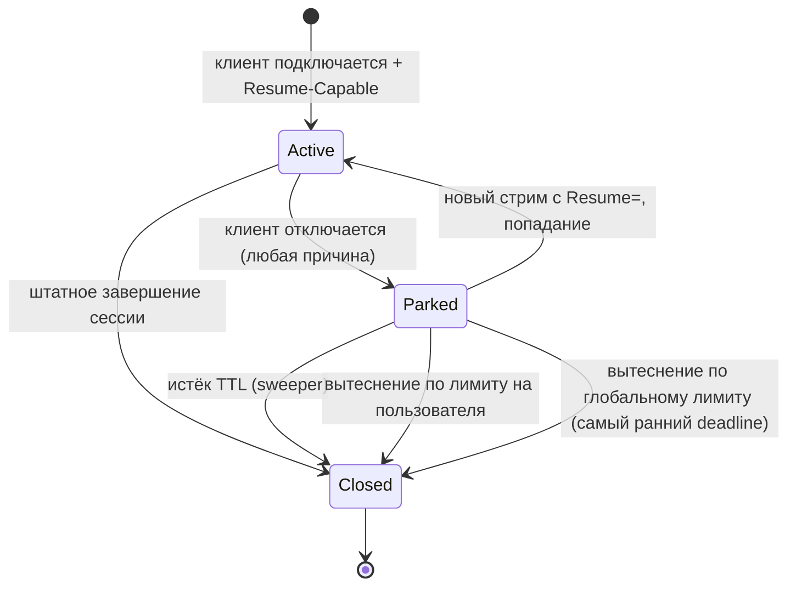

# Возобновление сессии (session resumption)

Документ описывает wire-формат и runtime-семантику возобновления сессии между транспортами в `outline-ss-rust`: как сессия паркуется при закрытии носителя, как следующее подключение к ней возвращается и как протоколы повтора v1/v2 восстанавливают байты, потерянные вместе со старым носителем. Документ для разработчиков пары `outline-ss-rust` ↔ `outline-ws-rust` и для операторов, включающих `[session_resumption]`.

*English version: [SESSION-RESUMPTION.md](SESSION-RESUMPTION.md)*

## Назначение и границы

С возобновлением сессии совместимый клиент переносит логическую сессию с одного входящего транспорта на другой (например, с WebSocket поверх HTTP/3 на WebSocket поверх HTTP/2) без переустановки upstream-соединения с целевым хостом. Сценарий — путь между клиентом и сервером, на котором прерывистые потери UDP ломают QUIC, а TCP работает, или наоборот.

На том же механизме TUN-клиент `outline-ws-rust` переживает смерть общего носителя. Много flow мультиплексируется в одно QUIC-соединение; при его коллапсе (connection-level `H3_INTERNAL_ERROR`, idle timeout) все flow на нём иначе были бы сброшены. Вместо этого клиент заново дозванивается на тот же аплинк, предъявляет Session ID каждого flow и подключает его запаркованный upstream — приложение разрыва не видит. Этому потребителю нужны обе половины протокола: v1 (Ack-Prefix) повторяет хвост uplink, v2 (Symmetric Downlink Replay) — downstream-байты, которые сервер уже записал в мёртвый носитель. Для скачивания или SSE-потока, где полезная нагрузка идёт downstream, resume без v2 оставляет дыру в ответе сервера. На сервере v2 по умолчанию выключен (`downlink_buffer_bytes = 0`), поэтому этому потребителю нужен ненулевой `downlink_buffer_bytes`. TUN-клиент к тому же паркует много flow одного пользователя одновременно, поэтому `orphan_per_user_cap` нужно задать заметно выше значения по умолчанию 4 (см. [Исчерпание ресурсов](#исчерпание-ресурсов)).

### Что сохраняется

- `TcpStream` к upstream-цели (TCP relay).
- Upstream `UdpSocket` и его NAT-привязка (UDP relay).
- Счётчики метрик пользователя (ключ — id пользователя).
- Для VLESS mux: все под-соединения (TCP и UDP) mux, паркуются как одно целое.

### Что не сохраняется

- Криптографическое состояние внутреннего протокола (nonce Shadowsocks AEAD, VLESS-запрос). Каждый новый транспортный стрим проходит полный handshake.
- TCP-байты в полёте в момент разрыва, если клиент и сервер не договорились о протоколах повтора v1/v2 (ниже). Без них на прикладном уровне ничего не пересылается; буфер ядра upstream-сокета хранит то, что уже было в очереди.
- UDP-датаграммы, пришедшие от upstream, пока сессия запаркована. Back-буфера нет: SS-UDP их отбрасывает, VLESS-UDP оставляет в приёмном буфере ядра до его переполнения (см. [Поведение UDP](#поведение-udp)).
- Сессии через рестарт сервера. Реестр orphan'ов живёт только в памяти.

### Совместимость

Возобновление сессии включается с обеих сторон явно. Клиенты, которые его не объявляют, работают так же, как без этой функции. Сторонние клиенты (sing-box, v2ray-core, официальный клиент Outline) не затронуты:

- согласование идёт через заголовки `X-Outline-*`, которые другие клиенты не шлют, а в ответах игнорируют;
- в handshake без согласования байты не добавляются.

Функция рассчитана на пару `outline-ss-rust` ↔ `outline-ws-rust`; это не публичный протокол.

## Идентификаторы

Session ID — 16 байт из CSPRNG (`ring::rand::SystemRandom`), их генерирует сервер. В кластере (`[cluster]`) id несёт ещё и shard домашнего сервера, обфусцированный ключом кластера, так что на проводе он по-прежнему выглядит случайным (см. [`docs/CLUSTER.ru.md`](../../../docs/CLUSTER.ru.md)). Клиент считает id непрозрачной байтовой строкой и возвращает его при resume.

### Жизненный цикл

| Событие | Эффект |
|---|---|
| Подключение с `X-Outline-Resume-Capable: 1` или `X-Outline-Resume` при включённом возобновлении | Сервер выпускает новый Session ID и возвращает его в `X-Outline-Session` |
| Транспортный стрим клиента закрылся или сломался (по любой причине) | Сервер переносит upstream-состояние в реестр orphan'ов под выданным Session ID с TTL |
| Пришёл новый стрим с `X-Outline-Resume: <id>` | После аутентификации сервер забирает запаркованное состояние из реестра и подключает к новому стриму |
| TTL истёк без resume | Sweeper уничтожает запаркованное состояние (закрывает upstream-сокеты) |

Session ID принадлежит ровно одному аутентифицированному пользователю. Запрос resume для Session ID другого пользователя отклоняется (см. [Безопасность](#безопасность)).

## Wire-формат

### Транспорты WebSocket и XHTTP (HTTP/1.1, HTTP/2, HTTP/3)

Согласование идёт в заголовках HTTP-запроса и ответа: WebSocket Upgrade, Extended CONNECT (h2/h3) или XHTTP-запрос. Имена заголовков заданы в `crates/outline-wire/src/resume.rs`.

#### Заголовки запроса

| Заголовок | Формат | Значение |
|---|---|---|
| `X-Outline-Resume-Capable` | `1` | Клиент хочет получить Session ID для этой сессии. `outline-ws-rust` шлёт его на каждом дозвоне |
| `X-Outline-Resume` | 32 hex-символа в нижнем регистре | Клиент просит возобновить запаркованную сессию с этим id |
| `X-Outline-Resume-Ack-Prefix` | `1` | Возможность v1, см. [Протокол Ack-Prefix (v1)](#протокол-ack-prefix-v1) |
| `X-Outline-Resume-Symmetric-Replay` | `1` | Возможность v2, см. [Симметричный повтор downlink (v2)](#симметричный-повтор-downlink-v2) |
| `X-Outline-Resume-Down-Acked` | десятичный `u64` | Downstream-смещение для v2, только в запросах resume |

`X-Outline-Resume` стоит слать только с недавно полученным Session ID.

#### Заголовки ответа

| Заголовок | Формат | Значение |
|---|---|---|
| `X-Outline-Session` | 32 hex-символа в нижнем регистре | Session ID, под которым этот стрим запаркуется при разрыве |
| `X-Outline-Resume-Ack-Prefix` | `1` | Сервер подтверждает v1 |
| `X-Outline-Resume-Symmetric-Replay` | `1` | Сервер подтверждает v2 |

Заголовки ответа пишутся в момент upgrade, до того как первый кадр данных аутентифицирует пользователя. Следствия:

- `X-Outline-Session` всегда несёт только что выпущенный id, в том числе на запросе resume. После попадания resume сессия при следующем закрытии носителя паркуется под этим новым id; старый id израсходован.
- Заголовки не сообщают, попал resume или промахнулся. Заголовка `X-Outline-Resume-Result` нет. Клиент, договорившийся о v1, узнаёт о попадании по управляющему кадру `"ORSM"`, который сервер шлёт только при попадании.

### VLESS Addons

Для носителя без HTTP-заголовков сервер разбирает resume-опкоды и в блоке Addons VLESS-запроса (`crates/outline-wire/src/vless.rs`). Текущие клиенты их не шлют: единственный такой носитель, raw QUIC, удалён.

| Направление | Тег | Длина | Значение |
|---|---|---|---|
| Запрос | `0x10` | 1 (`0x01`) | Готовность к resume |
| Запрос | `0x11` | 16 | Session ID для resume |
| Ответ | `0x10` | 16 | Выданный Session ID |
| Ответ | `0x11` | 1 | Результат: `0x00` попадание, `0x02` miss-unknown (несовпадение владельца отдаётся как miss-unknown) |

### Матрица согласования

```
Клиент шлёт                 Сервер возвращает (HTTP)           Действие сервера после аутентификации
───────────────────────────────────────────────────────────────────────────────────────────────────
(ничего)                    (ничего)                           Обычная сессия, resume невозможен
Resume-Capable              Session=<new>                      Свежая сессия, паркуется под <new>
Resume-Capable + Resume=X   Session=<new>                      Попадание: подключить upstream X, позже парковать под <new>
                                                               Промах: свежая сессия, паркуется под <new>
```

При `enabled = false` сервер ни одного из этих заголовков не отдаёт.

## Поведение сервера

### Реестр orphan'ов

Один реестр в памяти на процесс сервера (`server/resumption/registry.rs`):

```
struct OrphanRegistry {
    by_id:        DashMap<SessionId, ParkedEntry>,       // ParkedEntry = { owner, deadline, parked }
    reservations: DashMap<SessionId, Arc<Notify>>,       // парковки в процессе
    per_user:     DashMap<Arc<str>, Mutex<Vec<SessionId>>>,
    ...
}
```

Значение `Parked` имеет одну из четырёх форм (`server/resumption/parked.rs`):

```
enum Parked {
    Tcp(ParkedTcp),                       // половинки upstream reader/writer, счётчик up_acked, кольцо v2
    VlessUdpSingle(ParkedVlessUdpSingle), // connected UdpSocket + недоразобранный кадр с префиксом длины
    VlessMux(ParkedVlessMux),             // под-соединения по mux id + недоразобранный mux-кадр
    SsUdpStream(ParkedSsUdpStream),       // NAT-ключи, для которых стрим был ответчиком
}
```

Периодическая задача вызывает `sweep_expired` каждые 5 секунд (`ORPHAN_SWEEP_INTERVAL_SECS`) и уничтожает записи с истёкшим deadline.

### Последовательность парковки

Когда транспортный стрим клиента закрывается и для него был выдан Session ID:

1. Зарезервировать Session ID в `reservations` (см. [Барьер park-before-resume](#барьер-park-before-resume)).
2. Дописать в upstream всё, что в пути, чтобы в буфере писателя не осталось байт.
3. Прекратить пересылку на закрытую клиентскую сторону. Для TCP — остановить задачу, копирующую из upstream-читателя клиенту. Для SS-UDP стрим отвязывается от каждой NAT-записи, где был ответчиком (`detach_session_for_stream`).
4. Собрать значение `Parked` с upstream-сокетами, хэндлами читателей и счётчиков пользователя.
5. Если у пользователя уже `orphan_per_user_cap` запаркованных записей, вытеснить его самую старую.
6. Если в реестре `orphan_global_cap` записей, вытеснить запись с самым ранним deadline.
7. Вставить в `by_id` с `deadline = now + orphan_ttl_tcp_secs` (TCP) или `orphan_ttl_udp_secs` (UDP и mux), добавить id в список `per_user` пользователя и снять резервацию.

#### Сигнал закрытия на разных носителях

На WebSocket-носителях (h1/h2/h3) закрытие relay видит сам: Close-кадр или смерть TCP/QUIC-стрима под ним завершают чтение носителя, и парковка начинается за миллисекунды.

У XHTTP packet-up такого сигнала нет. Downlink-GET и каждый uplink-POST — отдельные запросы; клиент, переставший слать POST, выглядит так же, как притихший, а оборванный GET только освобождает downlink-слот для повторного подключения. Поэтому закрытие передаётся заголовком: финальный POST клиента несёт `X-Xhttp-Fin`, который закрывает uplink сессии, relay читает EOF и паркует. `outline-ws-rust` шлёт его и на явном `close()`, и при дропе транспорта без `close()` (так TUN-плоскость рвёт flow). Убитый клиент или клиент с умершей сетью не пришлёт ничего; тогда сессию уберёт только idle-вытеснение XHTTP-сессий (3 × интервал keepalive relay, в продакшене 180 с) — слишком поздно для soft switch, которому парковка нужна к моменту повторного дозвона. FIN закрывает uplink, поэтому он должен быть последним POST сессии; иначе остаток загрузки отбрасывается.

#### Парковка при сбое носителя

Парковка выполняется и когда носитель сломался, а не только при штатном закрытии: ошибка чтения носителя в relay (схлопнувшееся H3/QUIC-соединение, сброшенный TCP, ошибка H2-стрима) должна запустить парковку до того, как ошибка уйдёт наверх, так же как Close-кадр. TUN-клиент начинает миграцию носителя только когда носитель умер без штатного закрытия (`!closed_cleanly()`); если бы сервер парковал только при штатных закрытиях, каждый resume после миграции промахивался бы. Регрессионные тесты: `ss_resume_hit_after_dirty_carrier_death` и `vless_resume_hit_after_dirty_carrier_death` (`bins/outline-ss-rust/src/server/tests/resumption/`), которые сбрасывают носитель через `SO_LINGER = 0`, а не закрывают его.

#### Барьер park-before-resume

Session ID резервируется в начале парковки, до харвеста читателя (шаг 3 ждёт relay-задачу), и резервация снимается, когда запись закоммичена или парковка отменена. Без неё быстрый повторный дозвон клиента, пришедший пока его же сессия ещё паркуется, искал бы id до появления в `by_id`, промахивался и начинал свежую сессию, теряя байты середины потока. С резервацией параллельный resume ждёт до 5 с (`RESERVATION_WAIT`), пока парковка закоммитится или отменится. Та же резервация покрывает путь cluster edge-switch / failover, где повторный дозвон приходит по независимому сетевому потоку.

### Последовательность resume

На новом стриме с `X-Outline-Resume`:

1. Аутентифицировать стрим как обычно (ключ Shadowsocks или VLESS UUID).
2. Забрать id из `by_id`. Исходы:
   - Не найден: если для этого id парковка в процессе (зарезервирована, не закоммичена), ждать до `RESERVATION_WAIT`, пока она закоммитится или отменится, затем проверить `by_id` снова. Если записи всё ещё нет — промах (`unknown`), продолжить как свежая сессия.
   - Несовпадение владельца (запаркована под другим пользователем): запись возвращается в реестр, чтобы владелец ещё мог её забрать, в лог пишется `WARN` «resume rejected due to owner mismatch (security event)», промах считается как `reason="unknown"`. Продолжить как свежая сессия.
   - Истёк (deadline прошёл, sweeper ещё не отработал): вытеснить, промах (`expired`), продолжить как свежая сессия.
   - Попадание: запись удаляется из `by_id` и `per_user`.
3. При попадании подключить запаркованное состояние к relay нового стрима:
   - TCP: перенести половинки upstream writer/reader в новое состояние relay и запустить задачи копирования.
   - SS-UDP: для каждого запаркованного NAT-ключа вызвать `register_session(new_sender, ...)` — слот отправителя NAT-записи переключается на нового клиента без перепривязки UDP-сокета.
   - VLESS-UDP: переиспользовать connected-сокет и недоразобранный буфер кадра.
   - VLESS mux: запустить по задаче-читателю на каждое запаркованное под-соединение против нового стрима.
4. Если согласован v1 (и v2), отправить управляющие кадры до любых байт relay upstream→клиент (см. ниже).

### Поведение TCP

Upstream `TcpStream` разделён на `OwnedReadHalf` / `OwnedWriteHalf`. Пока сессия запаркована:

- Половину-читатель никто не читает. Окно приёма ядра создаёт back-pressure для upstream: объявляемое окно падает до нуля по мере заполнения буфера ядра.
- В половину-писатель никто не пишет: клиентского трафика нет.

При resume обе половины получают новые задачи копирования против нового клиентского стрима.

### Возобновление между протоколами

Запаркованную байт-потоковую (TCP) сессию может возобновить носитель любого из двух прокси-протоколов: сессия, запаркованная по Shadowsocks, подключается к VLESS-носителю и наоборот. Это верно на всех трёх путях resume: двух прямых и сплайсе через mesh кластера.

Почему это корректно. Ничто в `Parked::Tcp` не принадлежит протоколу, который его создал: половинки upstream-сокета, накопительный счётчик `up_acked` (байты, записанные в upstream-сокет, — одна и та же величина при любом протоколе) и кольцо downlink v2 (наполняется до шифрования) живут на уровне открытого текста. То, что протокол должен своему клиенту при resume — VLESS-заголовок ответа `[VERSION, 0x00]` или свежий шифр ответа Shadowsocks, — выводится из аутентифицированного пользователя возобновляющего стрима, а не из парковки. В mesh тело relay — прикладной открытый текст.

Зачем это нужно. Клиент, у которого аплинк перевыбирает активный wire на наборе со смешанными SS- и VLESS-wire (`shuffle_wires`), примерно в половине перевыборов приходит на другом протоколе, чем тот, что парковал, — с той же учётной записью и тем же Session ID: группа с `shared_resume` делит один id между аплинками, а id протокола не несёт. Отказ в таком resume рвал непрерывность сессии на каждом таком перевыборе.

Датаграммные и mux-парковки между протоколами не переходят. Они хранят состояние кадрирования, которое другой протокол выразить не может:

- VLESS mux — карта под-соединений по mux stream id плюс недоразобранный mux-кадр; у Shadowsocks мультиплексирования нет;
- VLESS-UDP — один connected-сокет плюс недоразобранный кадр с 2-байтным префиксом длины; SS-UDP-носитель многоадресный и обрамляет каждую датаграмму своим заголовком;
- SS-UDP — набор NAT-ключей, чьи слоты ответчика переключаются в SS-кодировке; VLESS-UDP-сессия одноадресная.

В mesh эти сочетания к тому же недостижимы через пробу формы (SS OPEN называет ровно одну форму, VLESS OPEN допускает все формы, кроме SS-датаграммной), так что отказы там — структурная защита и считаются в `outline_ss_mesh_relay_rejected_total{reason="protocol_mismatch"}`.

Успешные переходы считаются в `outline_ss_orphan_resume_cross_protocol_total{parked,resumed}` — подмножестве `outline_ss_orphan_resume_hit_total`; пишет узел-владелец парковки.

### Поведение UDP

UDP нельзя притормозить back-pressure. Пока клиента нет:

- SS-UDP: стрим отвязан от своих NAT-записей, поэтому датаграммы, которые NAT-читатель получает от upstream, отбрасываются. NAT-записи стареют как обычно и могут истечь до resume.
- VLESS-UDP (один адресат) и UDP-под-соединения VLESS mux: сокет никто не читает; датаграммы лежат в приёмном буфере ядра, а после его заполнения ядро отбрасывает следующие.
- Парковка не должна зависеть от того, вычитан ли старый носитель. Насос downlink VLESS-UDP, заблокированный на полном потоке, видит сигнал парковки; стрим, уже закрытый к моменту парковки, всё равно паркует сокет; ожидание насоса ограничено (`PARK_HARVEST_WAIT`, 2 с). NAT-читатель SS-UDP на `xhttp_h3` не ждёт отправителя носителя, с которого сессия ушла: при смене слота он отбрасывает одну датаграмму в полёте и доставляет следующие на новый носитель.

### VLESS mux

VLESS mux несёт несколько под-соединений (TCP и UDP) в одном стриме носителя. При разрыве:

- Mux паркуется как одно целое (`Parked::VlessMux`); отдельные под-соединения не паркуются.
- Каждое TCP-под-соединение паркуется как TCP relay (простаивающие половинки reader/writer).
- Каждое UDP-под-соединение сохраняет сокет; никто его не читает.
- `orphan_per_user_cap` считает mux одной сессией.
- Resume восстанавливает mux целиком; частичный resume не поддерживается. Парковка и подключение отдельных под-соединений потребовали бы соответствия Session ID → под-соединение с обеих сторон, а клиенту пришлось бы хранить состояние каждого под-соединения.

## Поведение клиента

`outline-ws-rust` (`crates/outline-transport/src/resumption.rs`):

1. Шлёт `X-Outline-Resume-Capable: 1` на каждом дозвоне и сохраняет значение `X-Outline-Session` из ответа в кеше resume.
2. Когда носитель закрывается или ломается посреди сессии, открывает новый транспорт (возможно, другого вида) и шлёт закешированный id в `X-Outline-Resume`.
3. Если согласован v1 и пришёл кадр `"ORSM"`, resume попал: клиент повторяет хвост uplink, верхний слой разрыва не видит.
4. При промахе новая сессия свежая, верхний слой получает уведомление, что прежняя сессия потеряна.

Путь повторов SOCKS посреди сессии ограничивает число повторных дозвонов на сессию параметром `tcp_mid_session_retry_budget` (по умолчанию 1).

## Протокол Ack-Prefix (v1)

Базовое возобновление паркует upstream `TcpStream` и подключает его при следующем подключении с `X-Outline-Resume`. Байты, отправленные клиентом в WebSocket-кадрах и не дошедшие до сервера до гибели соединения клиент–сервер, не пересылаются: клиент не знает, какие его байты ушли в upstream, а какие потерялись, и повтор всего подряд продублировал бы байты.

Протокол Ack-Prefix закрывает эту дыру для направления upstream: при каждом попадании resume сервер сообщает точное число байт, переданных в upstream, и клиент повторяет только байты после этого смещения.

### Согласование v1

Протокол активен, только если его объявили обе стороны. Если одна из сторон не объявила, сессия работает по базовой семантике resume (без повтора; клиент должен принять разрыв на уровне сессии).

| Сторона | Заголовок | Формат | Значение |
|---|---|---|---|
| Запрос клиента | `X-Outline-Resume-Ack-Prefix` | `1` | Клиент разберёт управляющий кадр при попадании resume |
| Ответ сервера | `X-Outline-Resume-Ack-Prefix` | `1` | Сервер отправит управляющий кадр при попадании resume |

Возможность не зависит от `Resume-Capable` / `Resume`. Клиент, которому нужен протокол, объявляет его на каждом подключении, включая первое подключение сессии, чтобы сервер подтвердил поддержку до первого цикла парковки и resume. Сервер отвечает эхом, только если возобновление включено.

### Управляющий кадр v1

Сервер шлёт один кадр данных SS-WS или VLESS-WS до любых байт relay upstream→клиент на возобновлённой сессии, если выполнены все условия:

1. Подключение — запрос resume (`X-Outline-Resume: <id>`).
2. Забор из реестра удался (попадание).
3. Проверка владельца пройдена.
4. Клиент прислал `X-Outline-Resume-Ack-Prefix: 1`.
5. Сервер ответил `X-Outline-Resume-Ack-Prefix: 1`.

Payload в открытом виде — ровно 14 байт:

```
+0  : magic        "ORSM"           4 bytes  ASCII
+4  : version      0x01             1 byte
+5  : flags        0x00             1 byte   reserved (must be 0 in v1)
+6  : up_acked     u64 BE           8 bytes  bytes the server forwarded upstream
                                              over the lifetime of this session
                                              (including all prior reattaches)
+14 : (end)
```

Для SS-WS 14 байт проходят обычное AEAD-шифрование relay, как любой кадр данных. Для VLESS-WS 14 байт — это payload WS-кадра.

#### Поля v1

| Поле | Значение |
|---|---|
| `magic` | ASCII `"ORSM"` (Outline Resume Sync Message). Вместе с проверками версии и флагов отличает управляющий кадр от upstream-байт с тем же началом |
| `version` | `0x01`. Клиент, увидевший неизвестную версию, должен сбросить сессию и переподключиться без этой возможности |
| `flags` | Зарезервировано. Клиент, увидевший ненулевые биты, должен сбросить сессию |
| `up_acked` | Всего байт направления upstream, записанных сервером в upstream `TcpStream` за время жизни сессии. Монотонно растёт через парковки и подключения, не сбрасывается. Хранится в `ParkedTcp::upstream_bytes_acked` |

### Отправка кадра v1 сервером

При попадании resume, после аутентификации и забора из реестра, до перезапуска задачи relay upstream→клиент сервер:

1. Читает запаркованный счётчик `upstream_bytes_acked`.
2. Собирает 14-байтный payload.
3. Отправляет его первым кадром данных на новом транспорте через слой SS / VLESS возобновляющего подключения.

Только после записи кадра в sink сервер запускает relay, копирующий upstream-байты клиенту.

На эндпоинте с `padded = true` кадр оборачивается carrier-padding, как любое downlink-сообщение, на каждом пути, где он отправляется (прямой resume, edge кластера и кадр v2 `"ORDR"`). У carrier-padding нет бита возможности на проводе, поэтому клиент на padded-пути декодирует каждое downlink-сообщение как padding-кадр; кадр без паддинга был бы съеден как обрамление и рассинхронизировал бы AEAD-поток за ним, и сессия упала бы с ошибкой расшифровки.

Кадр не отправляется:

- на свежих сессиях (resume не запрашивался);
- при промахах resume: состояние не подключено, счётчика нет;
- при попаданиях, если клиент не объявил возможность.

### Разбор кадра v1 клиентом

Если клиент запросил resume, объявил возможность и ответ несёт `X-Outline-Resume-Ack-Prefix: 1`, клиент считает первый расшифрованный кадр данных на новом транспорте управляющим:

1. Проверить `magic == "ORSM"`.
2. Проверить `version == 0x01`.
3. Проверить `flags == 0x00`.
4. Прочитать `up_acked` (`u64`, big-endian).

Если любая проверка не прошла, клиент сбрасывает сессию и переподключается заново без этой возможности: продолжение могло бы испортить поток байт в upstream.

Если проверки прошли, `up_acked` — смещение в буфере повтора клиента: байты `0..up_acked` уже переданы в upstream и пропускаются; байты `up_acked..client_up_sent` были в полёте и повторяются в новый транспорт до возобновления обычной пересылки клиент→upstream.

Если `up_acked > client_up_sent` (сервер утверждает, что передал больше, чем клиент отправил), клиент сбрасывает сессию. Если `up_acked` старше самого старого смещения в буфере повтора клиента (буфер перезаписан), клиент не может восстановить недостающие байты и сбрасывает сессию.

### Направление downlink в v1

v1 покрывает только направление upstream. Байты, записанные сервером в носитель и не дошедшие до клиента до разрыва, при одном v1 теряются. Протоколы со своим прикладным повтором (тела HTTP-запросов, идемпотентные RPC) восстанавливаются; протоколы, считающие поток байт единым упорядоченным журналом (SSH, сырой TCP, свои бинарные потоки), при resume только с v1 портятся. Направление downstream покрывает v2 (ниже), который требует v1.

### Матрица совместимости v1

| Возможность клиента | Возможность сервера | Попадание resume | Поведение |
|---|---|---|---|
| Выкл | Любая | Любое | Базовая семантика resume (без повтора; сброс сессии при потере байт) |
| Вкл | Выкл | Любое | Сервер не отвечает эхом; клиент переходит на базовую семантику |
| Вкл | Вкл | Нет (свежая / промах) | Управляющего кадра нет; свежая сессия; повторять нечего |
| Вкл | Вкл | Да | Сервер шлёт управляющий кадр; клиент повторяет со смещения |

## Симметричный повтор downlink (v2)

v1 восстанавливает upstream-байты (клиент → сервер → upstream), прошедшие WebSocket, но не дошедшие до upstream до гибели носителя. v2 делает то же для направления downstream: байты, записанные сервером в носитель, которые клиент так и не получил.

v2 строится поверх v1. Обе возможности согласуются отдельно, и кадр v2 отправляется после кадра v1 при каждом попадании resume, где v2 активен. v2 без v1 — недопустимая конфигурация: сервер не отвечает эхом `X-Outline-Resume-Symmetric-Replay: 1`, если клиент не объявил и `X-Outline-Resume-Ack-Prefix: 1`, а клиент не объявляет v2 без v1.

### Согласование v2

| Сторона | Заголовок | Формат | Значение |
|---|---|---|---|
| Запрос клиента | `X-Outline-Resume-Symmetric-Replay` | `1` | Клиент разберёт управляющий кадр v2 при попадании resume |
| Ответ сервера | `X-Outline-Resume-Symmetric-Replay` | `1` | Сервер отправит управляющий кадр v2 при попадании resume |

Сервер отвечает эхом v2, только если возобновление включено, запрошен v1 и `downlink_buffer_bytes > 0`.

### Смещение, которое сообщает клиент

Чтобы выбрать хвост сохранённых downstream-байт для повтора, серверу нужно последнее подтверждённое клиентом downstream-смещение:

| Сторона | Заголовок | Формат | Значение |
|---|---|---|---|
| Запрос клиента | `X-Outline-Resume-Down-Acked` | десятичный `u64` без ведущих нулей, максимум 2^63−1 | Всего байт downstream-payload, доставленных клиентом своему локальному клиенту (SOCKS5 или TUN-flow) за время жизни сессии |

`outline-ws-rust` шлёт заголовок только в запросах resume, которые объявляют v2, и только при ненулевом смещении. На первом подключении сессии сообщать нечего.

Если заголовок некорректен (не десятичное число, переполнение) или отсутствует в запросе resume с v2, сервер берёт `0` — «повторить всё, что осталось в кольце». Ошибка разбора пишется в лог на уровне `DEBUG`; сессия продолжается.

### Кольцевой буфер downlink на сервере

Когда v2 на сервере включён (`[session_resumption] downlink_buffer_bytes > 0`), у каждой TCP-сессии, чей начальный дозвон объявил v2, есть ограниченный FIFO недавно отправленных downstream-байт:

- Байты кладутся в кольцо до записи в sink, поэтому счётчик `total_sent` сессии отражает то, что сервер обязался отправить. Если запись упала, байты остаются в кольце до следующего попадания resume.
- Ёмкость кольца — `downlink_buffer_bytes`. При переполнении вытесняются самые старые байты.
- При разрыве кольцо переезжает в `ParkedTcp::downlink_ring`, при попадании resume — обратно, как счётчик v1 `upstream_bytes_acked`.
- Кольцо принадлежит сессии, а не носителю. Оно забирается из парковки при каждом попадании resume, в том числе когда носитель v2 не согласовал. Клиент может объявить v2 на одном дозвоне и не объявить на следующем (повторный дозвон при передаче wire не объявляет ничего); если бы кольцо терялось на таком переходе, следующий носитель, запросивший повтор, получил бы `REPLAY_TRUNCATED` (`reason="no_ring"`) для сессии, у которой кольцо было. Выделение нового кольца для парковки без кольца по-прежнему требует, чтобы возобновляющий носитель согласовал v2.
- Кольцо существует, только если его попросил дозвон, начавший сессию. Объявление выделяет кольцо один раз, в момент upstream-handshake; клиент, объявивший v2 только на повторном дозвоне при миграции, получает парковку без кольца ровно тогда, когда оно нужно. Поэтому каждый дозвон, начинающий новую сессию, должен объявлять v1 и v2, включая пуловые и прогретые носители — для сервера это новые сессии. Объявление на дозвоне без Session ID ничего не стоит: попадание resume, а значит и управляющий кадр, на нём невозможны.
- Память на сессию: до `downlink_buffer_bytes` и для активных сессий (кольцо живёт рядом с состоянием relay), и для запаркованных. При `orphan_global_cap = 10000` и кольце 64 КиБ худший случай для запаркованных — около 640 МиБ. На хостах с малым объёмом памяти уменьшите `downlink_buffer_bytes` или поставьте `0`, чтобы выключить v2.

### Управляющий кадр v2

Отправляется одним кадром данных SS-WS или VLESS сразу после кадра v1 при попадании resume, где v2 активен:

```
+0  : magic        "ORDR"           4 bytes  ASCII (Outline Resume Downlink Replay)
+4  : version      0x01             1 byte
+5  : flags        bitfield         1 byte   bit 0 = REPLAY_TRUNCATED, bits 1..7 reserved (must be 0)
+6  : replay_len   u64 BE           8 bytes  number of replay-payload bytes that follow
+14 : payload      replay_len bytes          server-captured downstream bytes
                                              from offset `X-Outline-Resume-Down-Acked`
                                              up to `total_sent_downlink`
```

Для SS-WS 14-байтный заголовок и payload проходят AEAD-шифрование relay одной или несколькими записями; клиент читает ровно `replay_len` байт открытого текста после заголовка, независимо от того, как нарезан шифртекст. Для VLESS-WS заголовок и payload — одно WS Binary-сообщение (открытый текст). Для VLESS-XHTTP — следующий фрагмент долгоживущего тела ответа (packet-up GET) или тела ответа двунаправленного POST (stream-one), открытый текст.

#### Поля v2

| Поле | Значение |
|---|---|
| `magic` | ASCII `"ORDR"`. Отличает кадр v2 от кадра v1 и от upstream-байт |
| `version` | `0x01`. Клиент, увидевший неизвестную версию, должен сбросить сессию и переподключиться без v2 |
| `flags` бит 0 `REPLAY_TRUNCATED` | Выставлен, когда сервер не может отдать запрошенное смещение; `replay_len` тогда `0`, а в downstream клиента невосстановимая дыра. Причины на сервере (метка `reason` у `outline_ss_orphan_downlink_replay_truncated_total`): `no_ring` (у парковки нет кольца), `evicted` (смещение старше самого старого байта в кольце), `client_ahead` (клиент утверждает, что получил больше, чем сервер отправил) |
| `flags` биты 1..7 | Зарезервированы, должны быть 0; клиент, увидевший выставленный бит, должен сбросить сессию |
| `replay_len` | Число байт payload после 14-байтного заголовка: `total_sent_downlink − X-Outline-Resume-Down-Acked`, когда кольцо покрывает смещение; `0` при усечении; `0` со сброшенным флагом, когда смещение клиента уже равно `total_sent_downlink` |

### Порядок действий при попадании resume

Когда resume попал и активны v1 и v2, сервер до перезапуска задачи relay upstream→клиент:

1. Отправляет 14-байтный кадр v1 `"ORSM"` с `up_acked`.
2. Отправляет кадр v2 `"ORDR"`: заголовок и payload (возможно, пустой) или маркер усечения.
3. Запускает relay, копирующий новые upstream-байты клиенту.

Кадры приходят в sink в этом порядке. Для SS-WS это следует из последовательного AEAD-кодирования в одной задаче записи; для VLESS-WS / VLESS-XHTTP — из последовательной отправки сообщений в один sink.

### Поведение клиента в v2

Если клиент запросил resume, объявил v1 и v2 и ответ содержит оба эха, клиент читает первые расшифрованные байты на новом транспорте как:

1. Кадр v1 (14 байт), разбор как в v1; при непрошедшей проверке — сбросить сессию.
2. Заголовок v2 (14 байт): проверить `magic == "ORDR"`, `version == 0x01`, нулевые зарезервированные биты флагов; при непрошедшей проверке — сбросить сессию.
3. Если выставлен `REPLAY_TRUNCATED` и `replay_len == 0`, в downstream невосстановимая дыра. Решает `tcp_mid_session_retry_overflow_policy`: `"soft"` продолжает сессию и увеличивает `outline_ws_uplink_mid_session_retries_total{outcome="downlink_truncated"}`; `"hard"` сбрасывает сессию.
4. Иначе прочитать ровно `replay_len` байт открытого текста и доставить их локальному клиенту раньше любых новых upstream-байт. Прибавить `replay_len` к подтверждённому смещению клиента.
5. После payload транспорт возвращается к обычному циклу чтения.

Клиент ограничивает `replay_len` параметром `tcp_symmetric_replay_max_bytes` (по умолчанию 1 МиБ); большее значение сбрасывает сессию, чтобы некорректный сервер не заставил клиента выделить неограниченный буфер.

### Матрица совместимости v2

| v1 клиент | v1 сервер | v2 клиент | v2 сервер | Попадание resume | Поведение |
|---|---|---|---|---|---|
| Выкл | Любой | Любой | Любой | Любое | Базовая семантика resume (без повтора в обе стороны) |
| Вкл | Выкл | Любой | Любой | Любое | Сервер не отвечает эхом v1; базовая семантика |
| Вкл | Вкл | Выкл | Любой | Да | Только кадр v1; возможна дыра в downstream |
| Вкл | Вкл | Вкл | Выкл | Да | Сервер не отвечает эхом v2; только кадр v1 |
| Вкл | Вкл | Вкл | Вкл | Нет (свежая / промах) | Кадров нет |
| Вкл | Вкл | Вкл | Вкл | Да | Оба кадра; повтор downstream |

### Настройки клиента

Настройки клиента лежат в конфиге балансировки (`LoadBalancingConfig` в `crates/outline-uplink/src/config.rs`), с переопределением на уровне группы:

| Ключ | По умолчанию | Что делает | Когда менять |
|---|---|---|---|
| `tcp_symmetric_replay_enabled` | `true` | Объявлять `X-Outline-Resume-Symmetric-Replay: 1` (только вместе с v1 и при включённых повторах посреди сессии) | `false` против сервера, поддерживающего только v1 |
| `tcp_symmetric_replay_max_bytes` | `1048576` (1 МиБ) | Наибольший принимаемый `replay_len` v2; больший сбрасывает сессию | Поднимать, только если `downlink_buffer_bytes` сервера больше |
| `tcp_mid_session_retry_overflow_policy` | `"soft"` | `"soft"` продолжает после `REPLAY_TRUNCATED`, `"hard"` сбрасывает сессию | `"hard"` для потоков, где дыра хуже сброса |
| `tcp_mid_session_retry_budget` | `1` | Повторных дозвонов на сессию на пути повторов SOCKS посреди сессии | — |

## Диаграмма жизненного цикла



## Ошибки и граничные случаи

| Случай | Поведение сервера |
|---|---|
| Resume-id существует, но владелец другой | Промах считается как `unknown`, в лог пишется `WARN` (событие безопасности), запись остаётся для владельца; свежая сессия |
| Два одновременных запроса resume на один id | Забор атомарный; второй промахивается (`unknown`) |
| Повторный дозвон клиента обгоняет парковку его же сессии | id зарезервирован в начале парковки; resume ждёт до 5 с, пока парковка закоммитится, и попадает; байты середины потока сохраняются |
| Upstream-сокет умер, пока сессия запаркована | Resume попадает; первое чтение после подключения отдаёт клиенту EOF / ошибку |
| Сессия снова отключается после resume | Паркуется под Session ID, выданным на подключении resume; старый id израсходован |
| `Resume-Capable` по пути без TLS | Принимается: возобновлению TLS не нужен; аутентификация Shadowsocks / VLESS не меняется |
| Запрос resume без `Resume-Capable` | Допустим; сервер всё равно выпускает и возвращает новый id |
| Ошибка под-соединения mux без разрыва носителя | Под-соединение закрывается обычным образом; mux остаётся активным и не паркуется |
| Рестарт сервера | Все запаркованные сессии пропадают; каждый resume промахивается (`unknown`) |

## Безопасность

### Конфиденциальность Session ID

Session ID — bearer-токен: тот, кто его узнал и владеет учётными данными пользователя, может забрать запаркованный upstream-сокет. Защита:

- Проверка владельца: возобновляющее подключение должно аутентифицироваться тем же пользователем, которому принадлежит парковка. Атакующему нужны и ключ Shadowsocks / VLESS UUID пользователя, и Session ID.
- Длина: 128 бит из CSPRNG.
- Одноразовость: попадание удаляет запись из реестра.

#### Что гарантирует проверка владельца сама по себе

Байт-потоковая парковка переходит между прокси-протоколами, поэтому проверка владельца — единственный сигнал идентичности на этом пути.

Метка владельца — имя учётной записи, а не учётные данные: `[[users]].id` или одно из имён `[users.aliases]` этой записи, если адрес источника совпал. Оба протокола паркуют и возобновляют под ней: сессия Shadowsocks — под `UserKey::effective_label`, VLESS — под `VlessUser::label` с уже подставленным алиасом. На одном узле пространство имён инъективно благодаря валидации конфига: дубликаты id пользователей отвергаются, а имя алиаса не может совпадать ни с другим алиасом, ни с id пользователя. Значит, одна метка обозначает ровно одну запись `[[users]]`, а в ней лежат и `password`, и `vless_id`; метка, совпавшая между протоколами, — одна учётная запись, достигнутая двумя путями. Угадать id недостаточно, как и владеть какими-то другими действующими учётными данными: они должны принадлежать той же записи.

Чего проверка не гарантирует: что узлы кластера одинаково понимают имена. Resume-id, выпущенный одним узлом, предъявляется другому, а домашний узел сверяет метку, которую подтверждает edge; два узла, выдавшие один `[[users]].id` разным людям, отдадут сессию одного другому. Так было и для resume в пределах одного протокола, поэтому узлы `[cluster]` обязаны иметь общую таблицу пользователей, а не только общий PSK (см. [`docs/CLUSTER.ru.md`](../../../docs/CLUSTER.ru.md)). Для алиасов то же требование: имя алиаса должно означать одну и ту же учётную запись на всех узлах.

### Раскрытие информации

Если отличать несовпадение владельца от отсутствующего id, клиент мог бы проверять, существует ли id. Сервер вообще не сообщает исход resume в HTTP-заголовках; байт результата VLESS Addons отдаёт несовпадение владельца как `miss-unknown`; метрика `outline_ss_orphan_resume_miss_total` считает его как `reason="unknown"`. Несовпадение видно только в логе сервера (`WARN`, событие безопасности).

### Исчерпание ресурсов

`orphan_per_user_cap` (по умолчанию 4) ограничивает число запаркованных записей на пользователя: следующая парковка вытесняет его самую старую запись. `orphan_global_cap` (по умолчанию 10000) ограничивает реестр: когда он полон, вытесняется запись с самым ранним deadline. Оба вытеснения считаются в `outline_ss_orphan_evicted_total{reason="per_user_cap"|"global_cap"}`.

### Понижение при согласовании

Посредник, вырезающий `X-Outline-Resume-Capable` из запроса, отключает возобновление. Соединение работает и без него; никакое поведение, важное для безопасности, от активности возобновления не зависит.

## Конфигурация

Все параметры — в секции `[session_resumption]` файла `config.toml`. Все необязательны; без секции или без `enabled = true` функция выключена.

```toml
[session_resumption]
enabled = true
orphan_ttl_tcp_secs = 30
orphan_ttl_udp_secs = 30
orphan_per_user_cap = 4
orphan_global_cap = 10000
downlink_buffer_bytes = 0
```

| Ключ | По умолчанию | Что делает | Когда менять |
|---|---|---|---|
| `enabled` | `false` | Включает возобновление. При `false` сервер игнорирует все заголовки `X-Outline-Resume*` и не отдаёт их | — |
| `orphan_ttl_tcp_secs` | `30` | Сколько TCP-парковка ждёт resume | Поднять, если растёт `orphan_resume_miss_total{reason="expired"}` |
| `orphan_ttl_udp_secs` | `30` | Сколько UDP- и mux-парковки ждут resume | То же |
| `orphan_per_user_cap` | `4` | Запаркованных записей на пользователя; сверх лимита вытесняется самая старая | Поднять для TUN-клиентов, паркующих много flow одновременно |
| `orphan_global_cap` | `10000` | Запаркованных записей в реестре | Снизить на хостах с малым объёмом памяти вместе с `downlink_buffer_bytes` |
| `downlink_buffer_bytes` | `0` | Размер кольца v2 на TCP-сессию; `0` выключает v2 (эхо не отдаётся, кольца не выделяются) | Задать ненулевое значение (например, `65536`), когда TUN-клиентам нужен повтор downstream |

## Метрики

Все метрики отдаются через Prometheus-эндпоинт сервера.

| Метрика | Тип | Метки | Описание |
|---|---|---|---|
| `outline_ss_orphan_park_total` | counter | `kind` | Сессии, перенесённые в реестр orphan'ов |
| `outline_ss_orphan_resume_hit_total` | counter | `kind` | Успешные resume |
| `outline_ss_orphan_resume_cross_protocol_total` | counter | `parked`, `resumed` | Resume, где протоколы парковки и возобновления различаются (`ss` / `vless`); подмножество счётчика попаданий |
| `outline_ss_orphan_resume_miss_total` | counter | `reason` | Неудачные resume: `unknown` (включая несовпадение владельца), `expired`, `disabled` |
| `outline_ss_orphan_evicted_total` | counter | `kind`, `reason` | Вытеснения: `per_user_cap`, `global_cap`, `ttl_expired` |
| `outline_ss_orphan_current` | gauge | `kind` | Запаркованных записей по видам |
| `outline_ss_orphan_downlink_replay_bytes_total` | counter | `transport` | Байт, повторённых в downstream при попаданиях resume с v2 |
| `outline_ss_orphan_downlink_replay_truncated_total` | counter | `transport`, `reason`, `path` | Downlink-replay v2, который сервер не смог отдать, по `reason`: `no_ring`, `evicted`, `client_ahead`. `path="direct"`: клиент возобновил сессию на этом узле и получил `REPLAY_TRUNCATED`. `path="mesh"`: этот узел — home сессии, перенесённой с edge кластера; у edge нет такого флага, чтобы передать его клиенту, поэтому клиент продолжает с дырой без уведомления |
| `outline_ss_orphan_downlink_buf_bytes` | gauge | — | Байт, занятых сейчас в кольцах v2 запаркованных TCP-сессий |

Значения `kind`: `tcp`, `vless_udp_single`, `vless_mux`, `ss_udp_stream`. `transport` у обеих метрик v2 — `tcp`.

## Вне рамок

- Сохранение реестра через рестарт. Resume после рестарта сервера не поддерживается: для этого нужна передача FD через systemd socket activation или восстановление upstream из сохранённого состояния.
- Миграция по инициативе сервера. Сервер не может велеть клиенту сменить транспорт; миграцию всегда начинает клиент, когда его текущий транспорт отказал.
- Возобновление между серверами без кластера. Отдельный сервер возобновляет только свои парковки. С `[cluster]` resume-id несёт домашний shard, и edge-узел передаёт resume домашнему узлу через mesh (см. [`docs/CLUSTER.ru.md`](../../../docs/CLUSTER.ru.md)). Без кластера балансировщик перед несколькими серверами должен быть sticky по IP клиента или по L4-хешу, переживающему смену транспорта.
- Частичный resume mux. Mux паркуется и возобновляется целиком.
