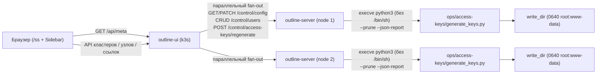

# Спецификация: Кластерное управление, полная настройка `outline-server` и генерация подписок в `outline-ui`

Дата: 2026-11-21
Статус: проект на согласовании

---

## 1. Цели и область действия

> В публичной документации парка реальные имена узлов, домены и каталоги заменены условными: `fleet.example` — домен парка; `relay-a`, `relay-b` — парный cloud-кластер; `exit-a`, `exit-b` — парный exit-кластер; `198.51.100.102` / `198.51.100.104` — домашние узлы; `<keys-dir>` — секретный каталог раздачи подписок.

Необходимо расширить веб-панель `outline-ui` (`bins/outline-ui/`) и control API сервера `outline-server` (`bins/outline-server/`) совместно с генератором артефактов (`ops/access-keys/`), чтобы решить четыре задачи:

1. **Полное управление настройками `outline-server` из `outline-ui`**:
   - покрыть в control API и в UI (`/ss/settings`, `/ss/cluster`) все секции `FileConfig`, включая полный CRUD по `[[endpoint]]`, `[shadowsocks]`, `[http_root]`, `[access_keys]`, `[tuning]`, поля `[server]` / `[server.h3]` и корректную очистку опциональных полей через трёхсостоянный `FieldPatch<T>`;
   - выводить флаг `restart_pending`, чтобы оператор видел, на каких узлах изменения уже сохранены в `config.toml`, но ещё не применены рестартом.
2. **Конфиг-управляемая кластеризация (без хардкода имён узлов)**:
   - описывать кластеры в конфиге `outline-ui` (`[[ss.clusters]]`) и автоматически обнаруживать кластеры по конфигам узлов (`[cluster].enabled == true` + совпадение отпечатка `cluster_psk`);
   - управлять общими настройками кластера с контролем дрейфа между участниками, при этом не смешивать общие секции с узловыми (`listen`, сертификаты, IPv6-префиксы и интерфейсы, `shard_id`, `mesh_listen`).
3. **Синхронное управление пользователями на всём кластере**:
   - создавать, редактировать, ротировать секреты (`password`, `vless_id`), блокировать/разблокировать и удалять пользователей сразу на всех узлах кластера;
   - обнаруживать частичное присутствие (`partial`) и расхождение параметров или секретов (`drift`) через необратимые BLAKE3-отпечатки, не раскрывая сами секреты в списках;
   - защищать создание пользователя pre-flight проверкой и компенсирующим откатом при частичном сбое.
4. **Генерация, очистка и выдача ссылок/подписок + отображение версии UI**:
   - **Вариант A**: `outline-server` вызывает существующий Python-генератор `ops/access-keys/generate_keys.py` напрямую без shell (`tokio::process::Command`), используя список узлов подписки из конфигов (`[access_keys].nodes` / `subscription_nodes` кластера); в парке балансер подписок используется только для пары `relay-a`/`relay-b`, остальные узлы используют собственный хост;
   - **обязательная очистка (`--prune`)** файлов удалённых и заблокированных пользователей в `[access_keys].write_dir`;
   - **просмотр и выдача ссылок/файлов/QR** (`AccessKeysModal`) прямо в `outline-ui` после создания пользователя или правки настроек (включая локально рендерящийся inline SVG QR-код под строгим CSP);
   - **отображение версии `outline-ui`** (`v<CARGO_PKG_VERSION>`) в подвале левого сайдбара через новый эндпоинт `GET /api/meta`.

### Вне области действия
- Автоматический перезапуск процесса `outline-server` по HTTP: топология узлов взаимная, поэтому рестарты выполняются строго по одному узлу под контролем владельца.
- Миграция клиентских настроек `/ws` в кластерный режим (эта спецификация касается серверной панели `/ss` и общих метаданных `outline-ui`).

---

## 2. Архитектура и потоки данных



---

## 3. Спецификация компонентов

### 3.1. Генератор подписок `ops/access-keys`

#### Новое поле конфигурации `[access_keys].nodes`
В `bins/outline-server/src/config/file.rs` (`AccessKeysSection`) и `ops/access-keys/config_model.py` (`AccessKeys`) добавляется опциональное поле:
- `nodes: Option<Vec<String>>` / `tuple[str, ...] | None` — список хостов для балансировки в `<user>.json` (Xray) и `<user>.toml` (`outline-client`), например `nodes = ["relay-a.fleet.example", "relay-b.fleet.example"]`.

Правило приоритета списка узлов в `generate_keys.py`:
1. Если в CLI переданы флаги `--node`, используются они.
2. Иначе, если в `[access_keys]` задан непустой `nodes`, используется `server.access_keys.nodes`.
3. Иначе используется прежний fallback (`xray_json.DEFAULT_NODES`) ради 100% совместимости с `GoldenCorpusTest` и существующими вызовами `save-keys.sh` без флагов.
4. При вызове из `outline-server` (Control API), если ни в запросе `nodes`, ни в `[access_keys].nodes` список не задан, `outline-server` явно передаёт `--node <access_keys.public_host>`, чтобы узел без явного балансера всегда выпускал подписку на самого себя.

#### Флаг `--prune` (обязательная очистка устаревших артефактов)
- На каждом прогоне собирается множество `expected_names` — точные имена всех сгенерированных на этом запуске файлов (`<filename><ext>`, `<filename>.json`, `<filename>.toml`, `<filename>.txt`).
- При `--prune` сканируется только верхний уровень `out_dir` (без рекурсии).
- Удаляются только обычные файлы (`entry.is_file()` и не `is_symlink()`), не начинающиеся с `.`, чьё расширение входит в набор управляемых расширений `{ak.file_extension, ".conf", ".yaml", ".json", ".toml", ".txt"}` и имя которых отсутствует в `expected_names`.
- **Граничный случай 0 активных пользователей**:
  - без `--prune`: поведение сохраняется (ошибка `no enabled users`, защита от случайного запуска на пустом конфиге);
  - с `--prune`: ошибка не возвращается; удаляются все управляемые артефакты из `out_dir`, возвращается `users: []` и список `pruned`.
- В `--dry-run --prune` файлы не удаляются, в отчёт попадают имена, подлежащие удалению.

#### Машиночитаемые режимы вывода
- **`--json-report`** (используется `POST /control/access-keys/regenerate`):
  ```json
  {
    "nodes": ["relay-a.fleet.example", "relay-b.fleet.example"],
    "users": [
      {
        "user": "alice",
        "outline_url": "ssconf://relay-a.fleet.example/<keys-dir>/alice.conf",
        "happ_url": "https://relay-a.fleet.example/<keys-dir>/alice.json",
        "ws_url": "https://relay-a.fleet.example/<keys-dir>/alice.toml",
        "txt_url": "https://relay-a.fleet.example/<keys-dir>/alice.txt",
        "written": ["alice.conf", "alice.json", "alice.toml", "alice.txt"],
        "warnings": []
      }
    ],
    "pruned": ["old_user.conf", "old_user.json", "old_user.toml", "old_user.txt"],
    "group_warnings": []
  }
  ```
  Примечания: в `written` и `pruned` попадают только имена файлов (не полный путь `write_dir`, чтобы путь секретного каталога не утекал в JSON-отчёты без необходимости); секреты (`password`, `vless_id`) не выводятся; `txt_url` строится как `join_url(ak.url_base, f"{user.filename}.txt")` при наличии `url_base` и хотя бы одного URI.
- **`--user <id> --links-json`** (используется `GET /control/users/{id}/access-keys`, без записи на диск):
  - возвращает для одного активного пользователя:
    - `user`, `enabled`, `outline_url`, `happ_url`, `ws_url`, `txt_url`, `warnings`;
    - `share_links: string[]` (список `ss://` / `vless://` ссылок из `user_urls`, без первой `ssconf://`);
    - `artifacts`: `{ conf?: string, json?: string, toml?: string, txt?: string }` для скачивания в браузере;
  - если пользователь не найден или отключён (`enabled = false`), возвращает ненулевой код выхода и понятное сообщение в stderr (преобразуется control API в `404` / `409`).

---

### 3.2. Control API и конфигурация `outline-server`

#### Расширение `[control]`
В `bins/outline-server/src/config/file.rs` (`ControlFileConfig`) и `bins/outline-server/src/config/control.rs` (`ControlConfig`) добавляются опциональные поля:
- `access_keys_generator: Option<PathBuf>` — путь к скрипту генератора (например, `/opt/outline/access-keys/generate_keys.py`).
- `access_keys_python: Option<PathBuf>` — путь к интерпретатору Python (по умолчанию `"python3"`).
- `access_keys_timeout_secs: Option<u64>` — таймаут выполнения генератора в секундах (по умолчанию `15`, допустимый диапазон `1..=120`).

Если `access_keys_generator` не задан, эндпоинты генерации возвращают `501 Not Implemented` с диагностическим JSON `{"error": "access_keys_generator is not configured in [control]"}`. Оба пути не считаются секретами, но валидируются на непустоту.

#### Полное покрытие `GET /control/config` и `PATCH /control/config`
1. **Трёхсостоянный `FieldPatch<T>` в `ServerConfigPatch`** (`bins/outline-server/src/server/control/persist.rs`):
   - Переиспользует `FieldPatch<T>` (`Missing` — не трогать, `Set(None)` — удалить ключ из `config.toml`, `Set(Some(v))` — записать значение).
   - Для секций целиком (`http_fallback`, `sni_fallback`, `server.h3`, `tuning`, `access_keys`): передача `null` удаляет таблицу из `config.toml`.
2. **Полный состав секций в `ServerConfigResponse` и `ServerConfigPatch`**:
   - `endpoints: Vec<EndpointConfigView>` — теперь несёт точный `kind` (`ws_ss`, `ws_ss_tcp`, `ws_ss_udp`, `ws_vless`, `xhttp_ss`, `xhttp_ss_tcp`, `xhttp_ss_udp`, `xhttp_vless`), `path`, `padded` (плюс сохранение вычисляемых `protocol`/`transport` для обратной совместимости UI). В `PATCH /control/config` поле `endpoints` принимает полный список `[{ path, kind, padded }]`, проверяет непустые пути, уникальность `path` (с нормализацией leading `/`), корректность `kind` и заменяет `[[endpoint]]` в документе перед `parse_and_validate`.
   - `server`: `listen`, `cert_path`, `key_path`, `max_connections_per_ip`, `certs: Vec<TlsCertView>`, `h3_listen`, `h3_cert_path`, `h3_key_path`, `h3_certs: Option<Vec<TlsCertView>>`, `h3_alpn: Option<Vec<String>>`, `h3_initial_mtu`, `h3_mtu_first_probe`, `h3_udp_datagrams: Option<bool>`.
   - `shadowsocks`: `{ method: Option<CipherKind> }`.
   - `http_root`: `{ auth: Option<bool>, realm: Option<String> }`.
   - `access_keys`: `{ public_host, public_scheme, url_base, file_extension, write_dir, nodes }`. При чтении и записи **`write_dir` никогда не логируется**.
   - `session_resumption`: без потери существующих полей.
   - `outbound`: все поля, включая `block_private_ips` и `allowed_subnets`.
   - `padding`: все 11 полей (включая `throttle_ratio_percent`, `throttle_window_secs`, `throttle_sustain_windows`, `throttle_min_bytes_per_sec`, `throttle_signal_cooldown_secs`).
   - `http_fallback` и `sni_fallback`: без потерь, с поддержкой сброса через `FieldPatch::Set(None)`.
   - `tuning_profile`: `small | medium | large` + `tuning`: все 23 поля `TuningOverrides` (`bins/outline-server/src/config/tuning.rs`).
   - `cluster`: добавляется `psk_fingerprint: Option<String>` — первые 12 hex-символов BLAKE3 с доменным разделителем `"outline-cluster-psk-fp\0"` от сырых байт `cluster_psk` (если PSK задан). Позволяет сравнивать PSK между узлами без передачи секрета.
   - `metrics` и `control` (read-only view): `metrics: { listen, path }`, `control: { listen, access_keys_enabled: bool }`.
   - `restart_pending: bool`: вычисляется в `GET /control/config` путём парсинга актуального `disk_file` и сравнения разрешённой конфигурации (через `parse_and_validate` с учётом CLI-аргументов или без сравнения `users`/`access_keys`/`control_access_keys`) с запущенной `state.config`. Если `config.toml` на диске отличается по runtime-параметрам от запущенного процесса, `restart_pending = true`.
3. **Умный `requires_restart` в `PATCH /control/config`**:
   - Если патч затронул **только** `access_keys`, возвращается `requires_restart: false`.
   - Во всех остальных случаях при реальном изменении файла возвращается `requires_restart: true` (или актуальный `restart_pending`).
4. **Позиционирование новых секций в `toml_edit`**:
   - При первом создании секций верхнего уровня (`cluster`, `access_keys`, `http_root`, `shadowsocks`, `tuning`, `http_fallback`, `sni_fallback`, `padding`, `session_resumption`, `outbound`) через `ensure_table` в `persist.rs`, таблица вставляется **до** первого `[[users]]`, чтобы блок пользователей оставался в хвосте файла.
5. **Отпечатки секретов в `UserView`** (`bins/outline-server/src/server/control/manager.rs`):
   - Добавляются поля `password_fp: Option<String>` и `vless_id_fp: Option<String>` (первые 12 hex-символов `blake3` с доменным разделителем `"outline-user-pw-fp\0"` / `"outline-user-vless-fp\0"` + `id` + `\0` + секрет). Сырые секреты по-прежнему никогда не возвращаются в `UserView`.

#### Новые эндпоинты генерации в `outline-server` (`bins/outline-server/src/server/control/access_keys.rs`)
- `POST /control/access-keys/regenerate` — тело JSON (опционально пустое `{}`): `{ nodes?: string[], prune?: bool }` (`prune` по умолчанию `true`):
  - захватывает `config_file_lock`;
  - валидирует каждый элемент `nodes` (`is_valid_node_host`: непустой, длина <= 253, без пробелов/управляющих символов/слешей, не начинается с `-`, валидный hostname/IP или `host:port`);
  - определяет список узлов: `req.nodes`, иначе `disk_file.access_keys.nodes`, иначе `[disk_file.access_keys.public_host]`;
  - запускает `tokio::process::Command::new(&python_bin)` напрямую (без `/bin/sh`) с `kill_on_drop(true)`, аргументами: `[generator_path, "--config", config_path, "--json-report"]`, добавляя `--prune` (если `prune`), `--file-extension <ext>` (только если не задано в файле — или берётся из `[access_keys]`) и по `--node <h>` на каждый узел;
  - ограничивает stdout и stderr (по 4 MiB) и время выполнения (`access_keys_timeout_secs`), возвращает распарсенный JSON со статусом `200 OK` (либо `400`/`500`/`504` при ошибке/таймауте, не печатая секреты в логи).
- `GET /control/users/{id}/access-keys` — query `?nodes=a,b` (опционально):
  - валидирует `id` и `nodes`;
  - запускает генератор с `--config <config_path> --user <id> --links-json` (+ `--node ...`);
  - маппит ошибки «user not found / disabled» в `404`/`409`, успех — `200 OK` с JSON от генератора.

#### Совместимость `--no-default-features`
- В `bins/outline-server/Cargo.toml` у `tokio` добавляется фича `"process"`. Весь модуль `control/access_keys.rs` скомпилирован только под `#[cfg(feature = "control")]`, чтобы сборка `cargo check -p outline-server --no-default-features` не получала warning'ов о мёртвом коде.

---

### 3.3. Бэкенд `outline-ui`

#### Конфигурация (`bins/outline-ui/src/config.rs`)
Обратно совместимое расширение:
```toml
[[ss.instances]]
name = "relay-a"
control_url = "https://relay-a.fleet.example/rust-ss-exporter"
token_file = "/etc/outline-ui/secrets/ss-relay-a"
public_host = "relay-a.fleet.example"     # опционально
mesh_addr = "198.51.100.10:9443"          # опционально

[[ss.instances]]
name = "relay-b"
control_url = "https://relay-b.fleet.example/rust-ss-exporter"
token_file = "/etc/outline-ui/secrets/ss-relay-b"
public_host = "relay-b.fleet.example"
mesh_addr = "198.51.100.11:9443"

[[ss.clusters]]
name = "cloud"
members = ["relay-a", "relay-b"]
# Опционально: явный список узлов для генерации балансера подписок.
# Если не задан, каждый узел использует свой [access_keys].nodes / public_host.
subscription_nodes = ["relay-a.fleet.example", "relay-b.fleet.example"]
```
Правила валидации в `UiConfig::load`:
- все элементы `members` обязаны существовать в `[[ss.instances]]`, не повторяться и образовывать кластер минимум из 1 (обычно 2+) узлов;
- имена кластеров `[[ss.clusters]].name` уникальны и непусты;
- один узел не может входить более чем в один явно объявленный кластер.

#### Автообнаружение кластеров из конфигов узлов
Для узлов, не входящих ни в один `[[ss.clusters]]`, `GET /ss/dashboard/api/instances` (или отдельный `/ss/dashboard/api/clusters`) возвращает:
- все явно сконфигурированные кластеры (`source: "config"`);
- и опциональную сводку автодетектированных пар/групп при опросе (когда 2+ инстанса имеют `cluster.enabled == true` и одинаковый непустой `psk_fingerprint`), помеченных `source: "discovered"`. В боевом парке для `relay-a`/`relay-b` используется явный `[[ss.clusters]]` с `subscription_nodes = ["relay-a.fleet.example", "relay-b.fleet.example"]`, а для `exit-a`/`exit-b` — либо явный `[[ss.clusters]]` без `subscription_nodes` (тогда подписки остаются per-node), либо автообнаружение.

#### Метаданные версии (`GET /api/meta`)
- Новый маршрут в `bins/outline-ui/src/main.rs` на корневом `Router` (после маршрутов `/ui-assets`, `/ws`, `/ss`, до `.fallback`, внутри обоих middleware-слоёв `origin::enforce_origin` и `auth::require_auth`):
  ```json
  { "name": "outline-ui", "version": "26.11.1" }
  ```
  Значение `version` берётся из `env!("CARGO_PKG_VERSION")` (который наследуется из `[workspace.package].version` в корневом `Cargo.toml`).
- В `security_headers` (`bins/outline-ui/src/main.rs`) добавить `path.starts_with("/api/")` в условие `is_api`, чтобы ответ нёс `Cache-Control: no-store`.
- В стартовом `info!` в `main.rs` логируется `version = env!("CARGO_PKG_VERSION")`.

#### Новые эндпоинты `/ss/dashboard/api/...` (`bins/outline-ui/src/ss/cluster.rs`)
1. `GET /ss/dashboard/api/instances`:
   - помимо `instances: [{ name, public_host?, mesh_addr?, cluster? }]`, возвращает `clusters: [{ name, members, subscription_nodes }]`.
2. `GET /ss/dashboard/api/clusters/{name}/config`:
   - параллельно запрашивает `GET /control/config` у всех `members` (сбои отдельных нод не роняют ответ — возвращаются в `nodes: [{ instance, ok, config?, error? }]`);
   - вычисляет **drift-отчёт** (`drift`): список различающихся общих полей (`endpoints`, `shadowsocks`, `session_resumption`, `padding`, `http_fallback`, `sni_fallback`, `http_root`, общие поля `outbound` и `access_keys`, `tuning_profile`, `tuning`);
   - проверяет mesh-консистентность (`mesh_health`): `psk_match` (все ноды имеют одинаковый непустой `psk_fingerprint`), `shards_unique`, `peers_symmetric`, `restart_pending_nodes: string[]`.
3. `PATCH /ss/dashboard/api/clusters/{name}/config`:
   - тело `{ shared?: ServerConfigPatch, per_node?: Record<string, ServerConfigPatch> }`;
   - объединяет `shared` и `per_node[member]` для каждого участника (per-node побеждает при совпадении ключа секции) и параллельно отправляет `PATCH /control/config`;
   - возвращает `{ ok, results: [{ instance, ok, requires_restart, error? }] }`.
4. `GET /ss/dashboard/api/clusters/{name}/users`:
   - параллельно опрашивает `GET /control/users` по всем участникам;
   - агрегирует пользователей по `id` и для каждого вычисляет:
     - `sync_status`: `"synced"` | `"partial"` | `"drift"` | `"unknown"` (если часть нод недоступна);
     - `present_on: string[]`, `missing_on: string[]`, `diff_fields: string[]`;
     - `per_node`: словарь кратких статусов по нодам (`enabled`, `method`, `fwmark`, `has_password`, `has_vless_id`, `password_fp`, `vless_id_fp`).
5. `POST /ss/dashboard/api/clusters/{name}/users`:
   - **Pre-flight**: проверяет доступность всех нод кластера (параллельным `GET /control/users`) и убеждается, что `id` не занят ни на одной ноде (иначе `409 Conflict` до любых мутаций).
   - **Fan-out**: параллельно отправляет идентичный `CreateRequest` на все ноды.
   - **Откат при частичном сбое**: если часть нод вернула ошибку, а часть успела создать юзера (и `rollback_on_error != false`), автоматически вызывает `DELETE /control/users/{id}` на создавших нодах и возвращает `502` / `207`-подобный отчёт с указанием причины и статуса отката.
6. `PATCH /ss/dashboard/api/clusters/{name}/users/{id}`, `POST .../block`, `POST .../unblock`, `DELETE .../users/{id}`:
   - параллельное применение на все узлы кластера;
   - для `DELETE` статус `404 Not Found` на ноде считается идемпотентным успехом (`already_absent: true`).
7. **Генерация и получение ссылок**:
   - `POST /ss/dashboard/api/clusters/{name}/access-keys/regenerate` (`{ nodes?: string[], prune?: bool }`): параллельно вызывает `POST /control/access-keys/regenerate` на всех участниках, подставляя `nodes = cluster.subscription_nodes` (если заданы в конфиге кластера и не переопределены в запросе), возвращает сводный отчёт по нодам.
   - `GET /ss/dashboard/api/clusters/{name}/users/{id}/access-keys`: вызывает `GET /control/users/{id}/access-keys` с `nodes = cluster.subscription_nodes` (при наличии `subscription_nodes` достаточно первого живого узла кластера или слияния по узлам, если подписка per-node).
   - Одиночные маршруты: `POST /ss/dashboard/api/access-keys/regenerate?instance=<name>` и `GET /ss/dashboard/api/users/{id}/access-keys?instance=<name>`.

---

### 3.4. Фронтенд `outline-ui` (Svelte 5 + TypeScript)

1. **Отображение версии в подвале левого сайдбара (`Sidebar.svelte`) и мобильном шапочном баре (`Topbar.svelte`)**:
   - В `vite.config.ts` добавляется proxy для `'/api': 'http://127.0.0.1:9500'`.
   - В `api.ts` добавляется `getMeta = () => json<MetaResponse>('/api/meta')`, а в `lib/meta.svelte.ts` — единый reactive-состояние-модуль, выполняющий **ровно один** запрос `/api/meta` за жизненный цикл приложения (без polling; ошибки тихо игнорируются, чтобы не ломать интерфейс при недоступности).
   - В `Sidebar.svelte` подвал `<div class="foot">` оформляется как флекс-строка с `border-top: 1px solid var(--border-soft)`: слева `outline-ui`, справа `<span class="ver mono">v{version}</span>` цветом `var(--fg-muted)` (в светлой теме `--fg-dim: #94a3b8` на белом даёт ~2.5:1 и не проходит WCAG AA 4.5:1, тогда как `--fg-muted` выдерживает контраст в обеих темах). При отсутствии ответа отображается просто `outline-ui` без мерцания.
   - Поскольку в `app.css` правило `@media (max-width: 900px)` скрывает `.sidebar .foot`, в `Topbar.svelte` рядом с `.brand small` выводится компактный `<span class="ver-mobile mono">v{version}</span>`, видимый только на узких экранах (`<= 900px`).
2. **Единый контекст цели (`/ss`)**:
   - Выпадающий селектор цели в `/ss` группирует цели на **Clusters** и **Single nodes**. Выбранная цель (`target = { kind: 'cluster' | 'instance', name }`) хранится в общем reactive-состоянии (`ssTarget.svelte.ts`), чтобы переходы между `/ss`, `/ss/cluster` и `/ss/settings` не сбрасывали выбранный кластер.
   - При выборе одиночной ноды, принадлежащей кластеру, выводится ненавязчивая подсказка-кнопка «Switch to cluster `<name>`».
   - При смене цели с несохранёнными правками в `ServerSettings` или `Cluster` вызывается нативный `ConfirmDialog` перед сбросом формы.
3. **Вкладка Users (`/ss`)**:
   - В режиме кластера над панелью отображается `ClusterStatusStrip.svelte` (статусы нод и кнопка **Regenerate subscriptions** с `--prune`).
   - В `UsersTable.svelte`:
     - таблица оборачивается в `.table-wrapper` (`overflow-x: auto`, `tabindex="0"`, `role="region"`, `aria-label`) для корректного скролла с клавиатуры и на мобильных;
     - убирается всегда пустая колонка `Created`, а `Access` заменяется на компактную колонку **Keys** (чипы доступных профилей `SS` / `VLESS`);
     - в кластерном режиме добавляется колонка **Sync** (`Synced`, `Partial (1/2)`, `Drift`) с раскрытием деталей по клику;
     - на каждой строке (и в toast после создания) — кнопка **Links / QR**, открывающая `AccessKeysModal.svelte`; удаление пользователя запрашивает подтверждение через нативный `ConfirmDialog.svelte` вместо системного `confirm()`.
   - В `UserDrawer.svelte`:
     - кнопки генерации и показа/скрытия пароля и VLESS UUID работают в режимах **Add**, **Clone** и **Edit** (ротация);
     - чекбокс по умолчанию **«Обновить файлы подписок после сохранения»** — автоматически запускает перегенерацию (с `prune = true`) после успешной мутации пользователя.
   - При удалении или блокировке пользователя автоматически запускается перегенерация с `--prune`, удаляющая `.conf`/`.json`/`.toml`/`.txt` пользователя с узлов.
4. **Модалка `AccessKeysModal.svelte` (нативный `<dialog>` + `QrCode.svelte`)**:
   - Построена на нативном `<dialog>` с `showModal()` и `closedby="any"` (плюс fallback на `pointerdown`/`pointerup` с проверкой `getBoundingClientRect()` для Safari).
   - Горизонтальный `tablist` в одну строку (без переноса) по типам клиентов:
     - **Outline** (`ssconf://` + `.conf` для скачивания),
     - **Happ / Xray** (`https://.../<user>.json` + `.json`),
     - **App Config** (`https://.../<user>.toml` + `.toml` для Android / macOS / Windows),
     - **Share Links** (список `ss://` и `vless://` + `.txt`).
   - Для недоступного типа подписки (например, при отсутствии `vless_id`) показывается понятный empty-state с подсказкой причины.
   - Локальный рендер **SVG QR-кода** (`QrCode.svelte`) через декларативную Svelte-разметку по матрице `uqr` (без `{@html}` и без `data:` URI — полное соблюдение строгого CSP `default-src 'self'`), строго на светлой подложке `#ffffff` с тёмными модулями `#0f172a` и `quiet zone >= 4` модуля в обеих темах.
   - Кнопки Copy (с мгновенным подтверждением `Copied` на 1.5с + `aria-live="polite"`) / Download и отображение `warnings` генератора.
5. **Вкладка Mesh Cluster (`/ss/cluster`)**:
   - В режиме кластера: единая панель статуса (`PSK match`, уникальность `shard_id`, симметрия `peers`, список `restart_pending` нод), редактируемая таблица участников (`node | shard_id | mesh_listen | mesh_addr`) с автозаполнением симметричных `peers` на всех нодах и кнопкой **Rotate PSK across cluster** (с подтверждением через `ConfirmDialog`).
6. **Вкладка Server Settings (`/ss/settings`)**:
   - Разделение настроек на **5 горизонтальных суб-вкладок в одну строку** (`Carriers & Endpoints`, `Network & TLS`, `Resumption & Camouflage`, `Subscriptions`, `Tuning & System`), полное покрытие всех секций `FileConfig` (`[[endpoint]]` CRUD, `[shadowsocks]`, `[http_root]`, `[access_keys]` со скрытием `write_dir` как `type="password"` + show/hide, `[session_resumption]`, `[outbound]`, `[padding]`, `[http_fallback]`, `[sni_fallback]`, `tuning_profile` + `<details>` для 23 полей `[tuning]`, read-only `[metrics]`/`[control]`).
   - В режиме кластера общие параметры несут `DriftBadge.svelte` при расхождениях между нодами, а узловые (`listen`, сертификаты, `h3.*`, `ipv6_prefix*`, `ipv6_interface`) переключаются по нодам.
   - **Sticky Save-Bar** при `formDirty` (счётчик изменённых секций, кнопка `Discard`, единственная primary CTA **Save changes** / **Save to cluster (N nodes)**).
   - После сохранения настроек выводится `RegenerateBanner.svelte`: при наличии `restart_pending` у нод — warning-тональность (`.applybar`) с перечнем нод и предупреждением о поузловом рестарте; при отсутствии `restart_pending` — info-тональность с кнопкой **Regenerate subscriptions**.

### 3.5. UI/UX-архитектура, доступность и дизайн-система

Проектирование фронтенда опирается на действующую дизайн-систему `app.css` (`Fira Sans` / `Fira Code`, палитра dark-ops и адаптированная светлая тема с `--chip-*`) и стандарты доступности и современных веб-API:

1. **Единые семантические токены без inline-хаков**:
   - Вся стилизация новых панелей, суб-вкладок, бейджей дрейфа и блоков SNI-бэкендов выносится в `app.css` строго на существующих токенах (`--surface`, `--surface-2`, `--surface-3`, `--border`, `--border-soft`, `--fg`, `--fg-muted`, `--chip-*`). Битые/несуществующие переменные (`--bg-surface-2`, `--border-subtle`) и нестилизованные классы (`btn sm danger` без существующего базового стиля в `app.css`) из `ServerSettings.svelte` устраняются, raw hex (кроме контрастной подложки QR-кода) в компонентах запрещён.
   - Псевдосимвол `✕` заменяется единым 15px SVG-набором (`stroke-width="2"`).
   - Иерархия заголовков страниц выравнивается строго по порядку `h1` → `h2` → `h3` без пропусков уровней.
2. **Семантика суб-вкладок и `<details>`**:
   - Суб-вкладки в `ServerSettings.svelte` и `AccessKeysModal.svelte` рендерятся в одну строку (`flex-wrap: nowrap`, `overflow-x: auto` при нехватке ширины) с `role="tablist"`, `aria-selected`, `role="tabpanel"` и `aria-labelledby`. Активная вкладка выделяется не только цветом, но и нижней полосой `border-block-end: 3px solid var(--accent)` на `::after` (WCAG 1.4.1).
   - Для сворачиваемого блока `[tuning]` overrides используется нативный `<details>`: заголовок остаётся в `<summary>` без вложенных `<h2>`/`<h3>` (требование скринридеров), а маркер `::before` ставится непосредственно перед текстом метки.
3. **Нативный `<dialog>` и подавление прокрутки фона**:
   - `AccessKeysModal.svelte` и `ConfirmDialog.svelte` используют `<dialog>` + `showModal()`, не дублируют `role="dialog"`, `aria-modal`, ручной focus trap или обработчик `Esc`, обязательно имеют `aria-labelledby`, видимую кнопку закрытия `<button>` и сбрасывают `dialog.returnValue = ''` в событии `close`.
   - Для предотвращения прокрутки страницы за модалкой применяются исключительно CSS-правила `dialog:modal { overscroll-behavior: contain; }` и `dialog::backdrop { overflow: hidden; overscroll-behavior: contain; }` (без `overflow: hidden` / `position: fixed` на `html`/`body` и без безусловного `display` на закрытом `dialog`, только `dialog[open]`).
   - В `ConfirmDialog.svelte` (`closedby="closerequest"`) `autofocus` ставится строго на безопасную кнопку **Cancel**, а деструктивная кнопка `.btn.danger` визуально отделена.
4. **Кластерный статус, `DriftBadge`, `PerNodeResultPanel` и обратная связь**:
   - `ClusterStatusStrip.svelte` и `DriftBadge.svelte` никогда не передают смысл одним цветом: статус дополняется точкой/иконкой и текстом (`2/2 online`, `restart pending`, `Drift`). Раскрытие `DriftBadge` работает по **клику** (клавиатурно доступный `<details>` / `popover`), а не только по `:hover`.
   - `PerNodeResultPanel.svelte` (`role="status"` / `role="alert"`) при частичном сбое fan-out операции (save config, CRUD пользователя, regenerate) отображает статус каждой ноды кластера и кнопку **Retry failed nodes**, вместо исчезновения ошибки в 3-секундном toast.
   - Мутирующие кнопки при ожидании переходят в `disabled` с 15px SVG-спиннером и текстом (`Saving…` / `Regenerating…`), учитывая `prefers-reduced-motion`.
   - Валидация полей форм срабатывает на `blur` (`aria-invalid="true"` + `aria-describedby` с причиной и способом исправления под полем), а при ошибке сабмита фокус переводится на первое невалидное поле.
   - На touch-экранах (`@media (pointer: coarse)`) область нажатия `.iconbtn`, вкладок и элементов форм увеличивается (не менее 36–44px) с минимальным зазором `>= 8px`.

---

## 4. Инварианты безопасности и отказоустойчивости

1. **Без shell и без инъекций**: `outline-server` запускает `python3` исключительно через `tokio::process::Command::new` с раздельными аргументами, никогда через `sh -c`; `id` и `nodes` проходят строгую валидацию до вызова.
2. **Ограниченные ресурсы**: вызов генератора ограничен таймаутом (`access_keys_timeout_secs`) и лимитом размера вывода (4 MiB) с `kill_on_drop(true)`; параллельные вызовы сериализуются под `config_file_lock`.
3. **Защита секретов и путей**: `write_dir` не попадает в логи и `Debug`; `UserView` и `ClusterConfigView` отдают только отпечатки `password_fp` / `vless_id_fp` / `psk_fingerprint`, но не сырые секреты; файлы в `write_dir` пишутся с правами `0640` и `fchown` на группу `www-data`.
4. **Безопасность `--prune`**: удаление происходит строго в верхнем каталоге `out_dir`, без следования по симлинкам, без подкаталогов и dotfiles, только по расширениям артефактов.
5. **Сохранение структуры `config.toml`**: все мутации через `toml_edit` с валидацией всего файла через `parse_and_validate` до `atomic_write`.
6. **CSP и XSS**: никаких внешних скриптов/картинок для QR, никакого `{@html}` для SVG.
7. **Синхронизация документации**: двуязычные файлы (`README.md` / `README.ru.md`, `CHANGELOG.md` / `CHANGELOG.ru.md`) обновляются одновременно; реальные имена и домены парка не попадают в коммитируемые файлы.
