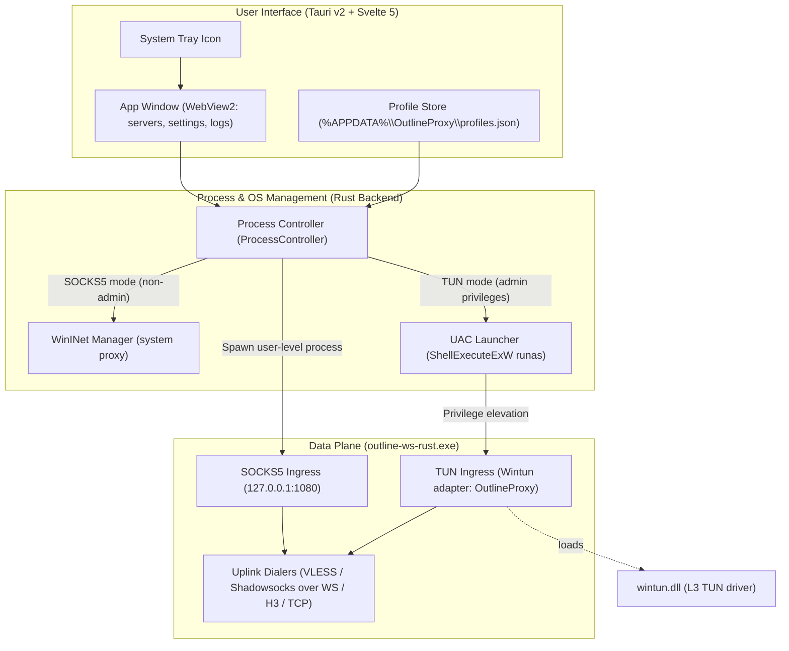

# Outline Proxy — Windows Client

Russian version: [README.ru.md](README.ru.md).

Native desktop client for Windows (x86_64 / amd64) living in the system tray.
The client implements a clean separation of concerns architecture:
- **GUI Shell (Frontend & IPC)**: Tauri v2 + Svelte 5 + Tailwind CSS (minimal memory footprint, native rendering via WebView2).
- **Network Core (Data Plane)**: High-performance `outline-ws-rust.exe` service (VLESS, Shadowsocks 2022 / AEAD, WebSocket, HTTP/3, padding, failover).
- **L3 VPN Adapter**: Battle-tested Wintun 0.14.1 network driver (`wintun.dll`), providing a lightweight virtual TUN interface without background service bloat.

---

## Architecture



---

## System Requirements

- **Operating System**: Windows 10 (version 1809+, build 17763 or newer) or Windows 11 (64-bit x86_64 editions).
- **WebView2 Runtime**: Pre-installed on Windows 11 and modern versions of Windows 10. If missing, the application prompts to download Microsoft Evergreen Bootstrapper.
- **Privilege Requirements**:
  - **SOCKS5 mode**: Administrator rights are **not required**. The system proxy is configured per-user via WinINet API.
  - **TUN mode**: Requires **Administrator rights (UAC elevation)** to create the virtual Wintun network adapter and manipulate Windows routing tables. The standard User Account Control (UAC) dialog is shown when enabling TUN mode.

---

## Operating Modes

### 1. SOCKS5 (System Proxy)
- **Mechanism**: The GUI launches `outline-ws-rust.exe` in the current user context listening on `127.0.0.1:1080`.
- **OS Integration**: The application invokes Windows WinINet API functions (`InternetSetOptionW` with `INTERNET_OPTION_SETTINGS_CHANGED` and `INTERNET_OPTION_REFRESH`), configuring `127.0.0.1:1080` as the HTTP/HTTPS/SOCKS proxy for the current user session.
- **Characteristics**:
  - Leaves network adapters and routing tables untouched.
  - Seamlessly redirects web browsers (Edge, Chrome, Firefox) and proxy-aware applications.
  - Automatically reverted on application exit or manual disconnect.

### 2. TUN (Full L3 VPN Adapter)
- **Mechanism**: The `outline-ws-rust.exe` core is launched with elevated administrator privileges via `ShellExecuteExW` with the `runas` verb.
- **Network Driver**: The core loads `wintun.dll` located in the application directory and registers an L3 virtual network adapter named `OutlineProxy`.
- **Routing**:
  - Direct host routes to upstream proxy servers are established via the physical gateway to prevent routing loops.
  - Default routes (`0.0.0.0/0` and `::/0`) are directed through the `OutlineProxy` adapter with high priority.
  - Intercepts all traffic: TCP, UDP, DNS queries, terminal commands, and background services.
- **Teardown**: When disconnected, the virtual adapter is deleted and system routing tables are restored.

---

## Building

The repository includes an automated build and packaging script: `scripts/package-windows.sh`.

### Option A: Cross-compilation from macOS or Linux

1. **Tooling Requirements**:
   - Rust stable (1.88+): `rustup target add x86_64-pc-windows-msvc`
   - MSVC cross-compilation tool: `cargo install cargo-xwin`
   - Node.js 20+ and `pnpm` package manager
2. **Validate Environment**:
   ```bash
   ./scripts/package-windows.sh --check-only
   ```
3. **Execute Full Build**:
   ```bash
   ./scripts/package-windows.sh
   ```
   The script performs:
   - Verification and download of the official `wintun-0.14.1.zip` archive with SHA256 verification (`07c256185d6ee3652e09fa55c0b673e2624b565e02c4b9091c79ca7d2f24ef51`) and extracts `wintun.dll`.
   - Release build of `outline-ws-rust.exe` for target `x86_64-pc-windows-msvc`.
   - Production build of the Svelte 5 / Vite frontend (`pnpm build`).
   - Release build of `OutlineProxy.exe` for `x86_64-pc-windows-msvc`.
   - Packaging of all binaries into `dist/windows/OutlineProxy-x86_64.zip`.

4. **Build Core Only (without GUI)**:
   ```bash
   ./scripts/package-windows.sh --skip-ui
   ```

---

### Option B: Native Build on Windows

1. **Prerequisites**:
   - Visual Studio 2022 Community or Build Tools (Desktop development with C++, Windows 10/11 SDK, MSVC v143).
   - Rust toolchain: `rustup default stable-x86_64-pc-windows-msvc`.
   - Node.js (LTS 20+) and pnpm (`npm install -g pnpm`).
2. **Manual Step-by-Step Build**:
   ```powershell
   # 1. Build frontend
   cd bins\outline-windows
   pnpm install --frozen-lockfile
   pnpm build
   cd ..\..

   # 2. Build network core
   cargo build -p outline-ws-rust --release --target x86_64-pc-windows-msvc

   # 3. Build GUI shell
   cargo build -p outline-windows --release --target x86_64-pc-windows-msvc
   ```
3. **Or run the script via Git Bash**:
   ```bash
   ./scripts/package-windows.sh
   ```

---

## Testing & Debugging on Test VM (NAS `.105` over RDP)

A test Windows Virtual Machine is hosted on the NAS `.105` server (`198.18.1.105`).

### 1. Connection & Bundle Transfer
1. Connect to the test VM via your preferred Remote Desktop (RDP) client.
2. Build the release bundle on the development workstation:
   ```bash
   ./scripts/package-windows.sh
   ```
3. Copy the resulting `dist/windows/OutlineProxy-x86_64.zip` to the VM (via RDP clipboard, shared SMB folder, or SFTP).
4. Extract the archive into a dedicated directory, e.g., `C:\OutlineProxy\`. Verify the contents:
   - `OutlineProxy.exe`
   - `outline-ws-rust.exe`
   - `wintun.dll`

### 2. Testing SOCKS5 Mode
1. Launch `OutlineProxy.exe` via normal double click (do NOT use Run as Administrator).
2. Import an access key (`vless://` or `ss://` share link from clipboard or subscription URL).
3. Select **SOCKS5** mode in the toggle.
4. Click **"Connect"**:
   - The status badge will change to "Connected".
   - An active Outline Proxy icon will appear in the system tray.
5. Verify proxy settings:
   - Open *Windows Settings -> Network & Internet -> Proxy*. Verify that "Use a proxy server" is toggled ON with address `127.0.0.1` and port `1080`.
   - In Edge or Chrome, open `https://ipinfo.io` and verify the external IP corresponds to the target server.
6. Click **"Disconnect"**:
   - Windows proxy settings should immediately return to disabled.

### 3. Testing TUN Mode (L3 Wintun)
1. In the application interface, switch mode to **TUN (VPN)**.
2. Click **"Connect"**:
   - Windows will display the User Account Control (UAC) prompt: *"Do you want to allow this app to make changes to your device?"*.
   - Click **Yes** to grant administrator privileges.
3. Verify network adapter and routing:
   - Open PowerShell and inspect the adapter:
     ```powershell
     Get-NetAdapter | Where-Object { $_.InterfaceDescription -like "*Wintun*" }
     ```
     The `OutlineProxy` adapter should be present with status `Up`.
   - Inspect routing tables:
     ```powershell
     Get-NetRoute -DestinationPrefix "0.0.0.0/0"
     ```
     The default route via the OutlineProxy adapter must have the lowest metric (highest priority).
4. Verify non-browser traffic:
   - In PowerShell, run:
     ```powershell
     curl.exe -i https://ipinfo.io
     Resolve-DnsName google.com
     ```
     Traffic and DNS queries should resolve through the tunnel.
5. Click **"Disconnect"**:
   - The `OutlineProxy` adapter is unregistered and default routing falls back to the physical gateway.

---

## Diagnostics & Log Collection

### File Locations
User data and active configurations are stored in the user profile:
- Directory: `%APPDATA%\OutlineProxy\` (e.g., `C:\Users\<Username>\AppData\Roaming\OutlineProxy\`).
- `profiles.json`: Saved server profiles, subscription URLs, and preferences.
- `active_config.toml`: Dynamically generated configuration passed to `outline-ws-rust.exe`.

### Real-time Log Viewer
1. Click the **"Logs"** tab in the client window.
2. The log view displays stdout and stderr from the `outline-ws-rust.exe` process in real time.
3. Level filters (`ALL`, `ERROR`, `WARN`, `INFO`, `DEBUG`) and keyword search are available.
4. The **"Copy"** button exports all retained logs to the clipboard for troubleshooting.

### Manual Core Invocation for In-depth Debugging
To inspect low-level network events, run the core directly from PowerShell with verbose logging:
```powershell
$env:RUST_LOG="trace"
.\outline-ws-rust.exe --config "$env:APPDATA\OutlineProxy\active_config.toml"
```
