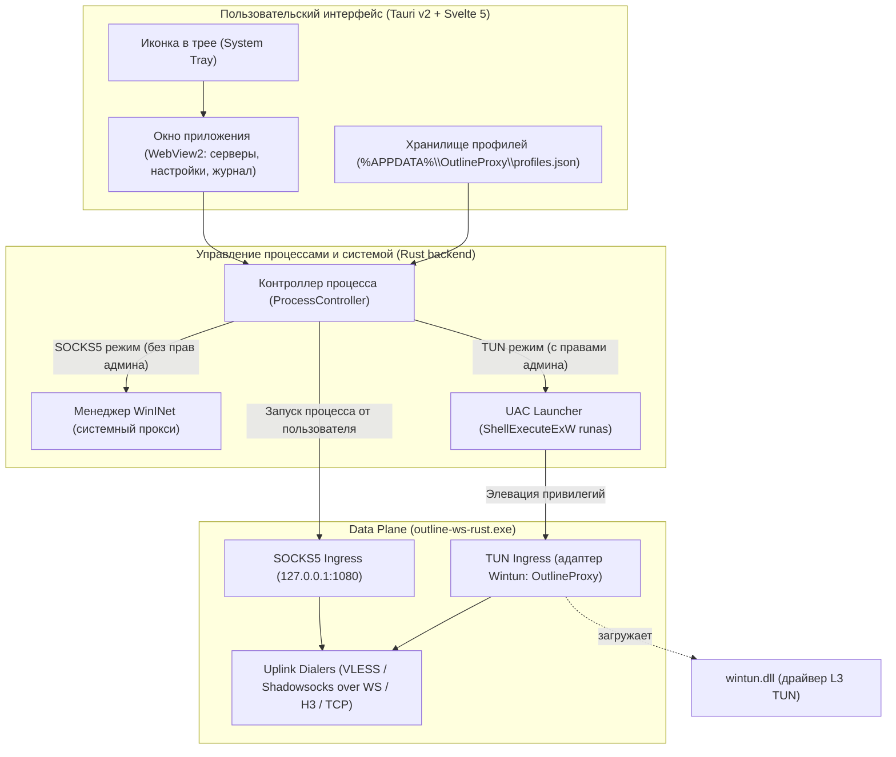

# Outline Proxy — клиент для Windows

English version: [README.md](README.md).

Нативный клиент для Windows (x86_64 / amd64), работающий в области уведомлений (System Tray).
Клиент построен на архитектуре разделения обязанностей (separation of concerns):
- **GUI-оболочка (Frontend & IPC)**: Tauri v2 + Svelte 5 + Tailwind CSS (минимальное потребление памяти, нативный рендеринг через WebView2).
- **Сетевое ядро (Data Plane)**: высокопроизводительный сервис `outline-ws-rust.exe` (VLESS, Shadowsocks 2022 / AEAD, WebSocket, HTTP/3, padding, failover).
- **L3 VPN-адаптер**: проверенный сетевой драйвер Wintun 0.14.1 (`wintun.dll`), предоставляющий виртуальный сетевой интерфейс TUN без создания лишних служб.

---

## Архитектура



---

## Требования к системе

- **Операционная система**: Windows 10 (версия 1809+, билд 17763 или новее) или Windows 11 (64-битные редакции x86_64).
- **Компонент WebView2**: предустановлен в Windows 11 и современных версиях Windows 10. Если WebView2 отсутствует, приложение предложит загрузить Evergreen Bootstrapper от Microsoft.
- **Права доступа**:
  - **SOCKS5-режим**: права администратора **не требуются**. Настройка системного прокси выполняется через WinINet API для текущего пользователя.
  - **TUN-режим**: требуются **права администратора (UAC)** для инициализации виртуального сетевого адаптера Wintun и управления системными маршрутами Windows. При включении TUN-режима система отображает стандартный диалог контроля учетных записей (UAC).

---

## Режимы работы

### 1. SOCKS5 (системный прокси)
- **Принцип работы**: GUI запускает бинарник `outline-ws-rust.exe` в контексте обычного пользователя с локальным слушателем `127.0.0.1:1080`.
- **Интеграция с ОС**: Приложение вызывает функции Windows WinINet API (`InternetSetOptionW` с флагами `INTERNET_OPTION_SETTINGS_CHANGED` и `INTERNET_OPTION_REFRESH`), устанавливая `127.0.0.1:1080` в качестве HTTP/HTTPS/SOCKS-прокси текущего пользователя.
- **Особенности**:
  - Не затрагивает сетевые интерфейсы и драйверы.
  - Перенаправляет трафик браузеров (Edge, Chrome, Firefox) и программ, использующих системные настройки прокси.
  - При закрытии приложения или отключении прокси автоматически сбрасывается.

### 2. TUN (полноценный L3 VPN-адаптер)
- **Принцип работы**: Ядро `outline-ws-rust.exe` запускается с правами администратора через UAC-элевацию (`ShellExecuteExW` с глаголом `runas`).
- **Сетевой драйвер**: Ядро находит `wintun.dll` в каталоге приложения и создает L3-адаптер с именем `OutlineProxy`.
- **Маршрутизация**:
  - Добавляются прямые host-маршруты до серверов прокси через основной физический шлюз (для предотвращения образования петель маршрутизации).
  - Устанавливаются маршруты по умолчанию `0.0.0.0/0` и `::/0` через виртуальный интерфейс `OutlineProxy`.
  - Захватывается весь трафик системы: TCP, UDP, DNS-запросы, консольные утилиты, игры и фоновые службы.
- **Очистка**: При отключении адаптер корректно уничтожается, а системные таблицы маршрутов возвращаются в исходное состояние.

---

## Сборка

В репозитории предусмотрен скрипт автоматической сборки и бандлинга `scripts/package-windows.sh`.

### Вариант А: Кросс-компиляция с macOS или Linux

1. **Необходимые инструменты**:
   - Rust stable (1.88+): `rustup target add x86_64-pc-windows-msvc`
   - Инструмент кросс-компиляции MSVC: `cargo install cargo-xwin`
   - Node.js 20+ и менеджер пакетов `pnpm` (для сборки интерфейса)
2. **Проверка готовности окружения**:
   ```bash
   ./scripts/package-windows.sh --check-only
   ```
3. **Запуск полной сборки**:
   ```bash
   ./scripts/package-windows.sh
   ```
   Скрипт выполнит:
   - Проверку наличия и скачивание официального архива `wintun-0.14.1.zip` с валидацией SHA256-хэша (`07c256185d6ee3652e09fa55c0b673e2624b565e02c4b9091c79ca7d2f24ef51`) и извлечение `wintun.dll`.
   - Сборку ядра `outline-ws-rust.exe` под таргет `x86_64-pc-windows-msvc` в режиме release.
   - Сборку фронтенда Svelte 5 / Vite (`pnpm build`).
   - Сборку GUI-приложения `OutlineProxy.exe` под `x86_64-pc-windows-msvc` в режиме release.
   - Бандлинг всех компонентов в `dist/windows/OutlineProxy-x86_64.zip`.

4. **Сборка только сетевого ядра без GUI**:
   ```bash
   ./scripts/package-windows.sh --skip-ui
   ```

---

### Вариант Б: Нативная сборка в Windows

1. **Установка зависимостей**:
   - Visual Studio 2022 Community или Visual Studio Build Tools (компоненты: «Разработка классических приложений на C++», Windows 10/11 SDK, MSVC v143).
   - Rust: официальный установщик `rustup-init.exe`, выбор дефолтного таргета `x86_64-pc-windows-msvc`.
   - Node.js (LTS 20+) и pnpm (`npm install -g pnpm`).
2. **Сборка вручную по шагам**:
   ```powershell
   # 1. Сборка фронтенда
   cd bins\outline-windows
   pnpm install --frozen-lockfile
   pnpm build
   cd ..\..

   # 2. Сборка сетевого ядра
   cargo build -p outline-ws-rust --release --target x86_64-pc-windows-msvc

   # 3. Сборка GUI приложения
   cargo build -p outline-windows --release --target x86_64-pc-windows-msvc
   ```
3. **Либо запуск скрипта в Git Bash**:
   ```bash
   ./scripts/package-windows.sh
   ```

---

## Тестирование и отладка на тестовой виртуальной машине (NAS `.105` по RDP)

В лабораторном парке развернута тестовая виртуальная машина под управлением Windows на сервере NAS `.105` (`198.51.100.105`).

### 1. Подключение и передача бандла
1. Подключитесь к виртуальной машине через любой RDP-клиент (например, Microsoft Remote Desktop на macOS).
2. Соберите релизный архив на хосте разработки:
   ```bash
   ./scripts/package-windows.sh
   ```
3. Скопируйте получившийся `dist/windows/OutlineProxy-x86_64.zip` на виртуальную машину (через общий буфер обмена RDP, SMB-сетевую папку или SFTP).
4. Распакуйте архив в любую директорию, например в `C:\OutlineProxy\`. Убедитесь, что в каталоге присутствуют файлы:
   - `OutlineProxy.exe`
   - `outline-ws-rust.exe`
   - `wintun.dll`

### 2. Тестирование режима SOCKS5
1. Запустите `OutlineProxy.exe` обычным двойным кликом (без запуска от имени администратора).
2. В интерфейсе импортируйте сервер (вставьте ключ доступа `vless://` или `ss://` из буфера обмена или по подписке).
3. Переведите переключатель режима в положение **SOCKS5**.
4. Нажмите **«Подключить»**:
   - Индикатор статуса должен измениться на «Подключено».
   - В трее появится активная иконка Outline Proxy.
5. Проверка применения параметров прокси:
   - Откройте *Параметры Windows -> Сеть и Интернет -> Прокси-сервер*. Переключатель «Использовать прокси-сервер» должен быть включен, адрес: `127.0.0.1`, порт: `1080`.
   - В браузере Edge или Chrome откройте `https://ipinfo.io` и убедитесь, что отображается внешний IP-адрес целевого сервера.
6. Нажмите **«Отключить»**:
   - Параметры прокси в Windows должны автоматически отключиться.

### 3. Тестирование режима TUN (L3 Wintun)
1. В интерфейсе переключите режим на **TUN (VPN)**.
2. Нажмите **«Подключить»**:
   - Появится системный диалог UAC: *«Разрешить этому приложению вносить изменения на вашем устройстве?»*.
   - Нажмите **Да** для предоставления прав администратора.
3. Проверка сетевого адаптера и маршрутизации:
   - Откройте консоль PowerShell и выполните команду:
     ```powershell
     Get-NetAdapter | Where-Object { $_.InterfaceDescription -like "*Wintun*" }
     ```
     Должен присутствовать адаптер `OutlineProxy` со статусом `Up`.
   - Проверьте таблицу маршрутов:
     ```powershell
     Get-NetRoute -DestinationPrefix "0.0.0.0/0"
     ```
     Метрика маршрута через адаптер OutlineProxy должна иметь наивысший приоритет.
4. Проверка системного трафика:
   - В PowerShell выполните:
     ```powershell
     curl.exe -i https://ipinfo.io
     Resolve-DnsName google.com
     ```
     Трафик консольных утилит и DNS-запросы должны успешно проходить через туннель.
5. Нажмите **«Отключить»**:
   - Адаптер `OutlineProxy` удаляется из системы, дефолтные маршруты возвращаются к физическому шлюзу.

---

## Диагностика и сбор логов

### Размещение файлов данных
Все пользовательские конфигурации сохраняются в профиле текущего пользователя:
- Каталог данных: `%APPDATA%\OutlineProxy\` (обычно `C:\Users\<Имя_Пользователя>\AppData\Roaming\OutlineProxy\`).
- `profiles.json`: сохраненные профили серверов, URL подписок и настройки режимов.
- `active_config.toml`: сгенерированный рабочий конфигурационный файл для запуска `outline-ws-rust.exe`.

### Просмотр журнала событий (Logs)
1. В интерфейсе клиента откройте вкладку **«Журнал»**.
2. Журнал отображает stdout и stderr процесса `outline-ws-rust.exe` в реальном времени.
3. Доступны фильтры уровней: `ALL`, `ERROR`, `WARN`, `INFO`, `DEBUG`, а также поиск по ключевым словам.
4. Кнопка **«Копировать»** позволяет скопировать журнал в буфер обмена для отправки разработчикам.

### Ручной запуск сетевого ядра для глубокой отладки
Для детального исследования проблем взаимодействия с сетью можно запустить ядро вручную из командной строки PowerShell с максимальным уровнем логирования:
```powershell
$env:RUST_LOG="trace"
.\outline-ws-rust.exe --config "$env:APPDATA\OutlineProxy\active_config.toml"
```
